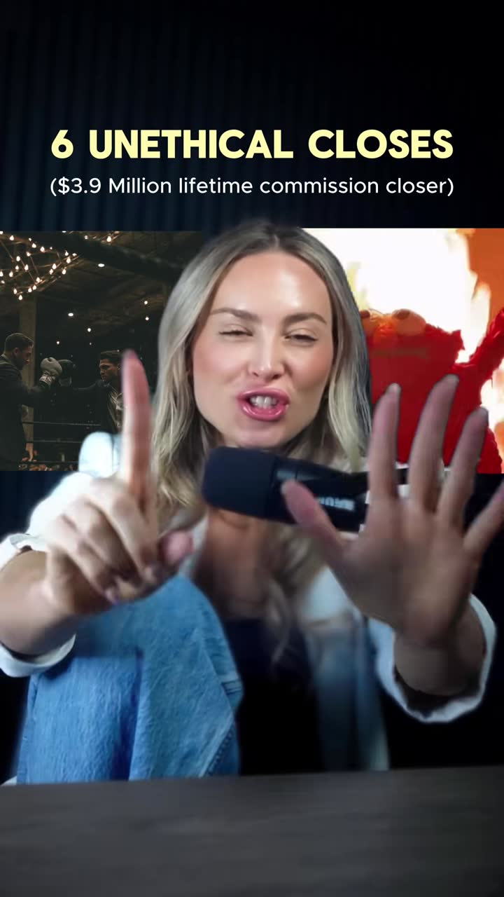
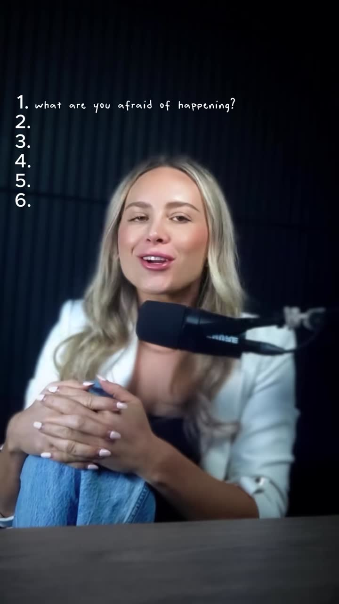
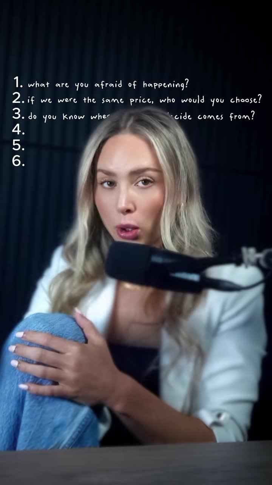
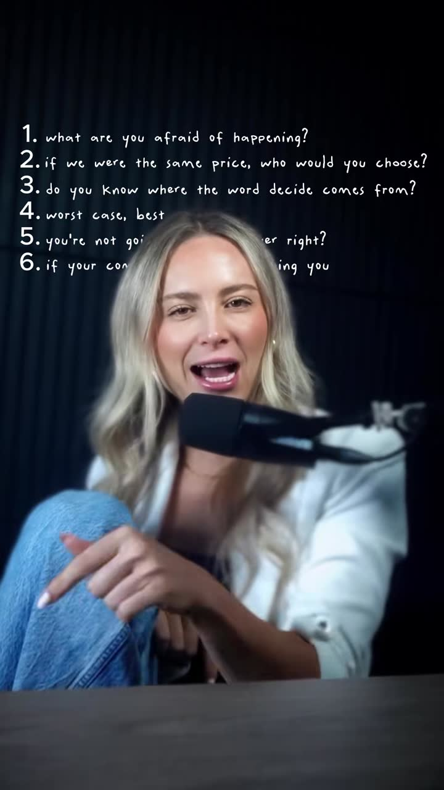
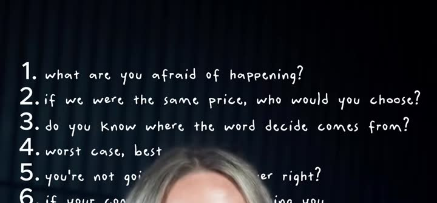

# 6 "unethical" closes (closing, persuasion, selling phrases)

| | |
|---|---|
| Source | <https://www.tiktok.com/@danidocumented/video/7698978039249521933> |
| Creator | Danielle Lynch (@danidocumented) |
| Uploaded | 2026-10-21 |
| Duration | 57s |
| Hashtags | #sales #highticketsales #salespsychology |
| Audio | original sound - Danielle Lynch |
| Ingested | 2026-10-30 by yeung-assistant (yt-dlp + faster-whisper `small`, language `en`) |

**Caption (verbatim):**

> the biggest mistake i see is reps using regurgitated closes and sounding like every other salesperson. or not reframing at all and letting them off without even trying you fail on both ends the best way to close is to try some or all of these and put them in your own words. for number 1, maybe it's the bahamas, maybe it's disneyland. find what feels natural, because that's where sales gets fun. when you're talking, it actually feels genuine someone asked me my favorite reframes and i said it depends on the person talking to a doctor? "would you tell your patient to give up if you couldn't figure out what was wrong? or keep trying?" talking to a mom? "if your kid fell off his bike, would you tell him to try again or give up forever?" know who you're talking to, and get good with analogies #sales #highticketsales #salespsychology

## Summary

Danielle Lynch (a high-ticket sales closer) gives six closing lines, three "easy" ones and three "people hate me for". Each one either surfaces the prospect's real objection or reframes the decision so that doing nothing looks like the risky choice. The caption adds two audience-specific reframes and says to put every close into your own words.

## Key takeaways

- Do not use canned closes word for word. Put them in your own words so they sound genuine. Not reframing at all is the other way to fail.
- Use humor to surface the real objection: an absurd guess ("taking your money and going to Vegas") makes the prospect laugh, and then they tell you the real reason.
- Price objection: ask which option they would pick if the prices were equal. They list your advantages themselves, and that list justifies the price difference.
- Reframe the decision: "decide" comes from the Latin for "to cut off", so every decision cuts off one future.
- Lay out a worst case, a best case, and a "riskiest option of all" (staying exactly where they are six months from now).
- Break the pattern: "You're not gonna fail forever, right? So when does that stop?"
- Competitor frame: would your competitor want you to say yes, or want you to stay where you are?
- Match the analogy to the audience (caption): for a doctor, the patient you would not give up on; for a mom, the kid who fell off a bike.

## Verbatim phrases and script

Transcribed from the audio, checked against the on-screen list. Stage directions are in *italics*.

**Close 1: "What are you afraid of happening?"**
> "What are you afraid of happening?"
>
> *If they try to give you some BS:* "So you're afraid of me taking your money and going to Vegas?"
>
> *They laugh, and then they tell you the real reason.* (Caption: "for number 1, maybe it's the bahamas, maybe it's disneyland.")

**Close 2: "If we were the same price, who would you choose?"**
> "Well, if we were the same price, which one would you pick?"
>
> *They say you.* "Why?"
>
> *They list every reason you are better.* "So now you understand why we aren't the same price."

**Close 3: "Do you know where the word decide comes from?"**
> "Do you know where the word decide comes from? In Latin, to cut off. So we cannot make a decision without cutting off something. So which future are you cutting off?"
>
> *(The transcriber heard "cutting on"; "cutting off" fits the setup.)*

*"Those three are the easy ones, the last three people hate me for."*

**Close 4: Worst case, best case**
> "You do it, you get 10% better, that's worst case. You do it, you get 100% better, your whole life changes. Or the riskiest option of all, you walk out that door and you're in the exact same spot you're in now, six months from now."

**Close 5: "You're not gonna fail forever, right?"**
> "You're not gonna fail forever, right? So, when does that stop?"

**Close 6: The competitor watching**
> "If your competitor was watching this call right now, would they want you to say yes, or would they want you to say exactly where you are?"

**Reframes from the caption:**
> To a doctor: "would you tell your patient to give up if you couldn't figure out what was wrong? or keep trying?"
>
> To a mom: "if your kid fell off his bike, would you tell him to try again or give up forever?"
>
> "know who you're talking to, and get good with analogies"

## On-screen text

Read from the frames by eye, because tesseract OCR could not be installed on the ingest box. `[...]` marks text that was hidden or is uncertain.

- 0-3s title: "6 UNETHICAL CLOSES" / "($3.9 Million lifetime commission closer)"
- The numbered list builds up as she speaks:
- 1. what are you afraid of happening?
- 2. if we were the same price, who would you choose?
- 3. do you know where the word decide comes from?
- 4. worst case, best [case ...] (partly hidden behind her head)
- 5. you're not goi[ng to fail forev]er right?
- 6. if your co[mpetitor was watch]ing you ... (partly hidden)

## Screenshots

Frames were chosen where a new tip, list item, or on-screen demo starts, using the transcript, ffmpeg scene-change detection, and manual review. They are 720px wide JPGs.

**0:01.0**: Title card: "6 UNETHICAL CLOSES ($3.9 Million lifetime commission closer)"

**0:03.5**: Close #1 appears as on-screen text: "what are you afraid of happening?"

**0:23.0**: List grows: closes #1-#3 (afraid / same price / where "decide" comes from)

**0:56.5**: End frame with the full six-item close list as overlay

**0:56.5**: Crop of the overlay list (items 4-6 partly hidden behind the speaker's head)

## How to apply

- **App outreach and demo calls:** keep closes 2 and 6 ready for the "we're looking at alternatives" objection. Ask: "If we were the same price as X, which would you pick? Why?"
- **Faceless short-form hooks:** each close works as a 15-30s "say this, not that" clip with text on screen. The six-item list that builds up on screen, with a save-bait hook ("so good they feel unethical"), is a format to copy.
- **Landing page and email copy:** close 4 (worst case, best case, cost of doing nothing) is a ready-made pricing-page section. Close 6 can be a CTA line.
- **Ethics:** use these to surface real objections and real costs of inaction. Do not invent urgency.

## Transcript

Full timestamped transcript: [transcript.md](transcript.md).
