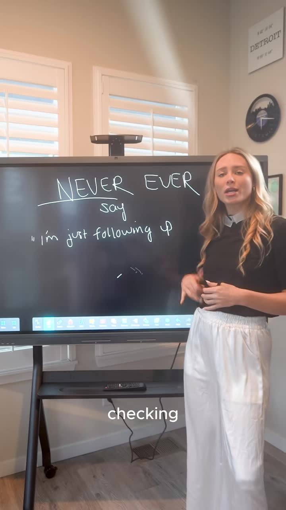
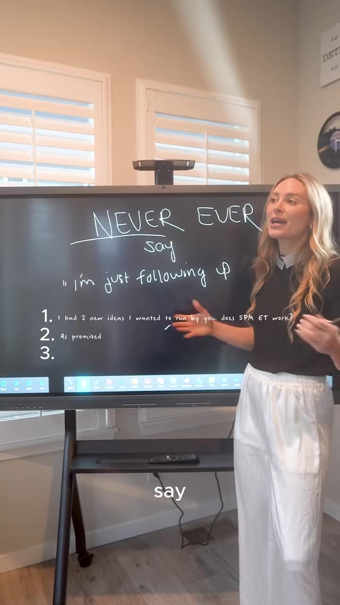
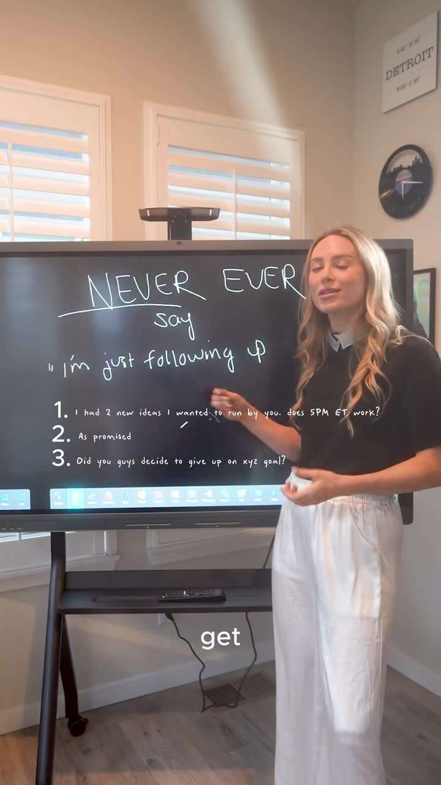
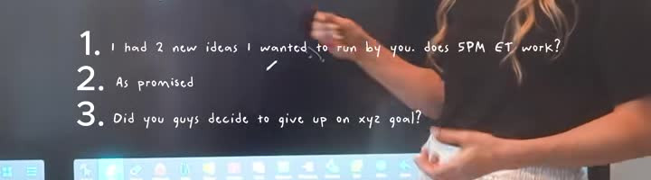

# Never say "just following up": 3 follow-ups that work

| | |
|---|---|
| Source | <https://www.tiktok.com/@danidocumented/video/7698982436352445709> |
| Creator | Danielle Lynch (@danidocumented) |
| Uploaded | 2026-10-21 |
| Duration | 63s |
| Hashtags | #3 #sales #followup #highticketsales #corpooratesales |
| Audio | original sound - Danielle Lynch |
| Ingested | 2026-10-30 by yeung-assistant (yt-dlp + faster-whisper `small`, language `en`) |

**Caption (verbatim):**

> #3 is my favorite because it flips the question "just checking in" makes them decide whether to answer you "did you decide to give up on [goal]?" makes them decide whether to give up on themselves most people won't say yes to that. they'll get back on the phone #sales #followup #highticketsales #corpooratesales

## Summary

Danielle Lynch explains why "I'm just following up" and "just checking in" give the prospect an easy reason to ignore you. She gives three replacements: an assumptive follow-up with new ideas and a proposed time, a call-back you promise on the first call, and a "did you give up on your goal?" message.

## Key takeaways

- Never open a follow-up with "I'm just following up" or "I'm just checking in". Those lines invite the prospect to ignore you.
- "Did you get a chance to look at the proposal?" invites the same response ("Yeah, and I decided to ignore you").
- Follow-up 1 assumes the close: bring something new ("two new ideas") and propose a specific time. That shows confidence and conviction.
- Follow-up 2 is set up on the first call: say you will call back tomorrow to go over the contract. The next day, open with "as promised".
- Follow-up 3 (her favorite) flips the question. Instead of asking whether they will answer you, you ask whether they have given up on their own goal.

## Verbatim phrases and script

**Never say:**
> "I'm just following up" / "I'm just checking in" ("great, and I'm just hanging up")
>
> "Did you get a chance to look at the proposal?" ("Yeah, and I decided to ignore you.")

**Replacement 1: assume the close**
> "Hey Joey, I'm just getting back to you after a busy week. I have two new ideas I wanted to run by you before we decide. Does 5pm Eastern work?"

**Replacement 2: the promised call-back**
> End of the first call: "Hey, I'm going to give you a call back tomorrow to go over the contract and see if you have any questions."
>
> Next day: "Hey, as promised, [I'm calling to] see what any thoughts on the contract and if we are ready to go."

**Replacement 3: "did you give up?"**
> "Hey Martha, I just saw your name and I was wondering, did you guys decide to give up on XYZ goal?"
>
> "And now they have to admit that they're a quitter or actually get this thing in motion."

**Caption:**
> "\"just checking in\" makes them decide whether to answer you / \"did you decide to give up on [goal]?\" makes them decide whether to give up on themselves / most people won't say yes to that. they'll get back on the phone"

## On-screen text

Read from the frames by eye, because tesseract OCR could not be installed on the ingest box. `[...]` marks text that was hidden or is uncertain.

- Title: "NEVER EVER US[E] THESE FOLLOW UPS" / "(10 years in sales)"
- Whiteboard: "NEVER EVER say" / "I'm just following up"
- 1. I had 2 new ideas I wanted to run by you. does 5PM ET work?
- 2. As promised
- 3. Did you guys decide to give up on xyz goal?

## Screenshots

Frames were chosen where a new tip, list item, or on-screen demo starts, using the transcript, ffmpeg scene-change detection, and manual review. They are 720px wide JPGs.

**0:01.0**: Title card: "NEVER EVER US[E] THESE FOLLOW UPS (10 years in sales)"

![0:01.0: Title card: "NEVER EVER US[E] THESE FOLLOW UPS (10 years in sales)"](screenshots/001.0s.jpg)

**0:14.0**: Whiteboard: NEVER EVER say "I'm just following up"

**0:43.0**: Alternative #1 written on screen while she explains #2 (the promised call-back)

**1:02.0**: End frame: all three replacement follow-ups listed

**1:02.0**: Crop of the three replacement follow-up lines

## How to apply

- **Cold-email sequence for an app:** never send a bare "bump". Every follow-up brings something new (a new feature, use case, or idea) and a concrete ask ("Does Thursday 2pm PT work for a 10-minute demo?").
- **Set up the next touch in the first one:** close the first email or DM with "I'll send you the 60-second walkthrough tomorrow", then open the next one with "As promised, here it is".
- **Break-up email:** "Did you decide to put [their stated goal, e.g. automating your shorts pipeline] on hold?" works as the final email in a sequence.
- **Short-form content:** a three-item "never say this, say this instead" whiteboard list is an easy faceless format (text on a board, voiceover).

## Transcript

Full timestamped transcript: [transcript.md](transcript.md).
