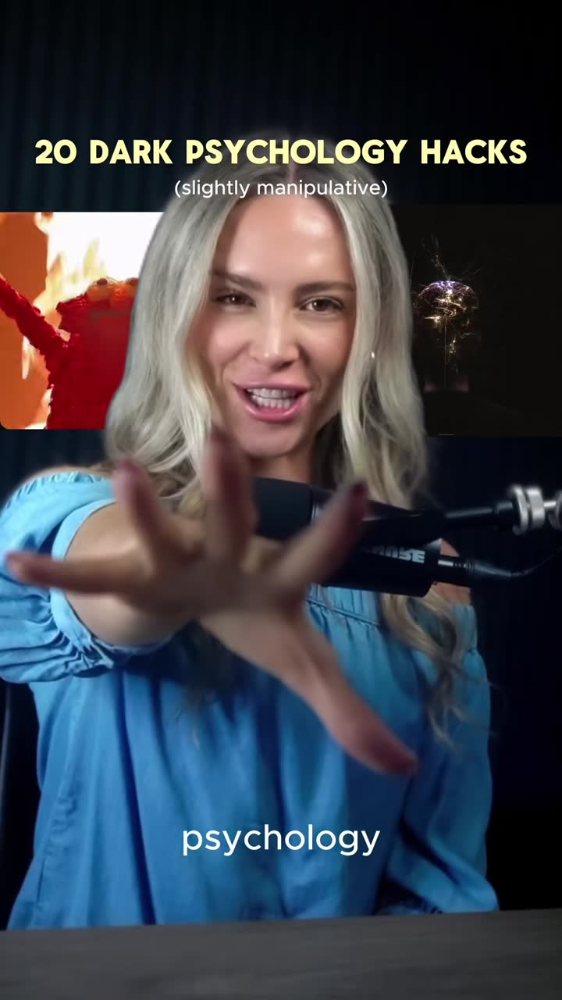
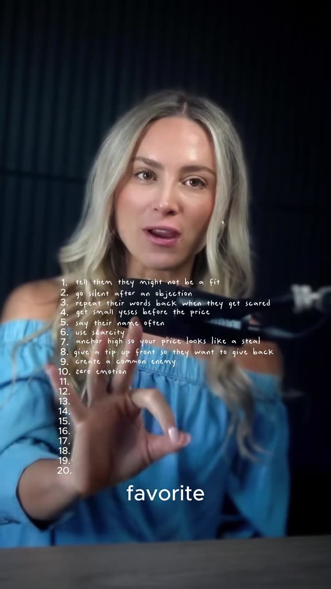
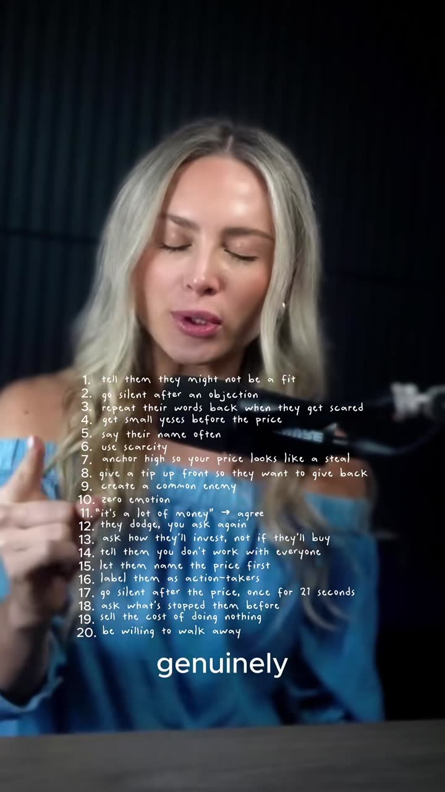
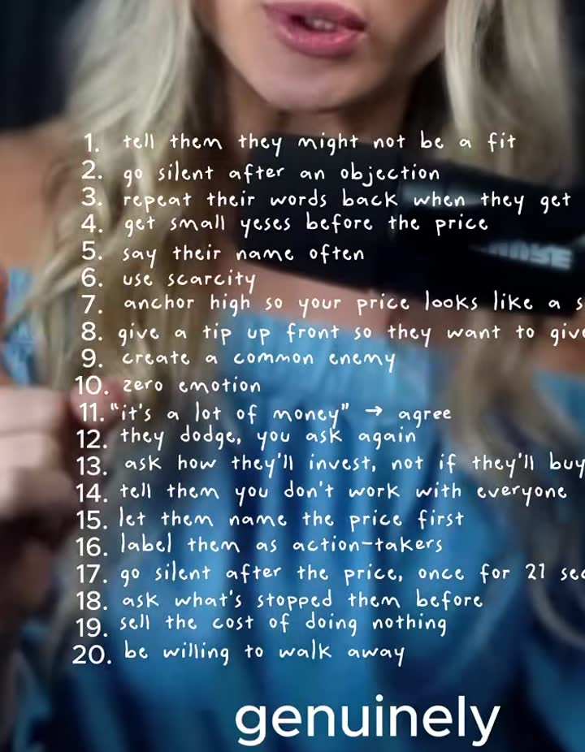

# 20 "dark psychology" sales hacks

| | |
|---|---|
| Source | <https://www.tiktok.com/@danidocumented/video/7699623985130081549> |
| Creator | Danielle Lynch (@danidocumented) |
| Uploaded | 2026-10-23 |
| Duration | 82s |
| Hashtags | #sales #salespsychology #darkpsychology |
| Audio | original sound - Danielle Lynch |
| Ingested | 2026-10-30 by yeung-assistant (yt-dlp + faster-whisper `small`, language `en`) |

**Caption (verbatim):**

> my personal favorites are 3 and 8, and for two reasons for number 3, people assign meaning to words. if i use different words than they're using, they won't feel heard and understood. they might even disagree with me, which is quite literally the worst thing that can happen on a call. now you're on different pages for number 8, i've learned over my lifetime that the more you give, the more you get back. it's the law of reciprocity. it might not even come from that person. it could be the person on the next call, your next job, your next industry. but it always comes back around which ones are you already using? #sales #salespsychology #darkpsychology

## Summary

A rapid list of 20 persuasion tactics for sales calls, ten "easy" ones followed by ten favorites. They cover silence, mirroring the prospect's words, small yeses, anchoring, scarcity, reciprocity, labeling, and selling the cost of doing nothing. In the caption she names #3 (repeat their words back) and #8 (give first, reciprocity) as her favorites.

## Key takeaways

- Silence is a tool: go silent after an objection, and again after you state the price (she once sat in silence for 21 seconds and closed the deal).
- Repeat their words back to them. People attach meaning to their own words, and if you switch vocabulary they won't feel heard.
- Collect small yeses before you reveal the price, and use their name throughout the call.
- Anchor on high market prices so yours feels like a steal. Let them name their price first.
- Ask "how are you going to invest?" rather than "do you want to buy?"
- Sell the consequence of inaction: people move faster to avoid pain than to gain pleasure.
- Detach from the outcome and genuinely be willing to walk away.
- Give first (a tip at the start of the call). The caption calls it the law of reciprocity: it always comes back around.

## Verbatim phrases and script

**The 20 hacks, spoken version (with the on-screen wording in brackets):**
1. "Tell them that they might not be a good fit." [tell them they might not be a fit]
2. "If they give an objection, just stay silent. They often start talking again and talk themselves right out of it." [go silent after an objection]
3. "Repeat their words back to them when they get scared." [repeat their words back when they get ...]
4. "Tie them down throughout the call by getting them to say yes before you drop the price." [get small yeses before the price]
5. "Say their name a number of times throughout the call." [say their name often]
6. "Use scarcity." [use scarcity]
7. "Anchor on high market prices to make yours feel like a steal." [anchor high so your price looks like a s(teal)]
8. "Give them a tip at the beginning of the call so they feel pressured into giving back." [give a tip up front so they want to give ...]
9. "Create a common enemy, like the healthcare system." [create a common enemy]
10. "Have zero emotion." [zero emotion]

*"And those my friends are the easy ones, but the next 10 are my favorite. The last one is the one that most people won't do."*

11. "If they say it's a lot of money, agree with them." ["it's a lot of money" -> agree]
12. "If they try to dodge a question, ask it again." [they dodge, you ask again]
13. "Don't ask if they want to buy, ask how they're going to invest." [ask how they'll invest, not if they'll buy]
14. "Tell them you don't work with everybody." [tell them you don't work with everyone]
15. "Let them name their price first." [let them name the price first]
16. "Label them. Tell them that you appreciate that they're so decisive and they know exactly what they want." [label them as action-takers]
17. "Go silent after you mention the price until they speak. I once sat in silence for 21 seconds and closed the deal." [go silent after the price, once for 21 sec(onds)]
18. "Ask them what stopped them from solving it on their own in the past." [ask what's stopped them before]
19. "Sell the consequence of inaction, not just what they have to gain. People move faster to avoid pain than to gain pleasure." [sell the cost of doing nothing]
20. "Detach from the outcome and genuinely be willing to walk away." [be willing to walk away]

## On-screen text

Read from the frames by eye, because tesseract OCR could not be installed on the ingest box. `[...]` marks text that was hidden or is uncertain.

- Title: "20 DARK PSYCHOLOGY HACKS" / "(slightly manipulative)"
- The 20-item list builds up on screen (bracketed wording above). It is fully readable in the end-frame crop.

## Screenshots

Frames were chosen where a new tip, list item, or on-screen demo starts, using the transcript, ffmpeg scene-change detection, and manual review. They are 720px wide JPGs.

**0:01.0**: Title card: "20 DARK PSYCHOLOGY HACKS (slightly manipulative)"

**0:41.0**: Overlay after the first 10 "easy" hacks

**1:21.5**: End frame: full 20-item overlay list

**1:21.5**: Crop of the 20-item overlay list (readable)

## How to apply

- **Demo and sales calls for an app:** the most useful and least manipulative tactics are #3 (mirror their words; reuse the customer's own phrasing in landing-page copy), #2 and #17 (silence), #18 ("what stopped you from solving this before?" is also a strong customer-discovery question), and #19 (cost of inaction).
- **Cold outreach:** #1 and #14 (a qualifying frame: "this may not be a fit if...") raise reply quality. #8 (give a free tip or mini-audit in the first message) is the reciprocity opener.
- **Short-form content:** "20 X hacks, save these" with a list that builds up on screen is a proven save-bait format, and a faceless channel can reproduce it with text and voiceover.
- **Caution:** some of these (fake scarcity, manufactured pressure, "zero emotion") can damage trust. Use the honest versions.

## Transcript

Full timestamped transcript: [transcript.md](transcript.md).
