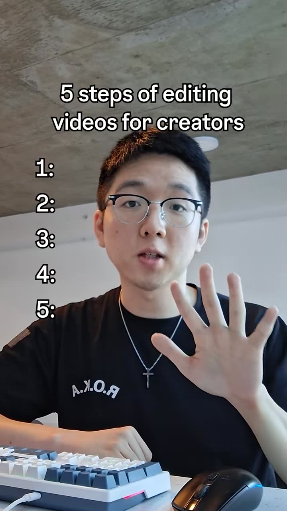
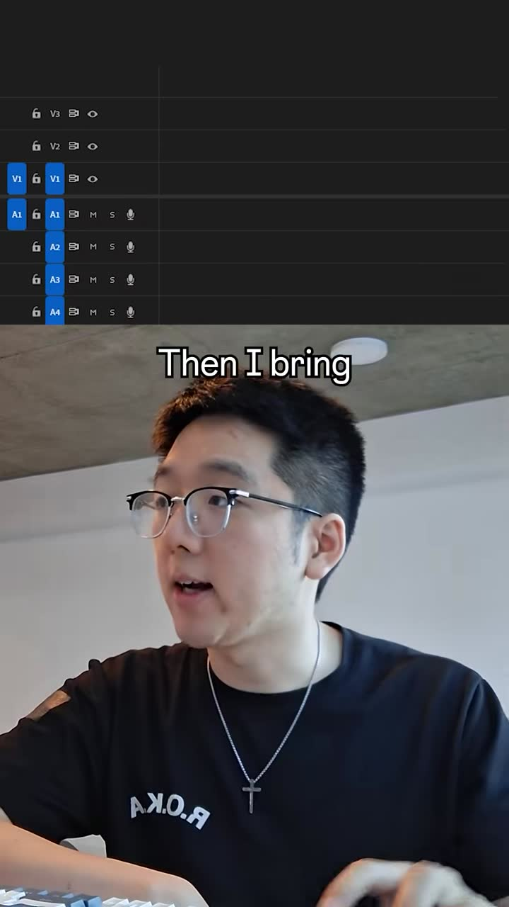
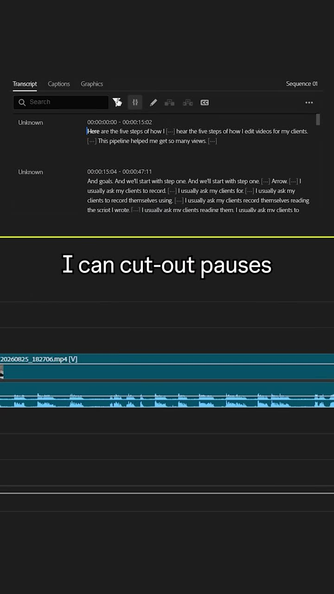
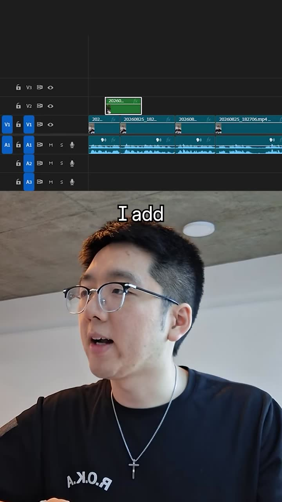
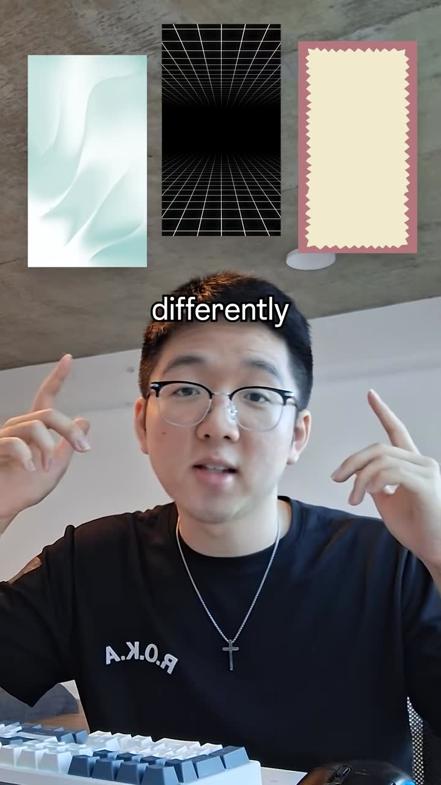
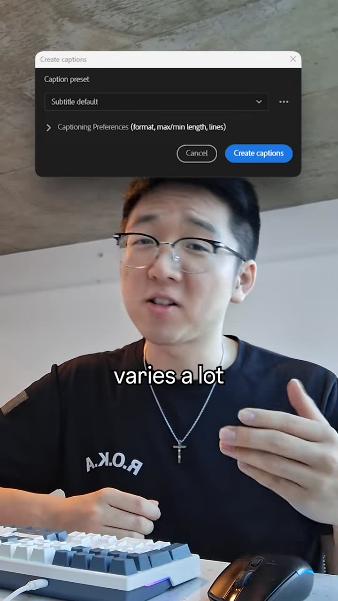
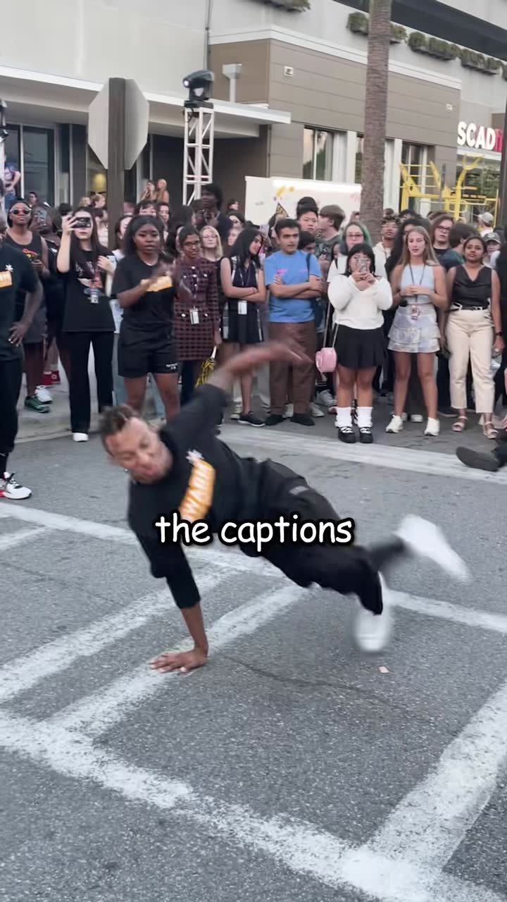
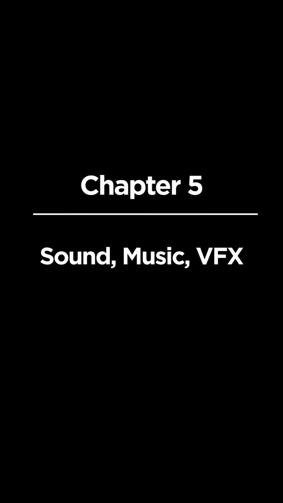

# 5-step short-form editing pipeline (A-roll, cuts, B-roll, captions, sound)

| | |
|---|---|
| Source | <https://www.tiktok.com/@ginyboi/video/7678511193039981854> |
| Creator | ginyboi (@ginyboi) |
| Uploaded | 2026-08-27 |
| Duration | 67s |
| Hashtags | #videoediting #editor |
| Audio | original sound - ginyboi |
| Ingested | 2026-10-30 by yeung-assistant (yt-dlp + faster-whisper `small`, language `en`) |

**Caption (verbatim):**

> I love my job so much. #videoediting #editor

## Summary

A client video editor walks through his five-step pipeline in Premiere Pro: (1) A-roll of the client reading his script, (2) basic cuts that remove pauses automatically with the transcript feature, (3) B-roll every 3-5 seconds, or a branded "B-roll space" layout when there is no footage, (4) captions styled for the audience's age, and (5) sound, music, and VFX kept light so the video stays raw and authentic.

## Key takeaways

- Script first: the editor writes the script and the client records A-roll reading it.
- Cut pauses automatically with text-based editing (Premiere's transcript panel). It saves a lot of time.
- Add B-roll every 3-5 seconds on a second layer to keep the visuals changing.
- No B-roll? Build a per-brand "B-roll space" layout (a framed area for pictures, icons, and assets). It also reinforces the brand.
- Captions depend on the audience: short and bouncy for younger viewers (attention span), clear and longer lines for older viewers so they don't feel overwhelmed.
- Sound, music, and VFX are secondary storytelling elements. Too many effects steal attention from the core message, so keep it as raw as possible.

## Verbatim phrases and script

> "Here are the 5 steps of how I edit videos for my clients. This pipeline helped me get so many views [...] step 1, A-roll. I usually ask my clients to record themselves reading the script I wrote."
>
> "Instead of doing everything manually, I can cut out the pauses automatically by using the transcript feature here."
>
> "Every 3 to 5 seconds, I add pre-recorded B-rolls on the second layer. [...] not every client send me B-rolls. In that case, I create a layout called a B-roll space where I can add pictures, icons, or other assets for better storytelling."
>
> "For younger clients, I keep the captions short and bouncy, considering their attention span. For older audiences, I keep them clear and long enough so they don't feel overwhelmed reading the captions."
>
> "I don't add too much effects to my videos because that can steal the attention from the core message. So I always try to keep the videos raw as possible so it feels more authentic and intuitive."

## On-screen text

Read from the frames by eye, because tesseract OCR could not be installed on the ingest box. `[...]` marks text that was hidden or is uncertain.

- "5 steps of editing videos for creators" with 1-5 placeholders
- A summary analytics card (views and followers) as proof
- Chapter cards: "Chapter 1" ... "Chapter 2 / Basic cut" ... "Chapter 4 / Captions" ... "Chapter 5 / Sound, Music, VFX"
- Burned-in word-by-word captions throughout ("I can cut-out pauses", "I add", "varies a lot")

## Screenshots

Frames were chosen where a new tip, list item, or on-screen demo starts, using the transcript, ffmpeg scene-change detection, and manual review. They are 720px wide JPGs.

**0:01.0**: Hook: "5 steps of editing videos for creators" with an empty 1-5 list

**0:09.5**: Step 1 A-roll: the client's recorded script brought into Premiere Pro

**0:17.0**: Step 2 basic cuts: Premiere transcript panel used to cut out pauses automatically

**0:24.0**: Step 3 B-roll: a new B-roll clip every 3-5 seconds on the second layer

**0:35.5**: "B-roll space" layouts designed per client brand when there is no B-roll

**0:43.5**: Step 4 captions: Premiere "Create captions" dialog

**0:46.0**: Short, bouncy captions over action footage for younger audiences

**0:55.0**: Chapter 5: "Sound, Music, VFX"

## How to apply

- **This maps directly onto an automated faceless pipeline:** script (LLM) -> voiceover (TTS) as the "A-roll" -> automatic silence and pause trimming (for example `ffmpeg silencedetect` or a whisper-based cut list) -> stock or generated B-roll swapped every 3-5s -> word-level captions from whisper timestamps -> light music bed.
- **The "B-roll space" is the faceless answer:** a branded template frame where icons, screenshots, and app UI rotate gives a consistent look without footage. This suits app marketing well (show the app's screens inside the frame).
- **Caption presets per audience:** a "young" preset (1-3 words per caption, bouncy animation) and a "pro" preset (full short lines, static).
- **Restraint:** limit transitions and effects in templates. Authenticity beats polish.

## Transcript

Full timestamped transcript: [transcript.md](transcript.md).
