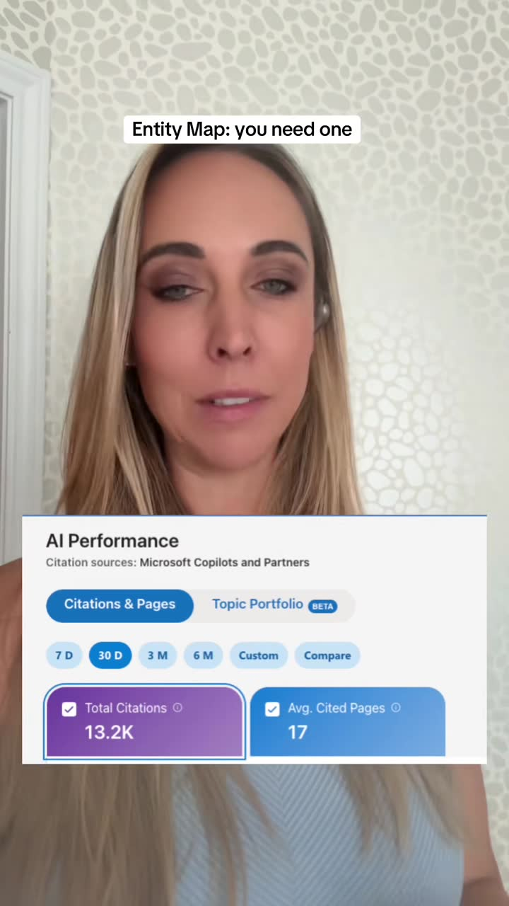
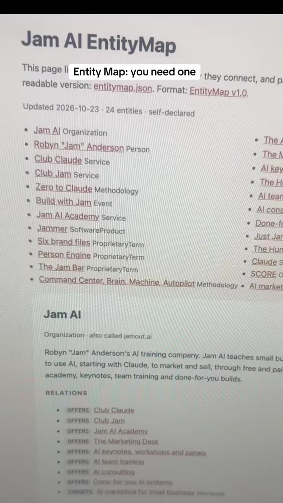
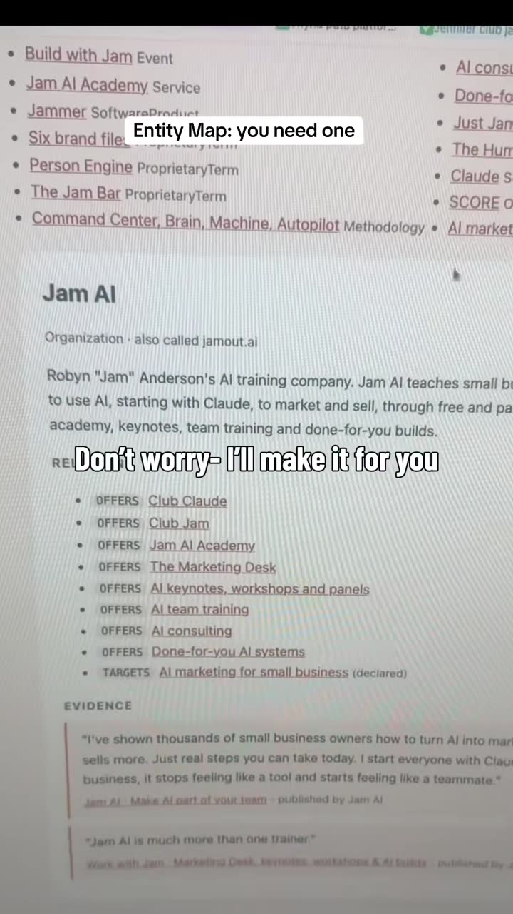
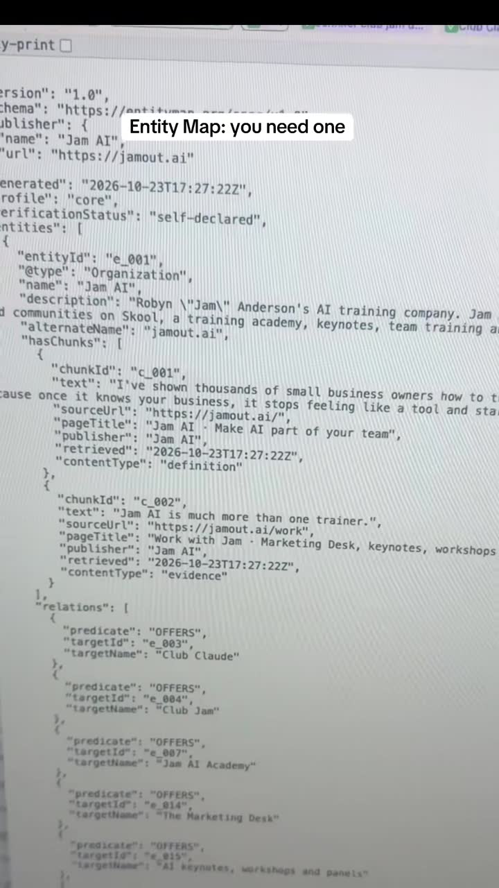
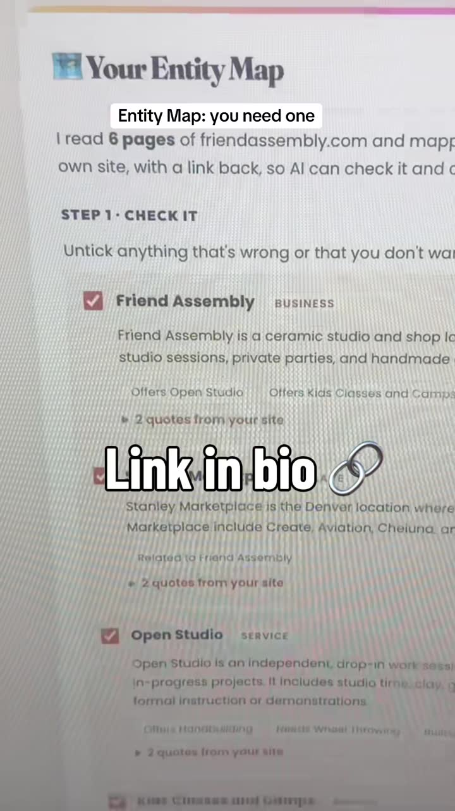
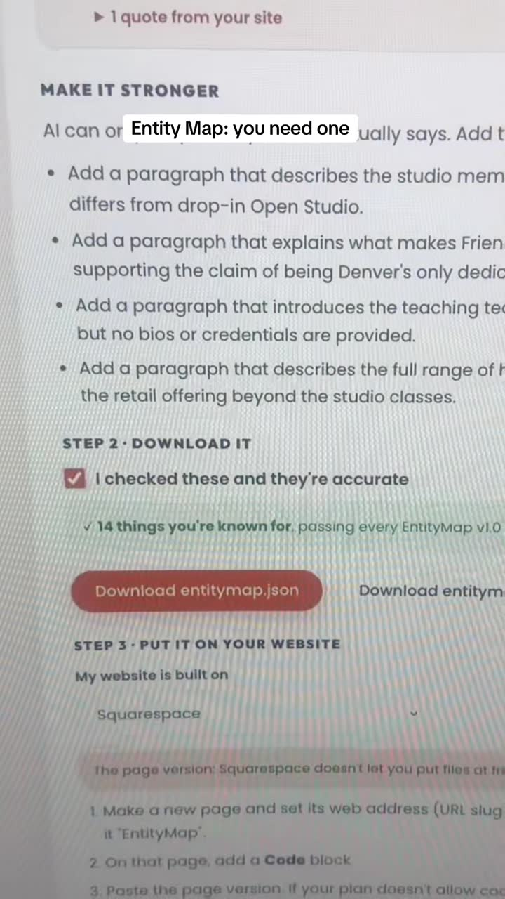

# Entity map: get recommended by ChatGPT and other LLMs (AI SEO / AEO)

| | |
|---|---|
| Source | <https://www.tiktok.com/@jamout.ai/video/7700225527377857822> |
| Creator | Jam | AI & Marketing (@jamout.ai) |
| Uploaded | 2026-10-24 |
| Duration | 56s |
| Hashtags | #seo #aiseo #aeo #aiagents |
| Audio | original sound |
| Ingested | 2026-10-30 by yeung-assistant (yt-dlp + faster-whisper `small`, language `en`) |

**Caption (verbatim):**

> Let me tell you a secret. You need an entity map.  #seo #aiseo #aeo #aiagents

## Summary

Robyn "Jam" Anderson (Jam AI) credits her high count of citations in AI answers to an entity map. An entity map is a structured page plus JSON schema markup that tells LLMs what the business is, what it offers, where it has been recommended, and where its testimonials are. She demos a builder that reads your site, proposes entities with supporting quotes, suggests ways to make the map stronger, and exports an `entitymap.json` to embed on Squarespace or WordPress.

## Key takeaways

- An entity map has two versions of the same content: a readable page for humans (a list of entities: organization, person, services, events, products, methodology terms) and JSON schema markup for LLMs.
- Each entity gets a type, a one-paragraph description, RELATIONS (for example `OFFERS` service X, `TARGETS` audience Y), and EVIDENCE (testimonials, quotes, where you have been recommended).
- The builder workflow: enter your website, what you want to be known for, and your platform. It reads your important pages and proposes entities, each backed by quotes from your site.
- Step 1, check it: untick anything wrong. Step 2, download `entitymap.json`. Step 3, put it on your website (for example a Code block on a new page with an EntityMap slug).
- "Make it stronger": add paragraphs that state what makes you different, that introduce the team, and that describe the full range of what you offer. You can only map claims your site actually makes.
- The goal is AEO/AI SEO: being the business an LLM recommends, measured by AI citations (her dashboard shows "Total Citations" and cited pages).

## Verbatim phrases and script

> "[...] it's because I have a super good entity map. Let me show you what that is. This is what an entity map looks like to humans. [...] what it's telling large language models, and this is what it looks like to large language models, is what my business does behind it. So where have I been recommended, where are my testimonials, all of that stuff."
>
> "[...] you just put in your info and it'll show like all of these things and then if you agree with it, it actually creates that JSON schema markup file for you and you can put it on whatever sort of platform you're on, if you're on Squarespace or WordPress or whatever."

## On-screen text

Read from the frames by eye, because tesseract OCR could not be installed on the ingest box. `[...]` marks text that was hidden or is uncertain.

- Hook: "ChatGPT can't stop talking about me"; header: "Entity Map: you need one"
- AI Performance dashboard: "Citations & Pages", "Total Citations", "Avg. Cited Pages"
- "Jam AI EntityMap": "Updated 2026-10-23 - 24 entities - self-declared"; entity types Organization, Person, Service, Methodology, Event, SoftwareProduct, ProprietaryTerm
- Entity detail: RELATIONS (OFFERS ..., TARGETS: AI marketing for small business) and EVIDENCE quotes
- "Don't worry - I'll make it for you"; "Link in bio"
- Builder: "Your website", "What do you want to be known for?", "Your website is built on: Squarespace", "Your most important pages (optional)", "Map my website"
- "Your Entity Map": "I read 6 pages of [site] and mapped [...] with a link back, so AI can check it"; "STEP 1 - CHECK IT: Untick anything that's wrong"
- "MAKE IT STRONGER" / "STEP 2 - DOWNLOAD IT" / "Download entitymap.json" / "STEP 3 - PUT IT ON YOUR WEBSITE"

## Screenshots

Frames were chosen where a new tip, list item, or on-screen demo starts, using the transcript, ffmpeg scene-change detection, and manual review. They are 720px wide JPGs.

**0:04.0**: Hook: "ChatGPT can't stop talking about me" with an AI Performance dashboard (citations)

**0:09.5**: "Jam AI EntityMap": the human-readable entity list (organization, person, services, events, methodology terms)

**0:13.0**: Entity detail: organization summary, RELATIONS (OFFERS ...) and EVIDENCE quotes

**0:18.0**: The same map as JSON schema markup: what LLMs see

**0:36.0**: Entity Map Builder output, "Step 1 - check it": untick anything wrong; each entity cites quotes from your site

**0:41.0**: "Make it stronger" suggestions, then "Step 2 - download entitymap.json" and "Step 3 - put it on your website"

## How to apply

- **Build one for each app or product we launch:** an `/entity-map` page plus JSON-LD (`Organization`, `SoftwareApplication`, `Person` for the founder, `Service`/`Offer` relations, `Review`/quote evidence) on the landing page. This is cheap and it compounds.
- **Make every claim citable:** before building the map, make sure the site actually says what the app does, who it's for, how it's different, and who uses it. The map can only cite real on-site text.
- **Connect it to the short-form channel:** link the TikTok/YouTube profiles as `sameAs` entities, and reuse consistent names across videos so LLMs connect the faceless channel to the app.
- **Track it:** periodically ask ChatGPT, Claude, and Perplexity "what's a good tool for X?" and log whether the app is cited, as a simple AEO metric.
- **Possible Monoclaw tool:** a small script that crawls our own landing page and emits a draft `entitymap.json`, the same workflow as the builder in this video.

## Transcript

Full timestamped transcript: [transcript.md](transcript.md).
