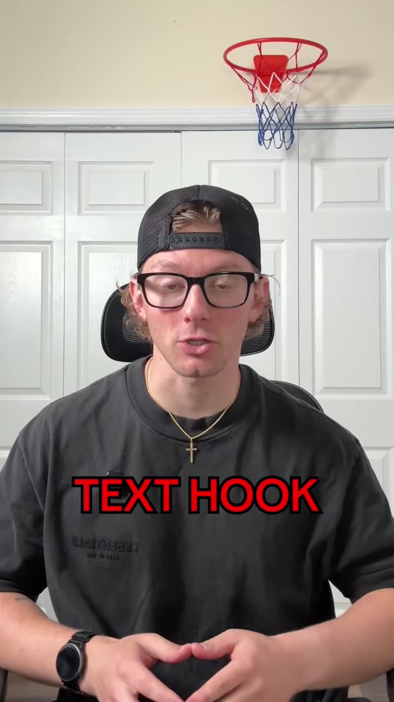
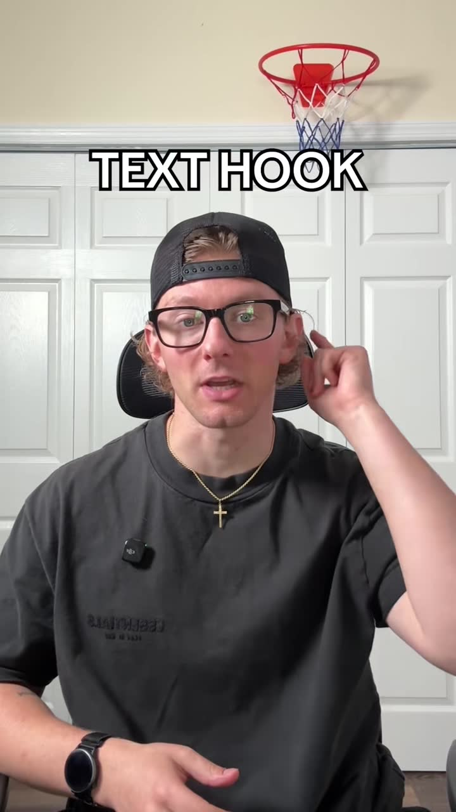
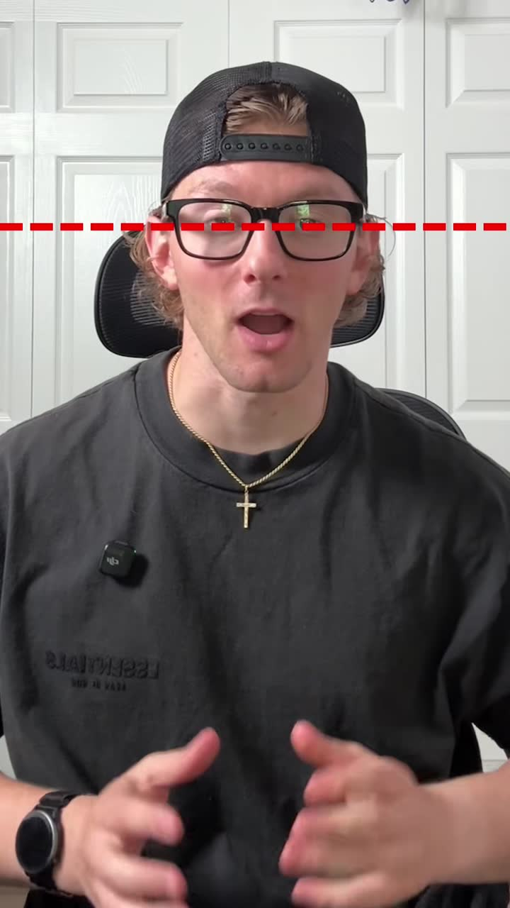
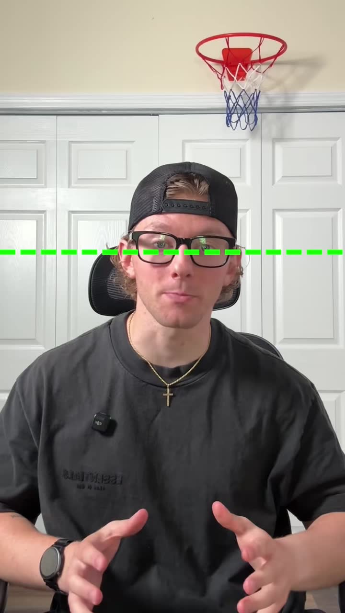
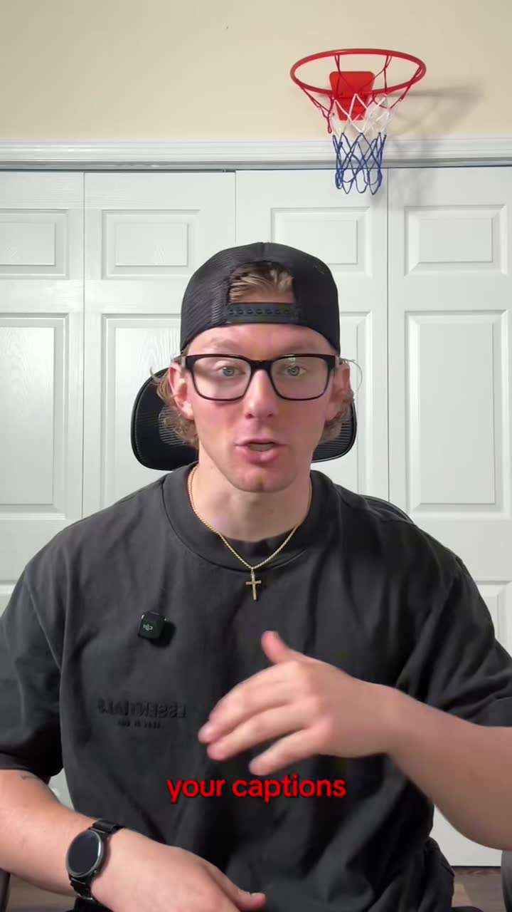
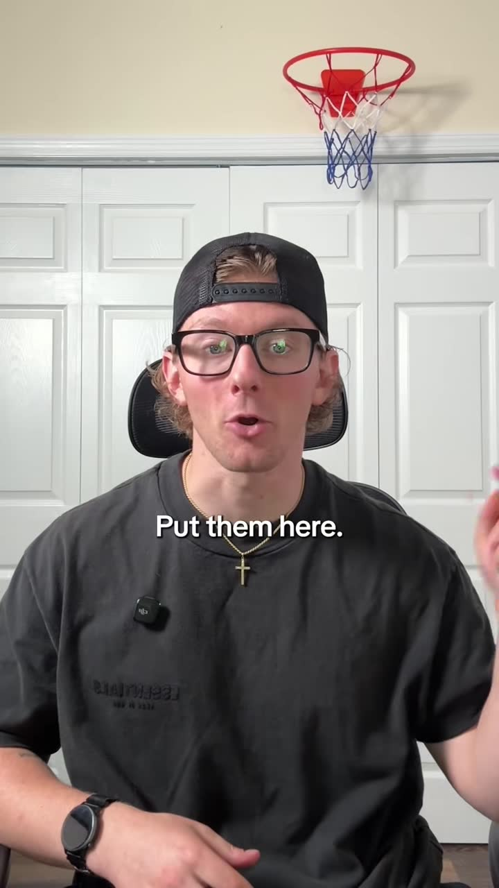

# How to frame your content: text hook, eye line, and caption placement

| | |
|---|---|
| Source | <https://www.tiktok.com/@ronan0437/video/7688325930997075214> |
| Creator | Ronan (@ronan0437) |
| Uploaded | 2026-09-22 |
| Duration | 14s |
| Hashtags | #personalbrand #tiktok #tiktoktips |
| Audio | original sound |
| Ingested | 2026-10-30 by yeung-assistant (yt-dlp + faster-whisper `small`, language `en`) |

**Caption (verbatim):**

> How to properly frame your content #personalbrand #tiktok #tiktoktips

## Summary

A 14-second framing tutorial in a "never here, always here" format. Put the text hook at the top of the frame, keep your eye line about one third down with headroom (not at the very top edge), and put captions mid-frame instead of near the bottom where the app UI covers them.

## Key takeaways

- Text hook: at the top of the frame above the head, not across the chest or the middle.
- Eye line: about one third from the top. Do not crop so tight that your eyes sit on the top edge.
- Captions: around the middle of the frame, not in the bottom area that TikTok's caption and buttons cover.
- Good framing makes the video look higher quality and gets more views.
- The format itself works: wrong and right examples back to back with a red/green indicator, in about 14 seconds.

## Verbatim phrases and script

> "Never put your text hook here. Instead, always put it here. Never put your eye line here. Instead, always put it here. Never put your captions down here. Instead, put them here. Using these simple framing techniques will help your videos look higher quality and get more views."

## On-screen text

Read from the frames by eye, because tesseract OCR could not be installed on the ingest box. `[...]` marks text that was hidden or is uncertain.

- "TEXT HOOK" in red mid-chest (wrong), then in white at the top above the head (right)
- Red dashed line at eye level on a too-tight crop (wrong), then a green dashed line about one third down (right)
- Red "your captions" near the bottom (wrong), then white "Put them here." mid-frame (right)

## Screenshots

Frames were chosen where a new tip, list item, or on-screen demo starts, using the transcript, ffmpeg scene-change detection, and manual review. They are 720px wide JPGs.

**0:01.0**: Wrong: text hook placed mid-frame over the chest

**0:03.1**: Right: text hook at the top of the frame, above the head

**0:04.5**: Wrong: eye line at the very top edge (red line), framed too tight

**0:06.2**: Right: eye line about one third down (green line) with headroom

**0:08.0**: Wrong: captions down low near the bottom

**0:09.8**: Right: captions mid-frame ("Put them here.")

## How to apply

- **Faceless templates:** apply the same safe zones when there is no face. Put the hook text in the top band (about the top 15-25%), keep the key visual subject around the upper third, and put burned-in captions around the vertical center. Keep everything clear of the bottom ~20% and the right-edge button column.
- **Encode it in the pipeline:** if we generate shorts programmatically (for example MoneyPrinterTurbo-style, see `../../MONEYPRINTERTURBO_ASSESSMENT.md`), set the caption `y` position to about 50% and the hook overlay to about 12-20%, not the bottom default.
- **Content idea:** "never X, always Y" before/after framing clips are a fast faceless format for teaching any skill.

## Transcript

Full timestamped transcript: [transcript.md](transcript.md).
