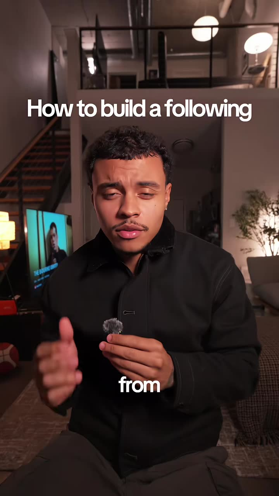
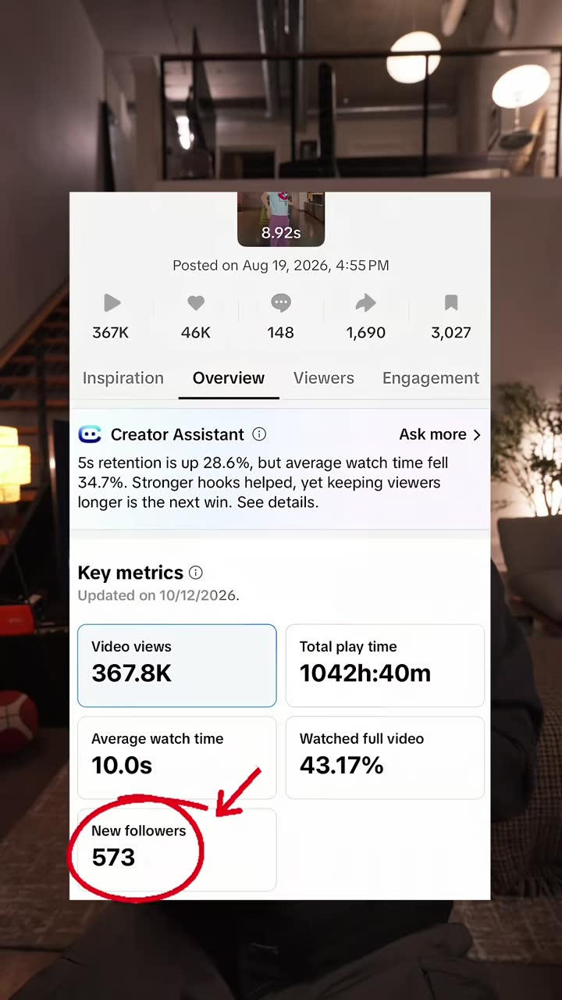
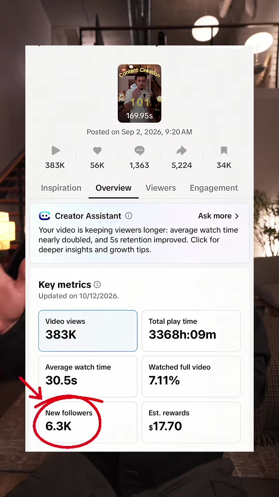
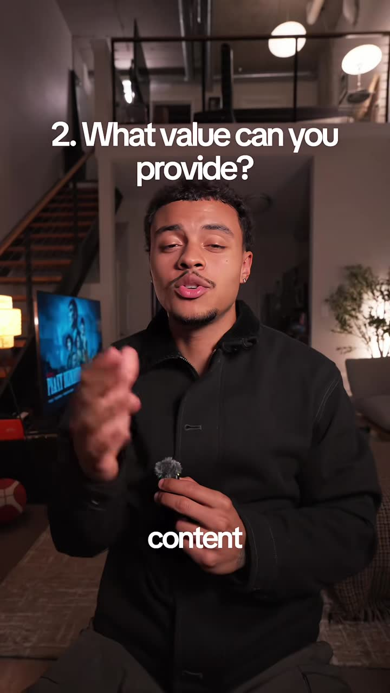
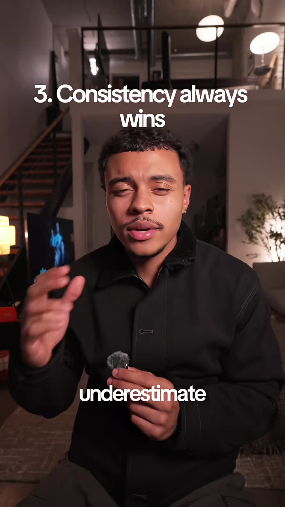
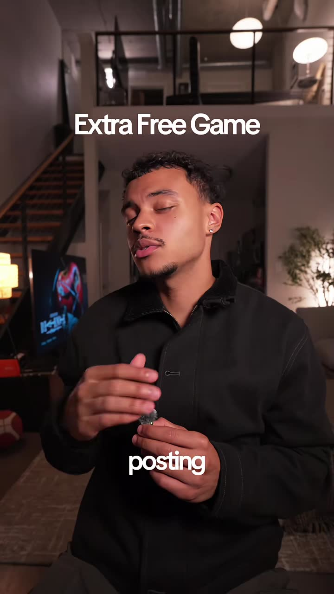

# Content creation 101: how to build a following (value over virality)

| | |
|---|---|
| Source | <https://www.tiktok.com/@themekhicarter/video/7696704990320004366> |
| Creator | themekhicarter (@themekhicarter) |
| Uploaded | 2026-10-15 |
| Duration | 115s |
| Hashtags | #contentcreator #advice |
| Audio | original sound |
| Ingested | 2026-10-30 by yeung-assistant (yt-dlp + faster-whisper `small`, language `en`) |

**Caption (verbatim):**

> Content Creation 101 : How to build a following.🫂 Crazy to say I have 150k followers on here 😃#contentcreator #advice

## Summary

A software-engineer creator (about 50K new followers in a few months) explains that going viral does not equal followers. Two of his videos with similar view counts gained 573 and 6.3K followers, and the difference was that one gave high-value advice. He lists three ways creators add value (attractiveness, personality or relatability, specific skill or knowledge), says to stay consistent so you are unavoidable on people's timelines, and says to give people a reason to come back to your page.

## Key takeaways

- Viral is not the same as followers. Views without value bring one-time interactions ("we interact once and we move on").
- Followers come from value that gives people a reason to come back to your page.
- The three sources of value are above-average attractiveness, great personality or relatability, and a specific skill or knowledge most people don't have. The top creators mix all three.
- Lean into an uncommon expertise (his example: being a software engineer).
- Consistency wins: the more often you are on someone's timeline, the more chances one video resonates and they follow.
- Memes and text-on-screen posts can get likes and impressions without converting to followers if they add no value.

## Verbatim phrases and script

> "Going viral does not mean you're going to gain followers. I have videos that have done over 300,000 views and I only gained 500 followers, whereas another video with a similar amount of views gained me over 6,000 followers. And the only difference between these two videos was that one actually provided value to the viewer."
>
> "Try to be the unavoidable on people's timeline."
>
> "I think the biggest thing is you have to give people a reason to come back to your page. If you're just posting memes or text on a screen or something that's not really adding any value, even if it's getting likes and impressions, nobody's going to actually follow you because there's no reason to come back to the page."

## On-screen text

Read from the frames by eye, because tesseract OCR could not be installed on the ingest box. `[...]` marks text that was hidden or is uncertain.

- "How to build a following"
- Proof cards: "TikTok +39.2k followers", "Instagram +8.9k followers"
- "1. Viral ≠ Followers" with two analytics cards: about 368K views / 573 new followers vs. about 383K views / 6.3K new followers (the 383K-view card also shows Est. rewards of $17.70, which is the creator's payout for that video)
- "2. What value can you provide?"
- "3. Consistency always wins"
- "Extra Free Game"

## Screenshots

Frames were chosen where a new tip, list item, or on-screen demo starts, using the transcript, ffmpeg scene-change detection, and manual review. They are 720px wide JPGs.

**0:00.5**: Hook title "How to build a following"

**0:12.5**: Proof point 1: a video with ~368K views that gained only 573 followers (red circle)

**0:17.0**: Proof point 2: a video with ~383K views that gained 6.3K followers, with Est. rewards of $17.70 (TikTok's payout estimate)

**0:33.0**: Section 2: "What value can you provide?"

**1:14.0**: Section 3: "Consistency always wins"

**1:40.0**: "Extra Free Game": give people a reason to come back to your page

## How to apply

- **Pressure-test faceless content:** a faceless channel can't use attractiveness or on-camera personality, so it has to win on skill or knowledge (lever 3) and a recognizable voice or format (a weak form of lever 2). Every video should teach something a viewer would come back for.
- **Optimize for follows, not views:** track new followers per 1K views, not just views. Pure meme or quote pages are exactly what he warns against.
- **Consistency:** batch-produce and schedule (for example one or two posts a day) so the channel is "unavoidable". This is where automation pays off.
- **Series give a reason to come back:** numbered series ("part 3 of 10 AI tools for X") turn a one-time viewer into a follower.

## Transcript

Full timestamped transcript: [transcript.md](transcript.md).
