# "I have 12 streams of income": adding a print-on-demand shop (Printify ad), part 2

| | |
|---|---|
| Source | <https://youtu.be/cY6GojPFOYc> (YouTube Short) |
| Channel | Wanderlust Alley (@wanderlustalley), <https://www.youtube.com/channel/UCetduXbEt1-VFkz8r-7x4YQ> |
| Title | I didn’t expect THIS… 😳 @Printify ad |
| Uploaded | 2026-10-23 |
| Duration | 48s, 608x1080 |
| Stats at ingest | 25,952 views, 627 likes |
| Hashtags | #printify |
| Sponsored | Yes. The title says "@Printify ad" |
| Ingested | 2026-10-31 by yeung-assistant (yt-dlp + faster-whisper `small`, language `en`) |

**Description (verbatim):**

> #printify

## Summary

Allie (captioned "Alley"), "a former struggling artist who has recently become obsessed with passive income streams," opens with a full-screen list of her **12 streams of income**. She says this is "part two" of adding a thirteenth. While she makes an iced matcha, she tells the story of her first trip after moving to Japan nearly 10 years ago, to see the snow monkeys. She says that trip "belongs in my new print shop," then shows Printify ("a print on demand platform with no upfront costs"), puts a snow-monkey photo on a stretched canvas mockup, and ends with "all we have to do now is launch."

It is a paid Printify ad written as a personal series episode. The list frame is the hook and the proof of credibility. It is on screen only from about 0:00.4 to 0:01.4.

## The passive income list (on screen, 0:00.4 to 0:01.4)

Read by eye from the full-resolution frame ([screenshot](screenshots/000.6s.jpg)). The list is static, so one frame shows all 12 items:

1. YouTube Adsense
2. Group Trip Host
3. Brand Partnerships
4. Marketing Producer
5. Affiliate Links
6. Buy Me a Coffee
7. Airbnb
8. Meta Adsense
9. UGC content
10. Merch
11. Bikini line
12. Google Adsense

Stream 13, which this video adds, is a print-on-demand shop on Printify.

Note: several of these are not passive (Group Trip Host, Marketing Producer, UGC content, and Brand Partnerships are active work). The list is about *streams*, and "passive income" is the framing.

## Key takeaways

- **Lead with a dense proof card.** A 12-item list fills the first second and pauses the scroll. Viewers rewatch or screenshot it to read it, which helps retention.
- **Series framing:** "this is part two of adding another one to my list" makes it an ongoing build-in-public series, which gives viewers a reason to follow.
- **The ad is the story.** The sponsor (Printify) only shows up at about 0:40. The first 40 seconds are a personal story plus a satisfying B-roll process (making a matcha), and the product demo feels like the story's payoff.
- **Burned-in, word-by-word captions** in the vertical middle, and constant motion (a new shot every 1 to 3 seconds).
- **The product is the content.** A personal photo becomes a sellable canvas, so the story, the content, and the product line up.

## Verbatim phrases and script

> "I have 12 streams of income and this is part two of adding another one to my list."
>
> "Hi, I'm Allie, a former struggling artist who has recently become obsessed with passive income streams. And today, we're making a pretty big decision."
>
> "So naturally, it belongs in my new print shop. I'm using Printify, which is a print on demand platform with no upfront costs. It makes it super affordable to start a business, which means all we have to do now is launch."

## On-screen text

Read from the frames by eye (no OCR on the ingest box).

- 0:00.4 to 0:01.4: the 12-item income-streams list above
- Burned-in captions for every line, for example "& this is part 2", "hi i'm alley", "passive income streams", "and it led me to snow monkeys", "the most transformative thing", "it belongs in my new print shop", "i'm using printify", "which is a print-on-demand platform", "which makes it super affordable", "all we have to do now", "is launch"
- 0:41 Printify homepage: "CREATE AND SELL CUSTOM PRODUCTS", "100% Free to use", "2000+ products", "Global delivery", "Get started for free", "No credit card required", "ITEM SOLD"
- 0:42 to 0:43 Printify product page: "Matte Canvas, Stretched" (partly legible)

## Screenshots

Frames were chosen by content: transcript cue points plus a dense 2 fps contact-sheet review and a 30 fps check of the first 1.6s, where the list appears. Each frame is at native resolution (608px wide, which is the source width). Nothing is redacted.

**0:00.6**: The 12 streams of income list (all items legible). This is the success-criterion frame.

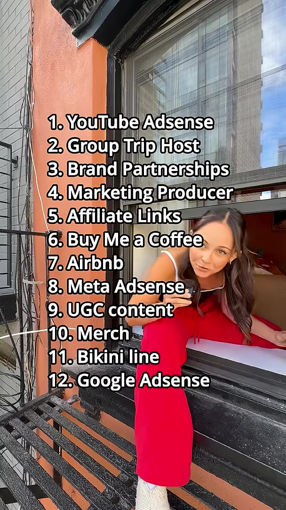

**0:02.0**: "& this is part 2": the series hook

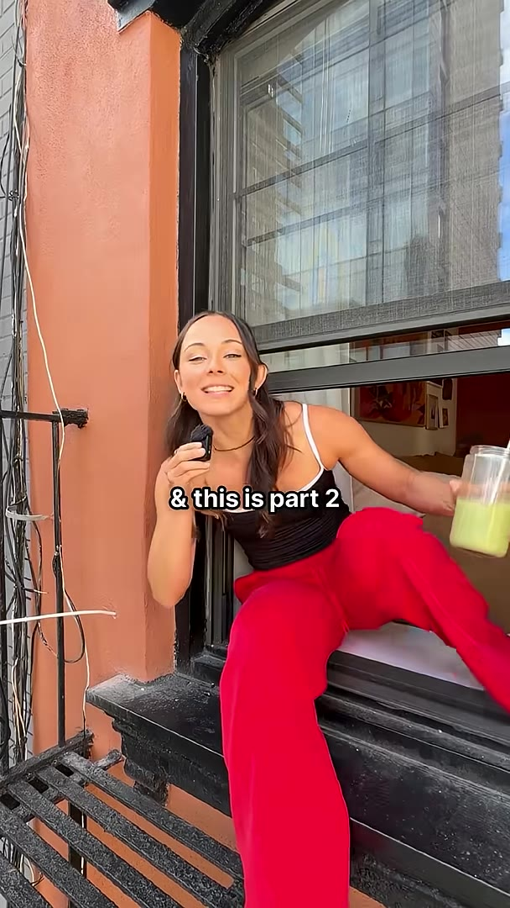

**0:05.0**: "hi i'm alley": the creator intro (a former struggling artist)

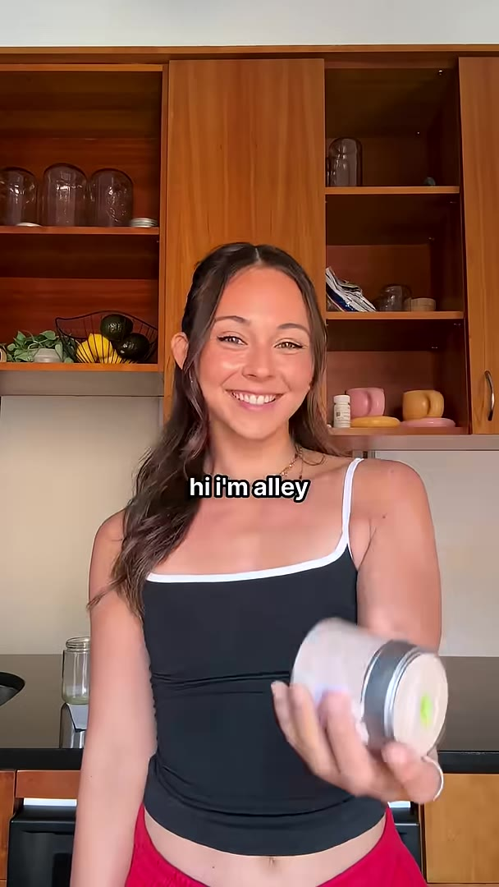

**0:08.5**: "passive income streams": the topic

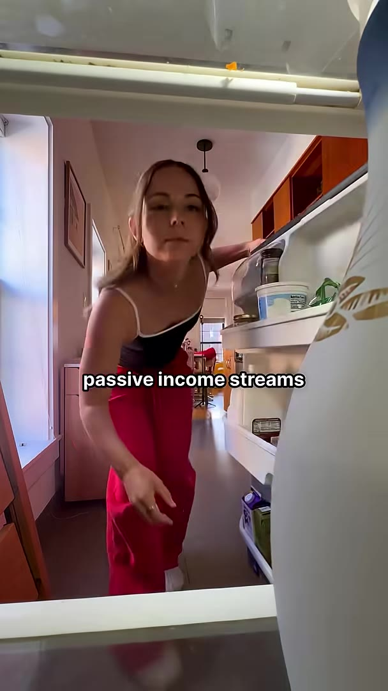

**0:10.0**: "we're making a pretty big decision": the story starts over matcha-making B-roll

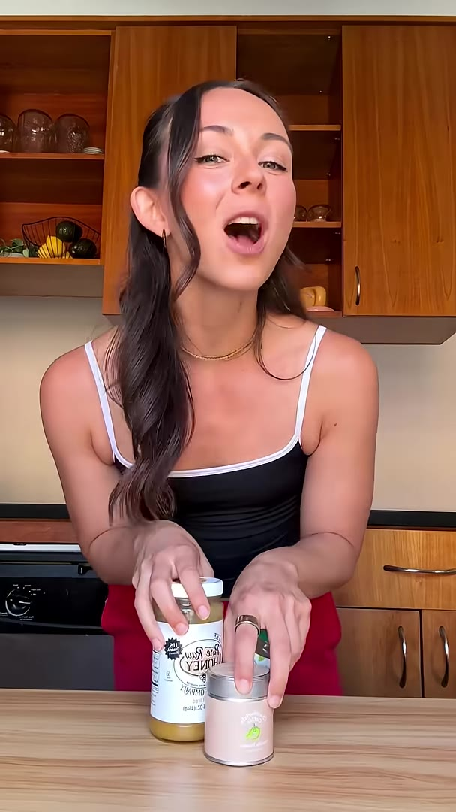

**0:29.5**: "and it led me to snow monkeys": a selfie with a photo inset of the trip

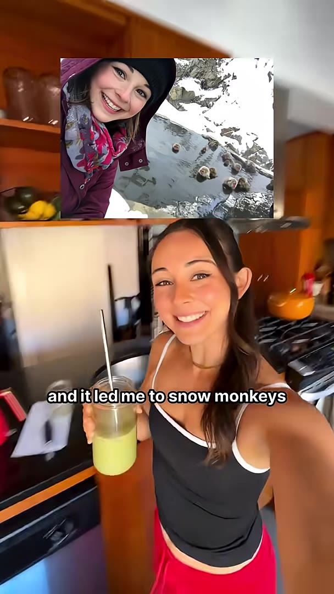

**0:32.0**: Snow monkey footage: the emotional peak of the story

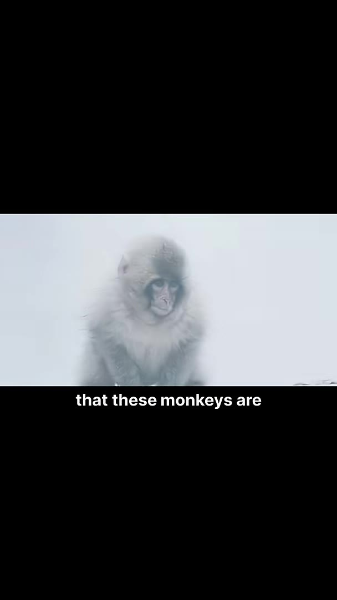

**0:37.0**: "the most transformative thing": the trip photo that becomes the product

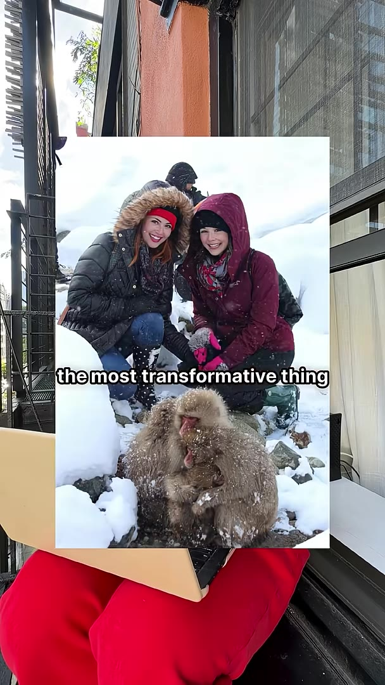

**0:39.0**: "it belongs in my new print shop": the pivot to the sponsor

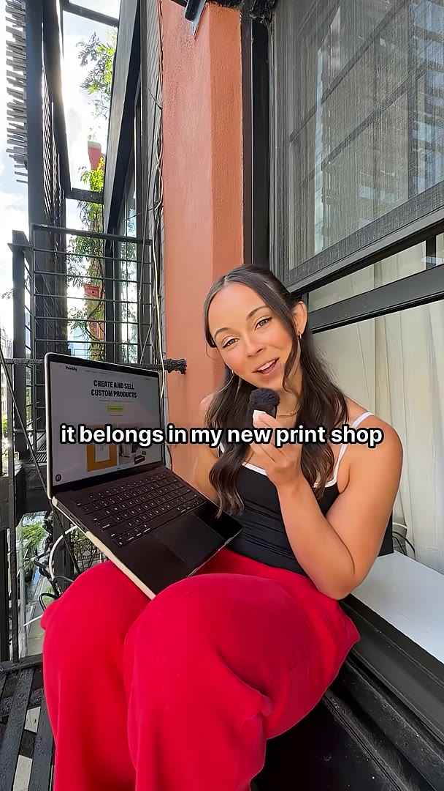

**0:41.0**: Printify homepage, "Create and sell custom products": "a print-on-demand platform"

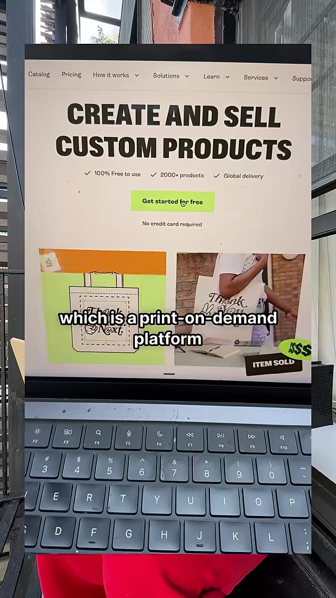

**0:44.0**: The snow-monkey photo placed on a canvas in Printify's editor: "super affordable"

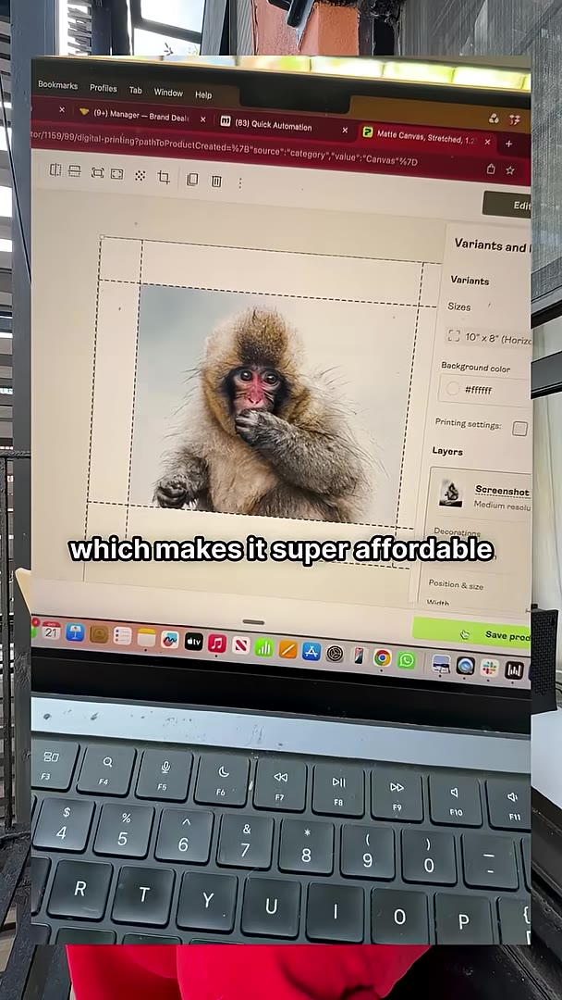

**0:47.0**: "all we have to do now is launch": the cliffhanger for the next part

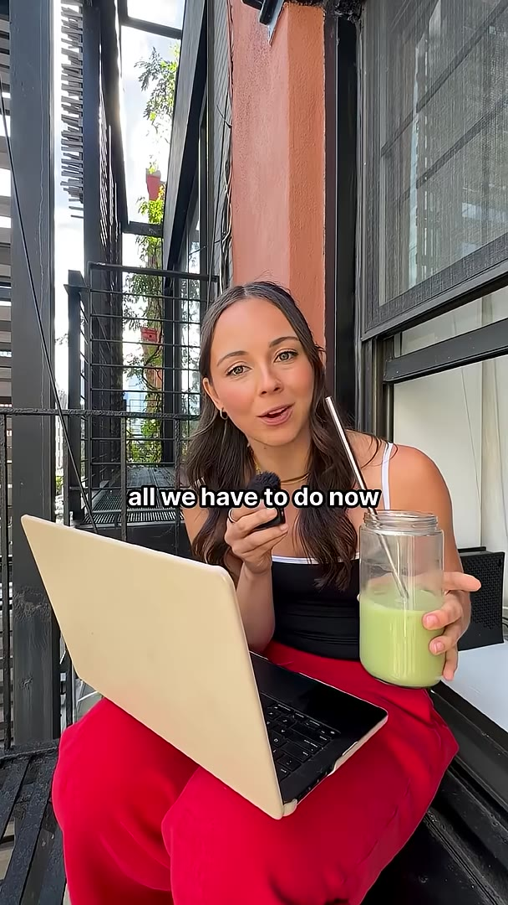

## How to apply

- **A faceless "income streams" proof card:** open a video with a full-screen numbered list (apps shipped, revenue streams, tools used) for about 1 second, then cut to the voiceover. It works without a face, because the list does the hooking.
- **A build-in-public series for the apps:** "I have N apps, this is part 2 of launching #N+1." Each episode is one step (idea, build, landing page, launch, first users), and it ends on a cliffhanger like "all we have to do now is launch."
- **Wrap the app demo in a story:** spend the first two-thirds on a relatable story or a satisfying process B-roll (faceless versions: a screen recording, a desk setup, a hands-only shot). Show the app only as the payoff, as she does with Printify.
- **Stream ideas for a faceless channel from her list:** YouTube/Meta/Google ad revenue, affiliate links, Buy Me a Coffee, merch, and print-on-demand (Printify) all work without a face. Brand partnerships and UGC come later, once the channel has an audience.
- **Sponsorship-ready format:** this is how a sponsor slot can look native. Keep it in mind if the app does creator partnerships (pay creators to make "part N" episodes that feature the app).

## Transcript

Full timestamped transcript: [transcript.md](transcript.md).
