# Day 5 Inti close — 5-shot B-roll sequence + Day-N scoreboard hook

| | |
|---|---|
| Source | <https://www.tiktok.com/@a13x_duke/video/7678570226601970957> |
| Creator | cA13X / ALEX (`@a13x_duke`) · Instagram: Alexdukee |
| Uploaded | 2026-08-26 |
| Duration | 60s |
| Hashtags | *(caption-based story, no visible hashtags)* |
| Audio | original sound |
| Stats (yt-dlp) | 824.9K views · 91.9K likes · 686 comments |
| Ingested | 2026-11-06 by yeung-assistant (yt-dlp + TikTok captions + frame OCR) |

**Caption (verbatim):**

> Day 5 and today we made…

## Summary

A Day-N web-design close reel that doubles as a **B-roll capture recipe**. The video opens on an unfinished scoreboard (**Day 5: $1,550**), teaches a 5-shot sequence (outside → front → walk-in → L→R pan → montage), shows the assembled result, captures the client approving on camera, and closes with the price. The recipe is directly reusable for faceless explainer sequences.

## Key takeaways

- **Scoreboard hook.** Open on an unfinished "Day N" card with a missing number. The scroll stops to see what's coming.
- **5-shot B-roll recipe:** (1) outside, (2) front, (3) walking in, (4) left-to-right pan, (5) assembled montage.
- **L→R pan is "the most important step."** Capture the whole environment in one continuous move.
- **Proof is overheard, not narrated.** Client approval is ambient audio at the table, not a testimonial voice-over.
- **One real number.** The spoken math ($1,300 + $250) and the open/end cards should match. (See caveat below.)

## Verbatim phrases

> "Step 1, record the outside."
>
> "The most important step, you gotta record from left to right. And here I had to walk a little bit, make sure I get the whole store."
>
> "Now if you did it correctly, it should come out something like this."
>
> Client: "I like the pictures. Would you be able to add more?"
>
> "$1,300 to own it, then $250 maintenance."

## On-screen text / key figures

| Timestamp | Text |
|---|---|
| 0:02 | **Day 5: $1,550** |
| 0:45 | **$1,300** spoken (ownership) |
| 0:50 | **$250** spoken (maintenance) |
| 0:56 | **Day 5: $1,500** (end card — inconsistent with $1,550 open) |

**Note on figure inconsistency:** The open card shows $1,550, the spoken math is $1,300 + $250 = $1,550, but the end card shows $1,500. This is already documented in [build-in-public-close-reel.md](../../../../shared/openclaw/skills/short-form-viral-content/references/build-in-public-close-reel.md): "Do not copy the broken number."

## Screenshots

Frames were chosen at each step of the B-roll recipe plus proof/payout cards, using the transcript, ffmpeg scene-change detection, and manual review. They are 720px wide JPGs. **Creator revenue cards ($1,550 / $1,500) are kept unedited.**

**0:00.8**: Hook — "Day 5 and today we made…"

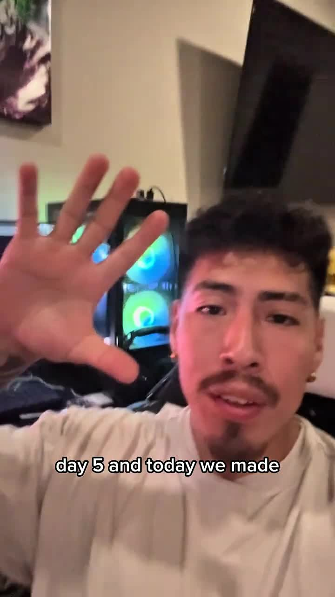

**0:03.0**: $1,550 card

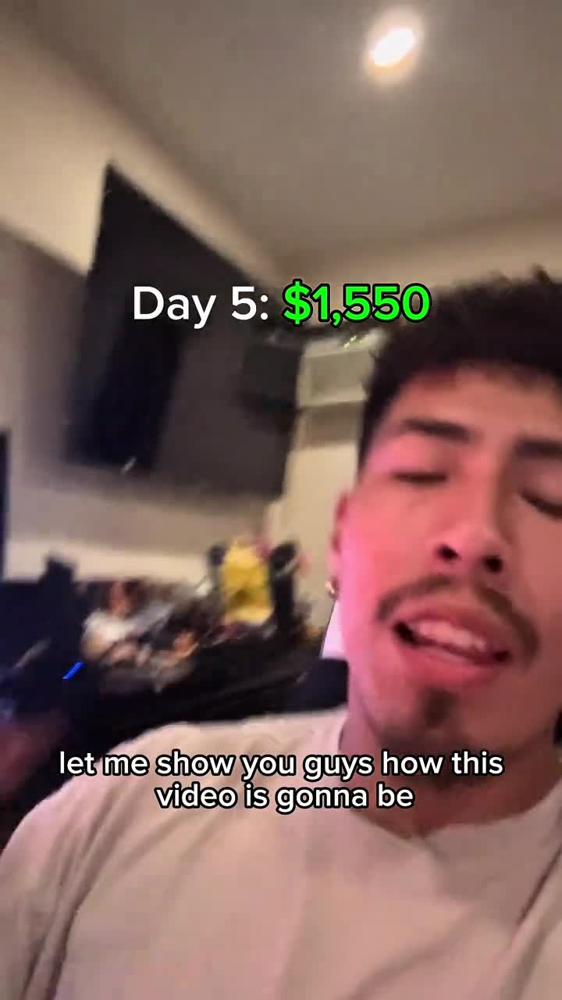

**0:06.5**: Step 1 — record the outside

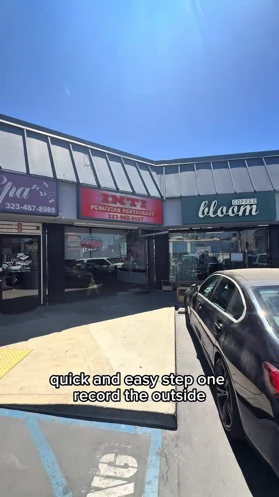

**0:11.5**: Step 2 — record the front

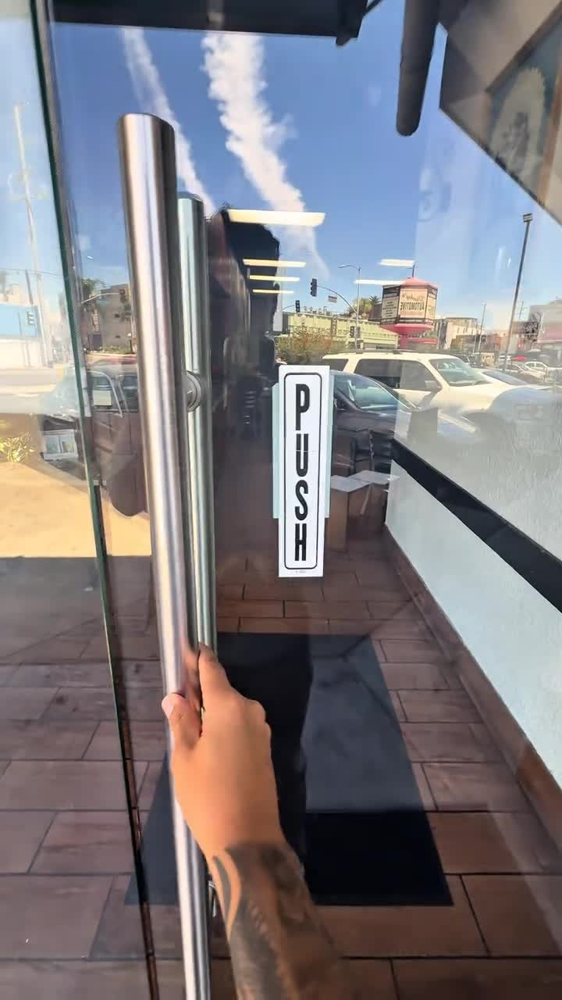

**0:14.5**: Step 3 — walking in

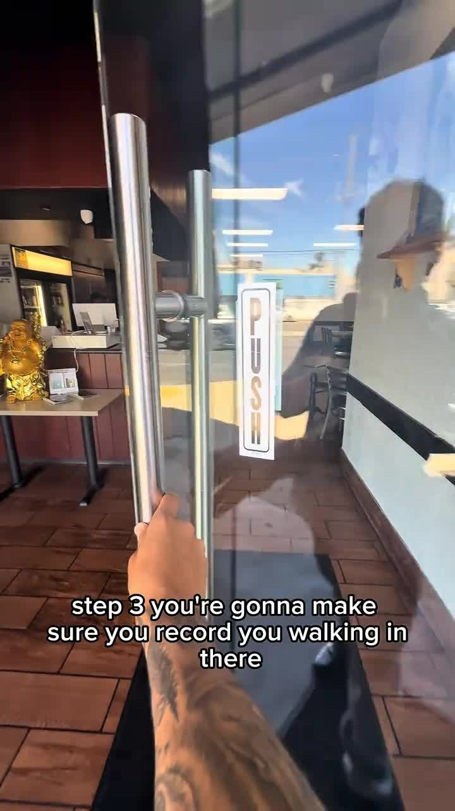

**0:19.0**: Step 4 — left-to-right pan

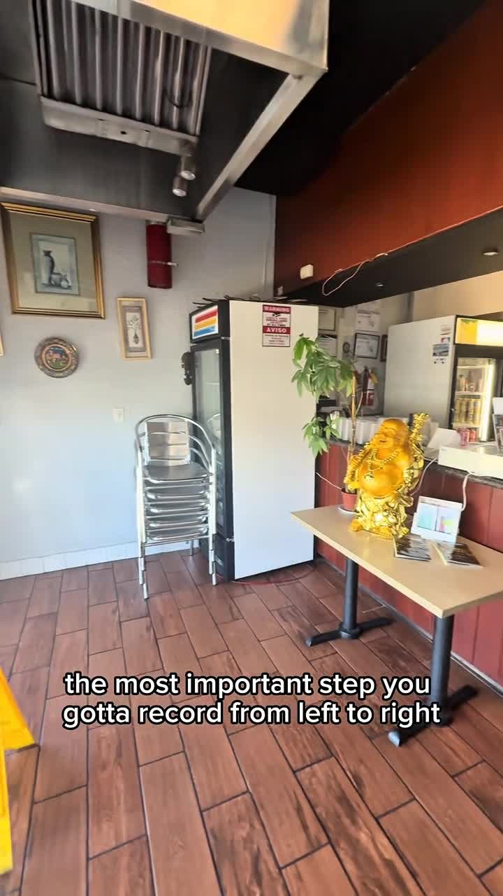

**0:23.0**: Pan captures the whole store

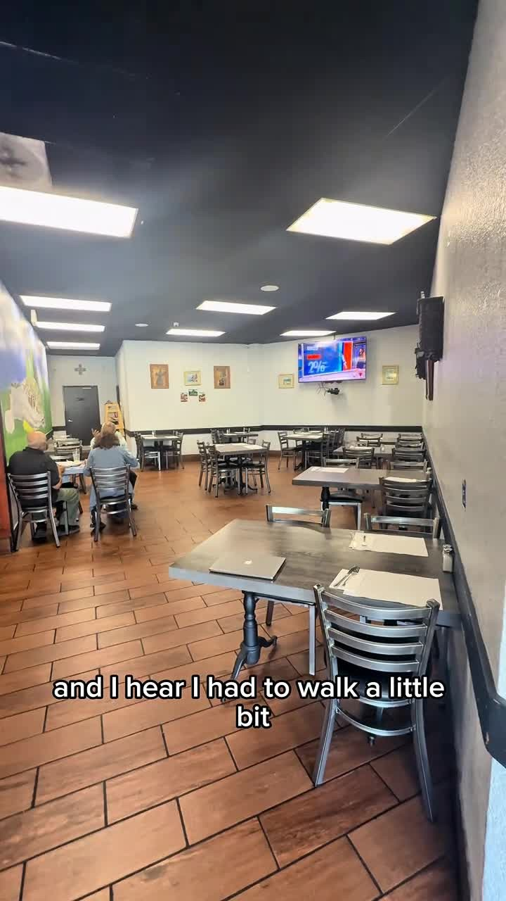

**0:27.5**: Step 5 — assembled montage

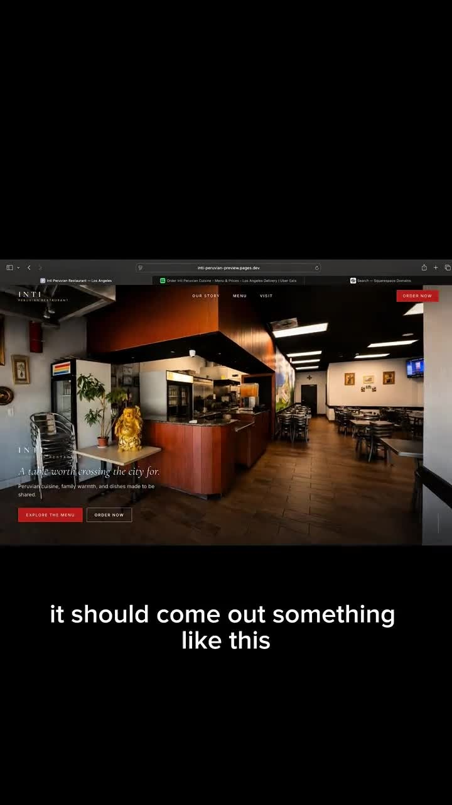

**0:33.0**: Client table — approval overheard

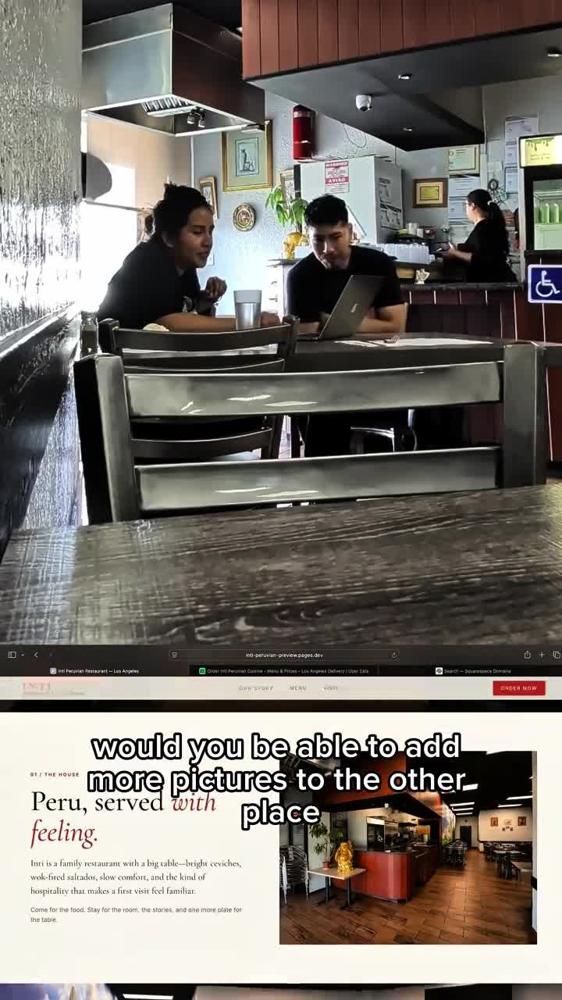

**0:38.0**: Client: "add more pictures"

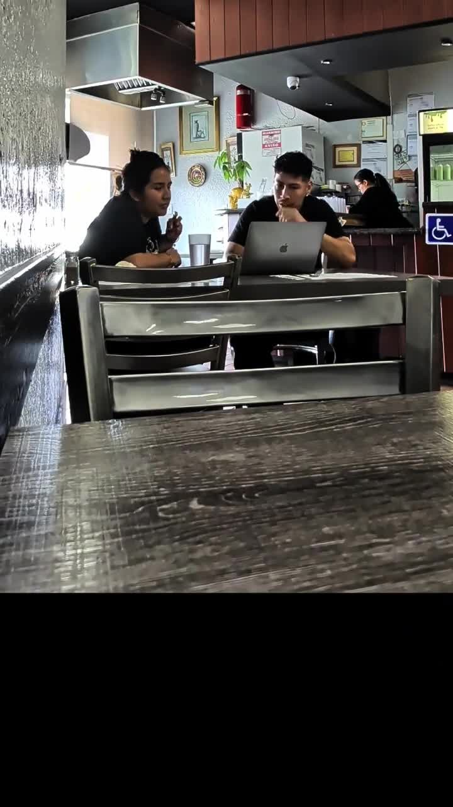

**0:45.0**: $1,300 ownership price

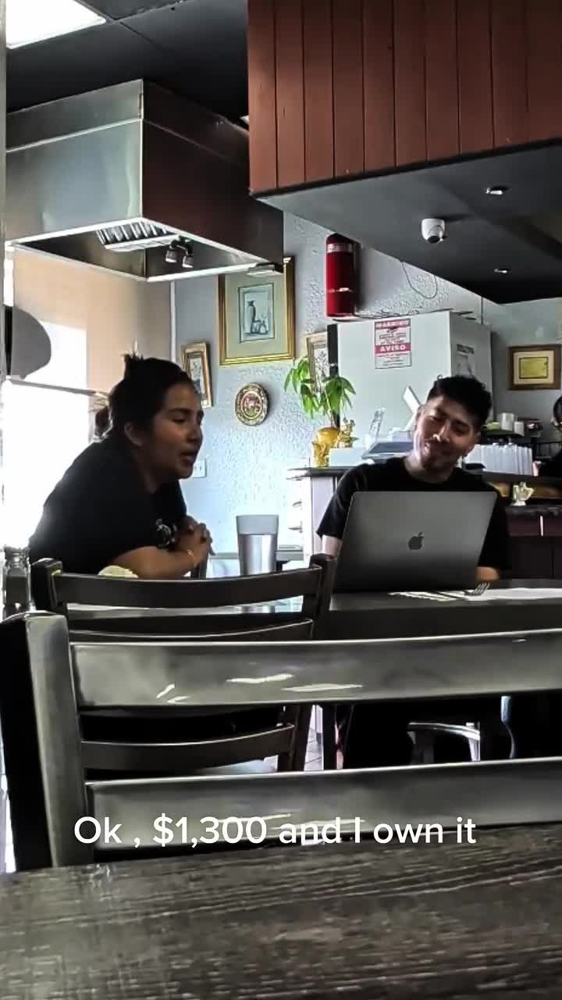

**0:50.0**: $250 maintenance

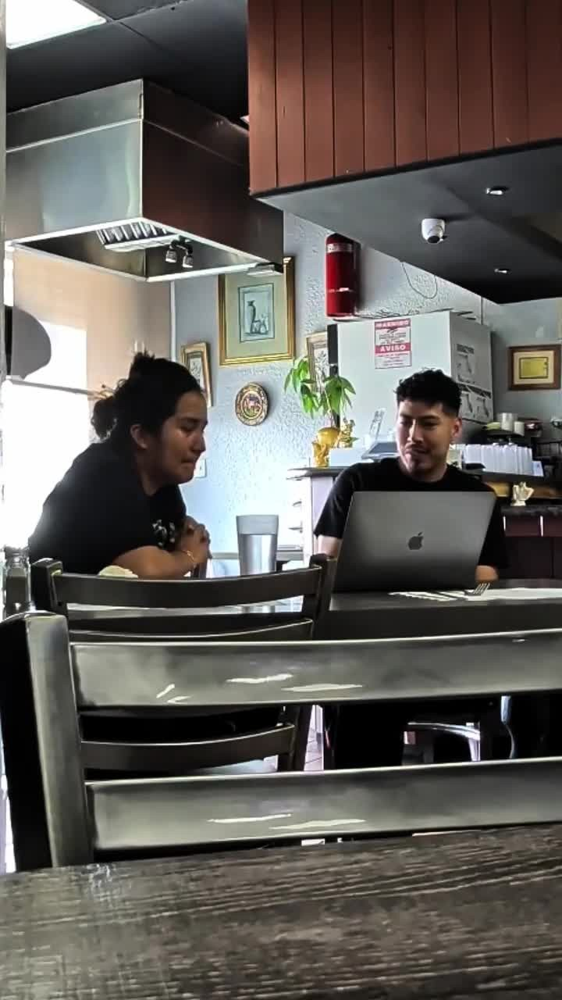

**0:56.0**: End card — Day 5: $1,500

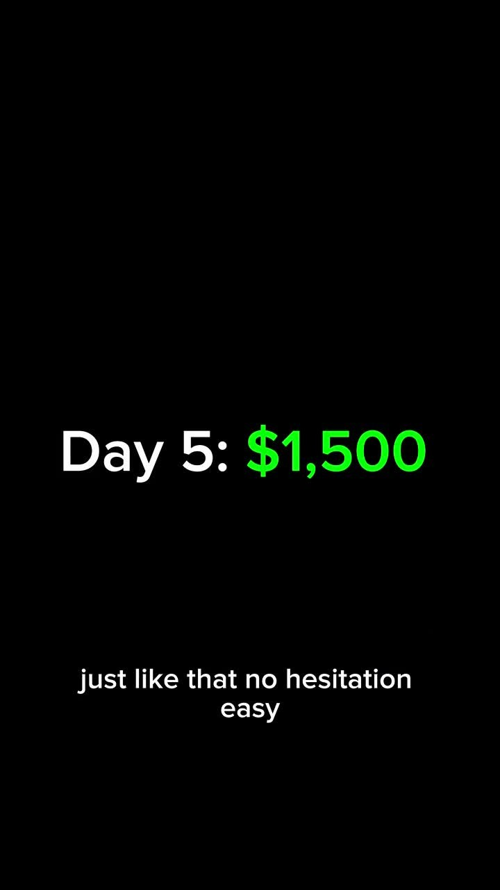

## Faceless & Automated Short-Form Analogue

The talking-head local-business POV is not our primary mode, but the structure translates directly:

1. **Scoreboard hook:** First frame = unfinished Day-N / metric card ("Day 5 and today we made…"), then reveal the number. Remotion text card, no face required.
2. **5-shot B-roll playlist:** For product/app launches, generate a fixed sequence template:
   - (1) Wide establishing still / stock
   - (2) Hero product front
   - (3) "Enter" transition (zoom into UI)
   - (4) L→R Ken Burns across feature screenshots
   - (5) Assembled montage
3. **Proof without face:** Replace overheard client table with screenshot of testimonial / analytics / Stripe — same "proof is overheard not narrated" energy.
4. **Single-number QA assert:** Open card, spoken math, and end card must match. Fail render if they diverge.
5. **Step chips:** On-screen sticky step labels ("Step 1", "Step 2") for faceless explainers — same density as this reel.

**Dependencies (zero paid SaaS):**
- FFmpeg (local)
- Remotion (MIT license)
- Local TTS (Coqui, Piper, or macOS `say`)
- Claude/Codex/Grok basic plans for scripting

## Related

- [REFERENCE_CREATORS.md](../../REFERENCE_CREATORS.md) — @a13x_duke account notes
- [build-in-public-close-reel.md](../../../../shared/openclaw/skills/short-form-viral-content/references/build-in-public-close-reel.md) — close-reel structure, dollar inconsistency caveat

## Transcript

Full timestamped transcript: [transcript.md](transcript.md).
