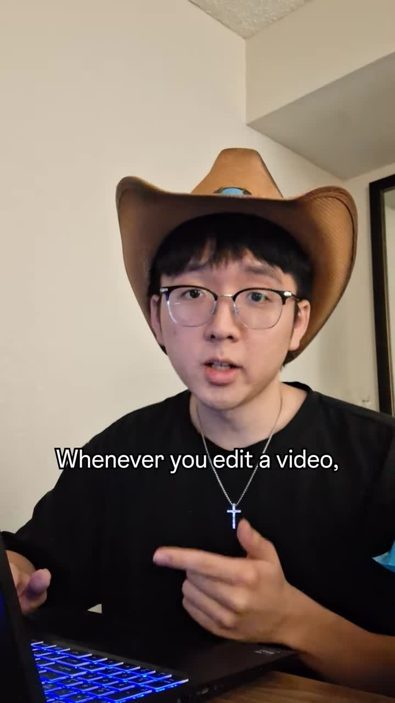
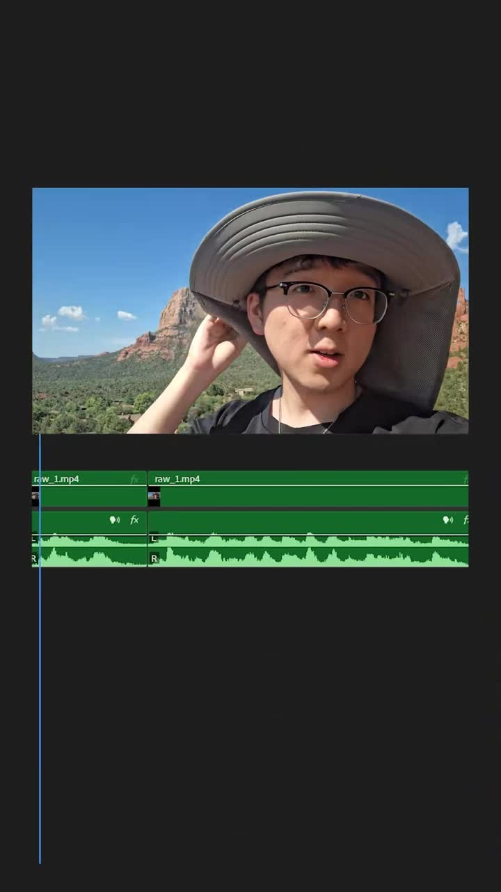
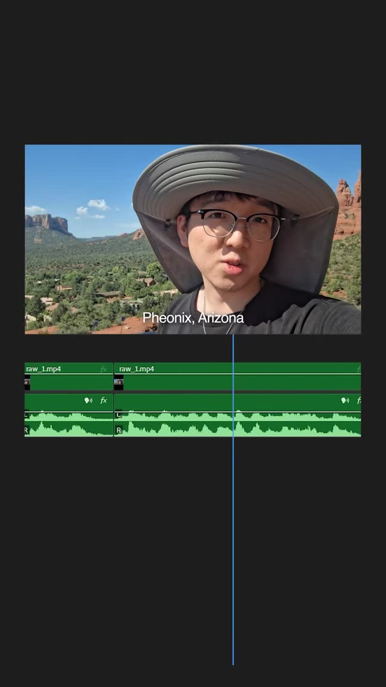
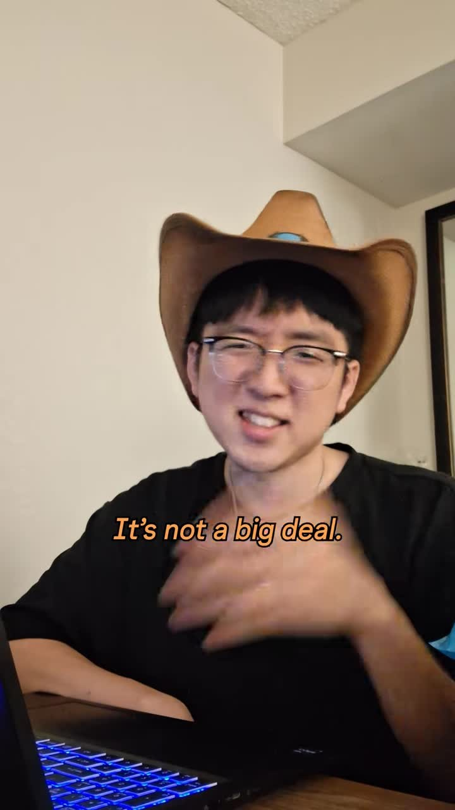
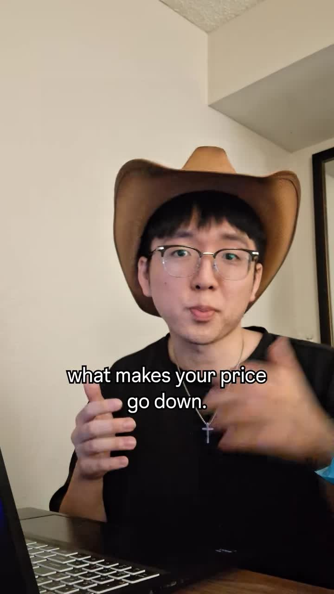
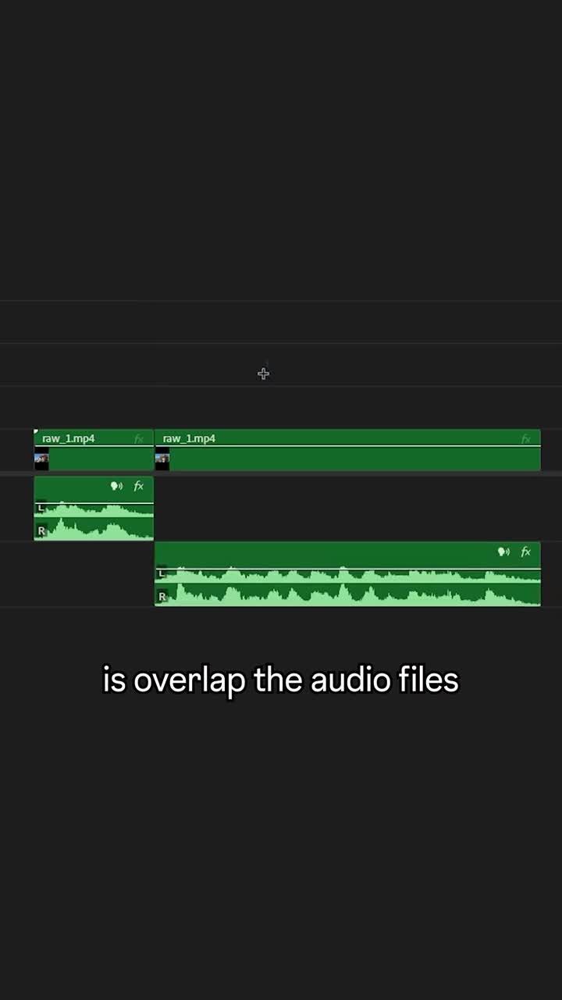
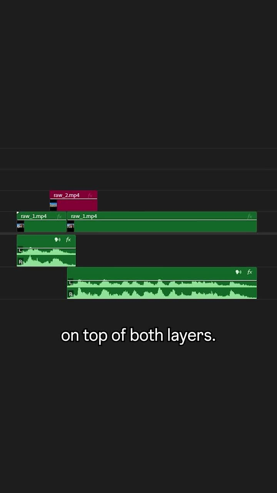
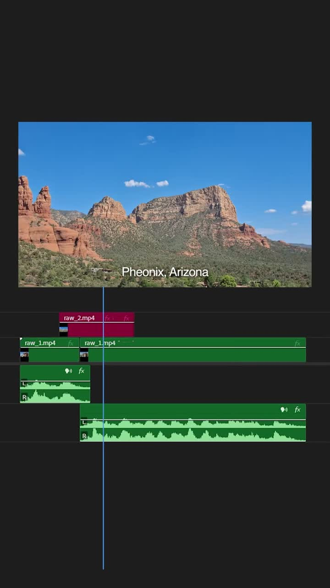
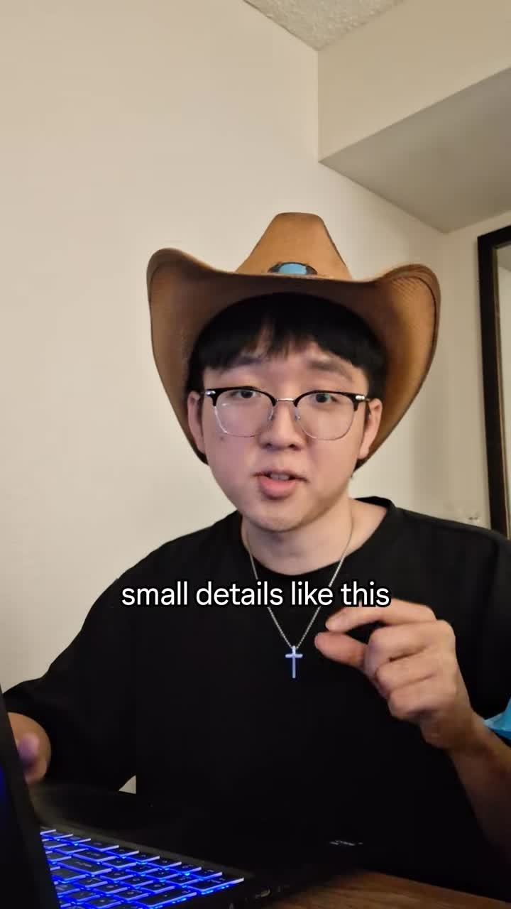

# Jump-cut masking via overlapping audio + B-roll coverage

| | |
|---|---|
| Source | <https://www.tiktok.com/@ginyboi/video/7670579415201500447> |
| Creator | ginyboi (`@ginyboi`) |
| Uploaded | 2026-08-05 |
| Duration | 33s |
| Hashtags | #videoediting #editor |
| Audio | original sound - ginyboi |
| Stats (yt-dlp) | 723.7K views · 77.3K likes |
| Ingested | 2026-11-06 by yeung-assistant (yt-dlp + faster-whisper `small`, language `en`) |

**Caption (verbatim):**

> Whenever you edit a video, there's always that moment where you have to cut out a big chunk and then it looks like this.

## Summary

Cutting a big chunk from A-roll creates a visible jump that "makes your price go down." The fix: (1) overlap / split the audio across the cut (J/L-cut style) so speech is continuous even though picture jumps, and (2) lay B-roll on a higher track covering both sides of the cut so the visual discontinuity is hidden.

## Key takeaways

- **Naked cuts cost credibility.** Even a 0.3s visual jump signals amateur editing and "makes your price go down."
- **Overlap the audio.** J/L-cut the speech so the waveform is continuous across the splice.
- **Cover with B-roll.** Place B-roll on V2 bridging both sides of the cut; the picture jump happens under coverage.
- **Small details separate noob from pro.** This is a finishing-pass QA check.

## Verbatim phrases

> "These small mistakes are what makes your price go down."
>
> "So what you should do in this case is overlap the audio files to remove the jump, and then add a B-roll shot on top of both layers, and it looks like this."
>
> "Remember, small details like this separate a noob and a professional."

## On-screen text

Read by eye from frame exports.

- Demo VO line: "Here I am in Phoenix, Arizona, where the wind and water start carving the story of God's creation."
- Location caption in fixed version: **"Pheonix, Arizona"** (typo in original — spell-check burn-in captions)

## Screenshots

Frames were chosen where the problem and fix are demonstrated, using the transcript, ffmpeg scene-change detection, and manual review. They are 720px wide JPGs.

**0:01.0**: Hook — editing problem setup

**0:05.0**: Jump cut demo — visible discontinuity

**0:09.0**: Awkward jump flagged

**0:12.5**: "This is a big deal"

**0:16.0**: "Makes your price go down"

**0:19.0**: Fix — overlap audio across cut

**0:22.5**: B-roll coverage on V2

**0:26.5**: Fixed version — smooth playback

**0:30.5**: "Pro vs noob" summary

## Faceless & Automated Short-Form Analogue

This is *even more important* for faceless VO pipelines than for talking heads:

1. **Never leave a naked visual cut at a VO splice.** After whisper silence-trim / pause-cut of TTS audio, every edit point is a potential visual jump.
2. **Auto-cover rule:** for every audio edit point, place covering B-roll (stock / Ken-Burns still / app UI) from `t_cut − 0.15s` to `t_cut + 0.35s` (or longer) on V2.
3. **Prefer continuous single-file TTS under segmented visuals.** True L-cut: one audio bed, many picture changes. Jump cuts become a non-issue.
4. **QA gate:** `±0.2s` voiceover splice check — fail render if any hard cut on V1 is uncovered by V2 within ±0.2s of an audio boundary.
5. **Spell-check location captions.** Avoid the "Pheonix" class of burn-in typo.

**Dependencies (zero paid SaaS):**
- FFmpeg (local)
- Remotion (MIT license)
- whisper / faster-whisper for edit-point detection
- Local TTS (Coqui, Piper, or macOS `say`)
- Claude/Codex/Grok basic plans for scripting

## How to apply

1. **Generate continuous TTS.** One audio file for the full script.
2. **Segment visuals.** Ken Burns stills, app UI, stock — 3–5s per segment.
3. **Place B-roll on V2.** Ensure every visual boundary has B-roll spanning ±0.2s.
4. **QA pass.** Script checks: no uncovered splices, no typos in location captions.
5. **Render.**

## Related

- [ginyboi 5-step pipeline](../ginyboi-7678511193039981854/README.md) — the full editing workflow
- [ginyboi stills B-roll](../ginyboi-7678120287228939550/README.md) — Ken Burns, shutter SFX, eye-line

## Transcript

Full timestamped transcript: [transcript.md](transcript.md).
