# Turn static photos into dynamic B-roll (Ken Burns + camera SFX + eye-line)

| | |
|---|---|
| Source | <https://www.tiktok.com/@ginyboi/video/7678120287228939550> |
| Creator | ginyboi (`@ginyboi`) |
| Uploaded | 2026-08-25 |
| Duration | 38s |
| Hashtags | #videoediting #editor |
| Audio | original sound - ginyboi |
| Stats (yt-dlp) | 29.7K views · 3.0K likes |
| Ingested | 2026-11-06 by yeung-assistant (yt-dlp + faster-whisper `small`, language `en`) |

**Caption (verbatim):**

> What should editors do if they don't have enough videos to use as B-roll?

## Summary

When there's no video B-roll, static photos can fill the gap — if you add motion, sound, and visual continuity. Three techniques: (1) Ken Burns zoom/pan via position keyframes so momentum never dies, (2) camera shutter SFX on every still cut to sell "looking through memories," and (3) keep subjects' eyes aligned on rapidly cut portraits so viewers don't get motion-sick.

## Key takeaways

- **Add motion.** Zoom or sideways pan via position keyframes. Even 4–8% movement over 3–5s keeps a still from feeling static.
- **Camera shutter SFX.** Fire a shutter click on every still-to-still cut. It sells "memory" and works especially well for storytelling, travel, finance explainers.
- **Eye-line alignment.** When rapidly cutting between portrait photos, draw an eye-line guide and lock subjects' eyes to the same Y coordinate. Prevents visual fatigue.

## Verbatim phrases

> "Even though pictures are static, you can still add movement by zooming in or moving them sideways like this using position keyframes."
>
> "This helps maintain the momentum throughout the video."
>
> "Every time you cut to a picture, add a camera sound effect like this. It gives the feeling of looking through memories, which can be really powerful for storytelling content."
>
> "If you are rapidly cutting between multiple pictures, draw an eye line and position the subject's eyes along the same line. That way, the audience don't feel tired."

## On-screen text

Read by eye from frame exports.

- **"How to edit without B-roll shots"** — hook text (frame ~1.0s)
- Chapter numbers and tips overlaid on demos

## Screenshots

Frames were chosen where a new tip or on-screen demo starts, using the transcript, ffmpeg scene-change detection, and manual review. They are 720px wide JPGs.

**0:01.0**: Hook — "How to edit without B-roll shots"

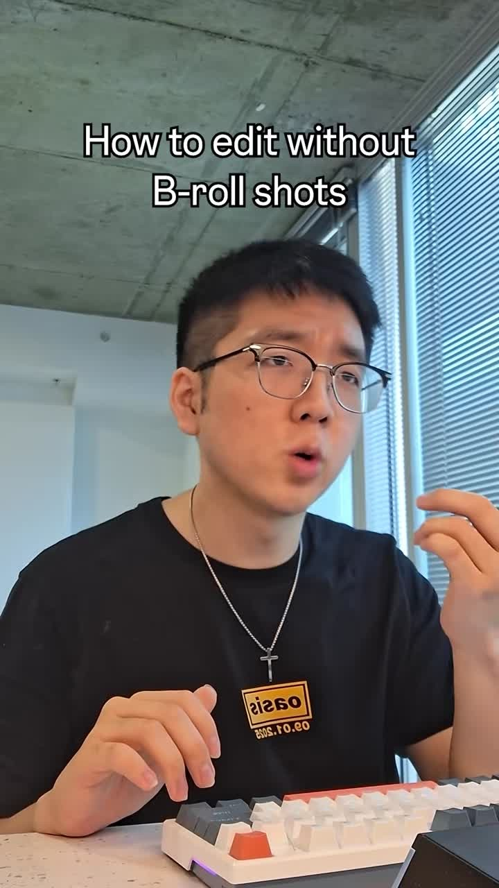

**0:05.0**: Static pictures demo

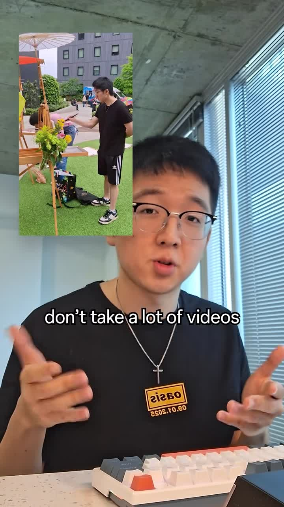

**0:08.5**: Motion demo — zoom/pan keyframes

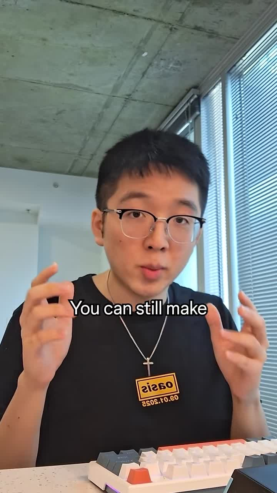

**0:12.5**: Step 1 — Add motion

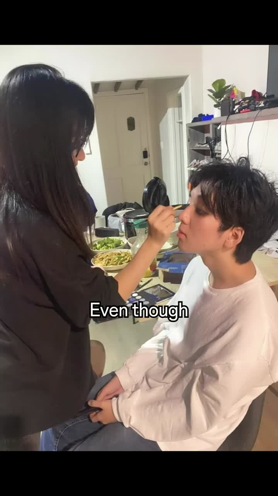

**0:15.5**: Position keyframes in Premiere

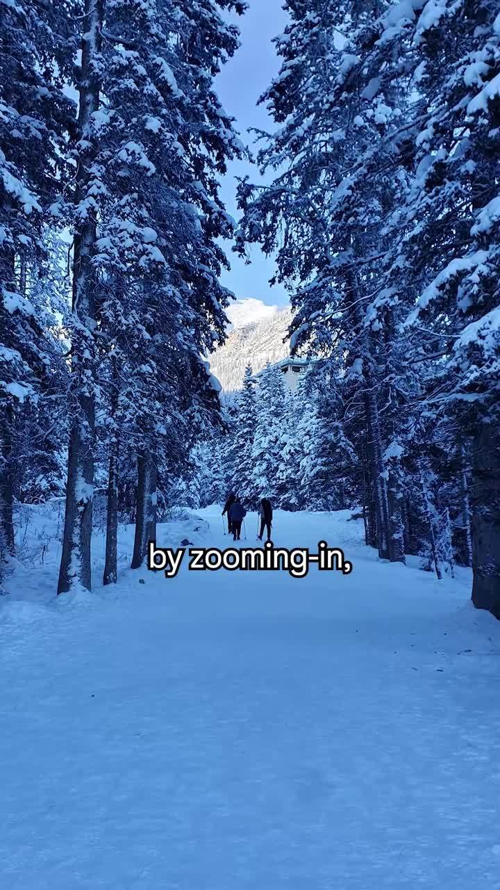

**0:19.0**: Momentum maintained

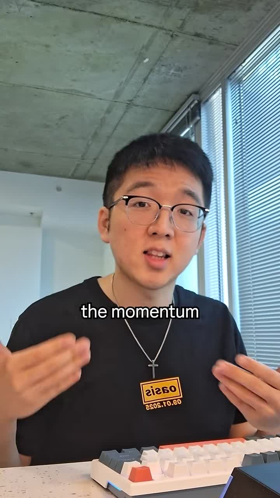

**0:22.5**: Step 2 — Sound effects

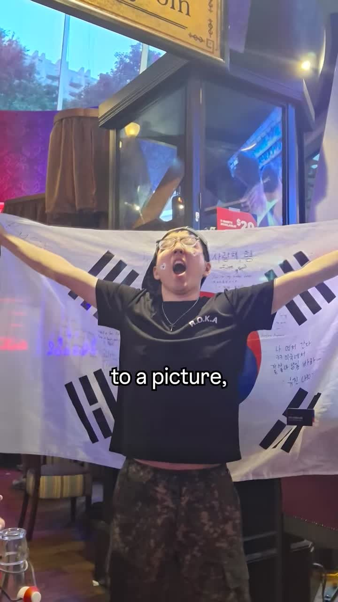

**0:26.0**: Camera shutter SFX waveform

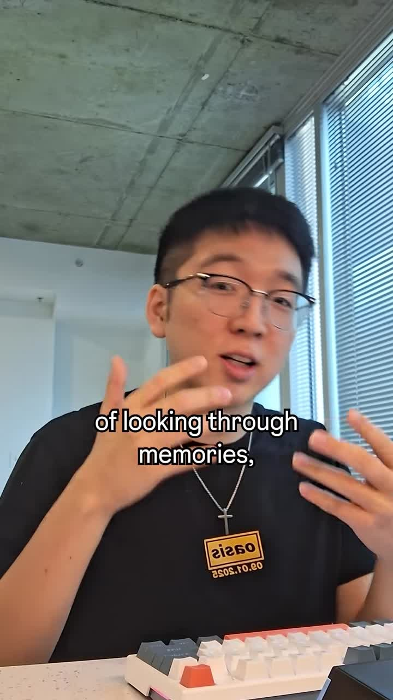

**0:30.5**: Step 3 — Eye-line alignment

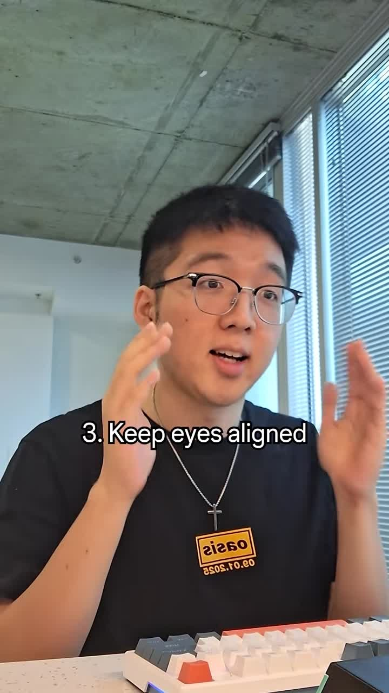

**0:34.0**: Eye-line demo in Premiere

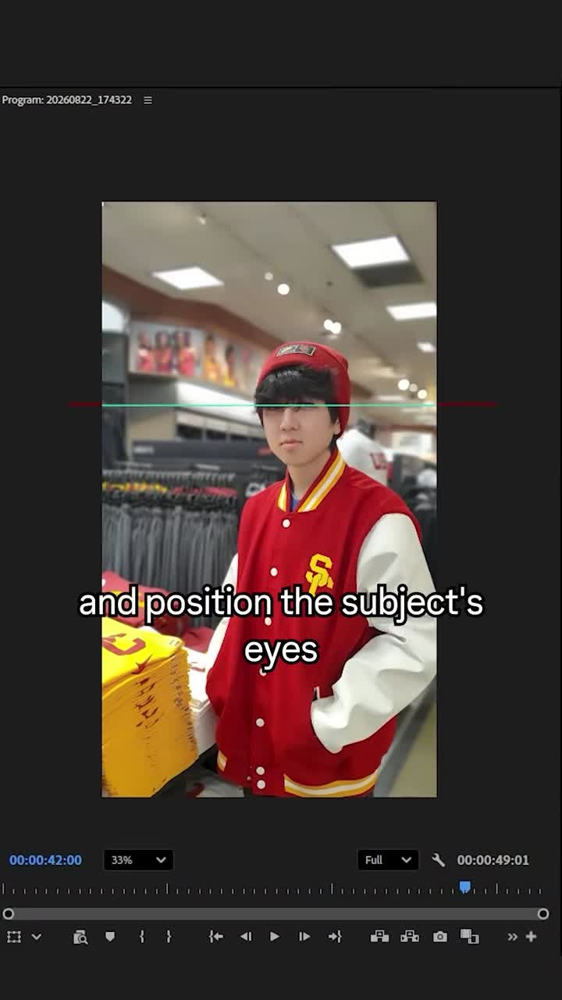

**0:37.0**: End

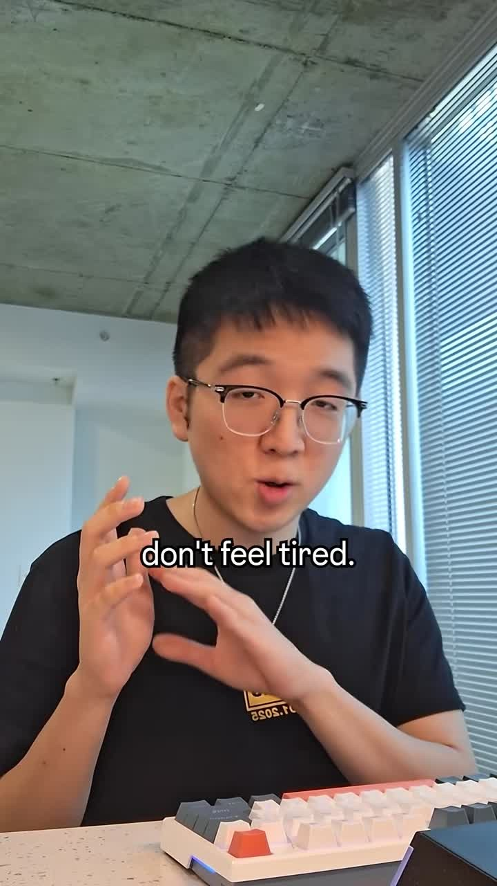

## Faceless & Automated Short-Form Analogue

This is *directly* the faceless stills pipeline:

1. **Asset pool:** local / CC0 stills, app screenshots, icons, the "B-roll space" from ginyboi's [5-step video](../ginyboi-7678511193039981854/README.md).
2. **Ken Burns automation (Remotion / FFmpeg):** for each still, randomize `{scale: 1.0→1.08 | 1.08→1.0, xPan: ±4%}` over 3–5s. Never hold a fully static frame >1.5s.
3. **Camera shutter SFX:** on every still-to-still cut, mix a local `camera-shutter.wav` (Freesound / CC0) at −12 to −18 LUFS under VO.
4. **Portrait eye-line alignment:** MediaPipe / face-detect → crop so eye midpoint hits a fixed Y (upper-third). Reject or re-crop cuts that jump eye-line >5% of frame height.
5. **Target niches:** finance explainers, travel facts, product memories — anywhere the "looking through memories" feel fits.

**Dependencies (zero paid SaaS):**
- FFmpeg (local)
- Remotion (MIT license)
- MediaPipe face detection (Apache 2.0)
- Freesound CC0 shutter SFX
- Claude/Codex/Grok basic plans for scripting

## How to apply

1. **Collect stills.** App screenshots, stock photos, icons.
2. **Apply Ken Burns to each.** Random zoom direction + small pan; 3–5s duration per still.
3. **Add shutter SFX on cuts.** Global rule in the render config.
4. **Eye-line QA for portraits.** Run face-detect, compute eye Y, reject if variance > threshold.
5. **Combine with VO.** One continuous TTS bed under segmented visuals.

## Related

- [ginyboi 5-step pipeline](../ginyboi-7678511193039981854/README.md) — B-roll space concept
- [ginyboi jump-cut masking](../ginyboi-7670579415201500447/README.md) — audio overlap + B-roll coverage

## Transcript

Full timestamped transcript: [transcript.md](transcript.md).
