# Sound is the third hook — 9 SFX jobs for short-form editing

| | |
|---|---|
| Source | <https://www.tiktok.com/@kienobimedia/video/7678711626492562718> |
| Creator | Kien Nguyen (`@kienobimedia`) |
| Uploaded | 2026-08-27 |
| Duration | 34s |
| Hashtags | #videoediting #capcut |
| Audio | original sound - Kien Nguyen |
| Stats (yt-dlp) | 1.8M views · 158.6K likes · 767 comments |
| Ingested | 2026-11-06 by yeung-assistant (yt-dlp + TikTok captions + faster-whisper `small`) |

**Caption (verbatim):**

> Sound is a hook too… sound is the third hook most creators skip…

## Summary

Most creators obsess over words and visuals but skip **sound as the third hook**. A sharp SFX in the first second can stop the scroll before the caption lands. Sound also paces reveals, cuts, and transitions — and is the fastest path to a shareable feeling (comedy, hype, payoff). The video demonstrates nine concrete SFX jobs with on-screen waveforms and labels.

## Key takeaways

- **Sound stops the scroll.** One transient SFX in the first second grabs attention before the caption lands.
- **Sound paces the edit.** Transitions, reveals, and payoffs feel tighter when they land on a sound cue.
- **Sound carries emotion.** Comedy, failure, celebration, suspense — each has a sound class that hits faster than words.

## 9 SFX jobs (on-screen labels + spoken purposes)

| # | SFX label | Purpose |
|---|---|---|
| 1 | **Fahh** | Grab attention |
| 2 | *(transition whoosh)* | Make transition feel smooth |
| 3 | **Dun Dun Dun** | Reveal something unexpected |
| 4 | **Orchestral Hit** | Make a point feel important |
| 5 | **Bonk** | Add comedy and break tension |
| 6 | **Sad Trombone** | Call out a mistake or bad example |
| 7 | **Tada** / **Impact** | Celebrate a win or result |
| 8 | **Impact** | Build hype before payoff |
| 9 | **Violin Screech** | Build suspense |

## On-screen text

Read by eye from frame exports (tesseract unavailable on the ingest box).

- Opening list (scrolling): each SFX name + purpose appears as an animated line
- Waveform + labeled SFX overlays on each beat

## Screenshots

Frames were chosen where each SFX job is demonstrated, using the transcript, ffmpeg scene-change detection, and manual review. They are 720px wide JPGs.

**0:00.5**: Hook — numbered list begins scrolling

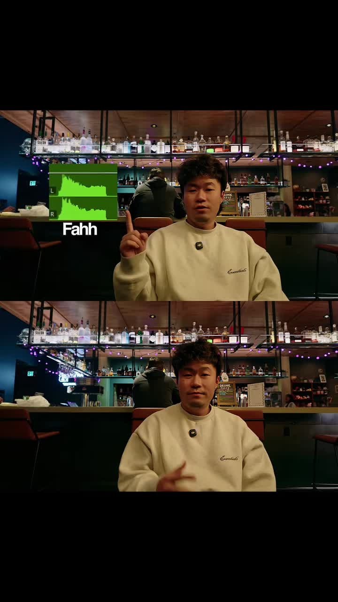

**0:03.0**: SFX 1 — Fahh (grab attention)

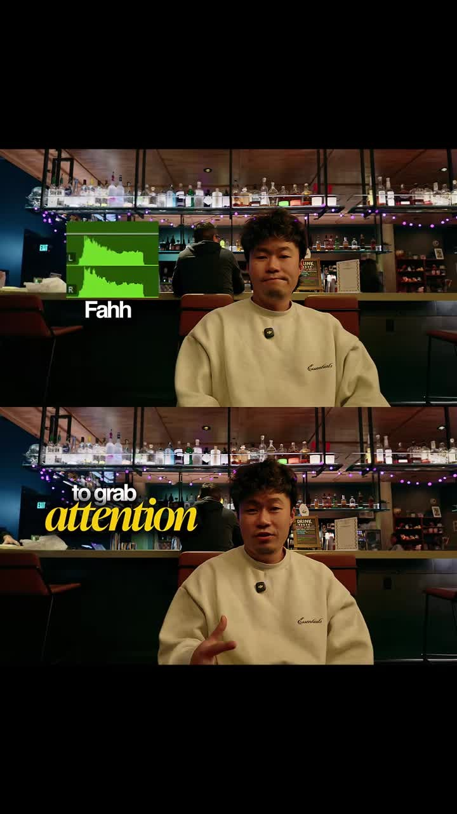

**0:06.5**: SFX 2 — whoosh transition

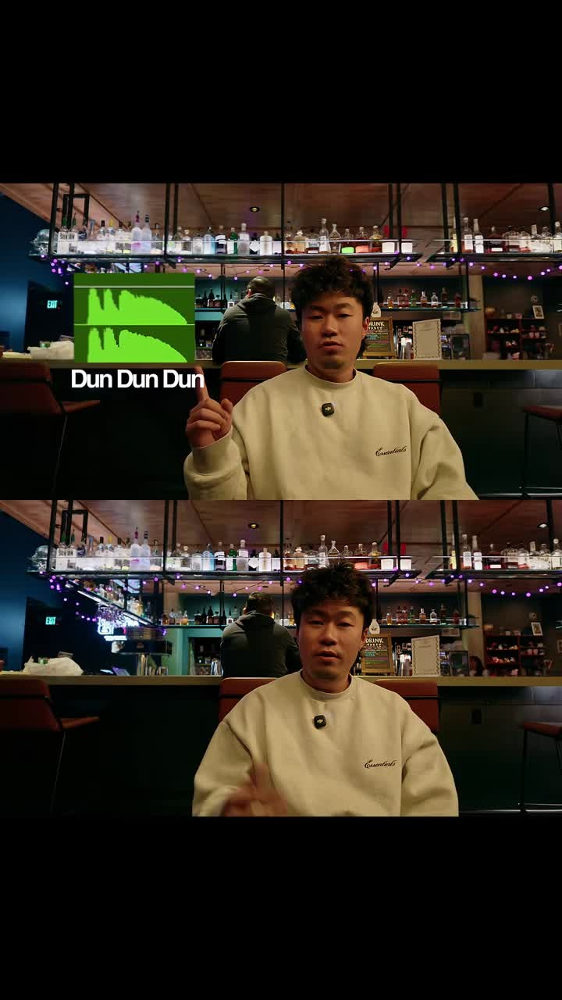

**0:09.5**: SFX 3 — Dun Dun Dun (reveal)

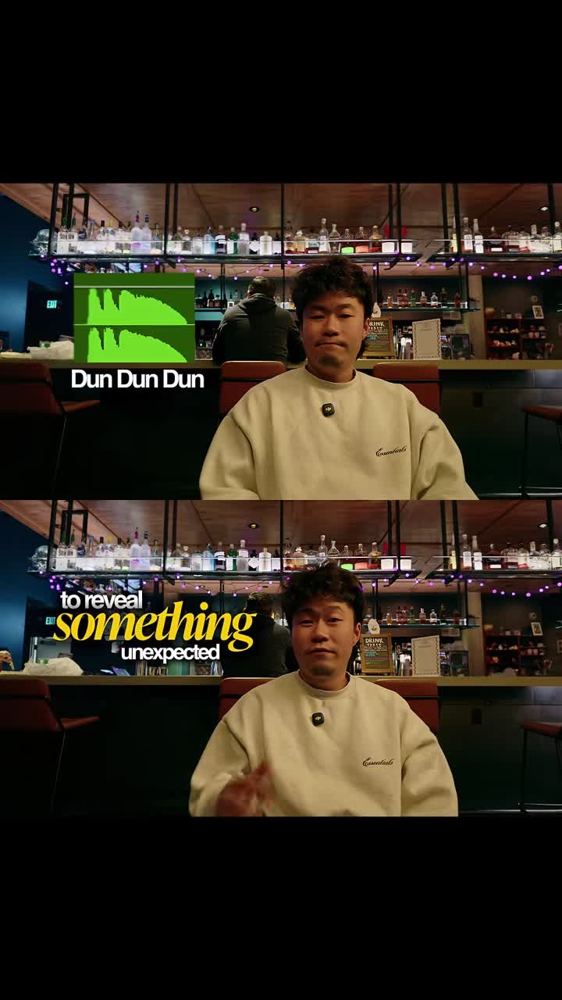

**0:12.0**: SFX 4 — Orchestral Hit (important point)

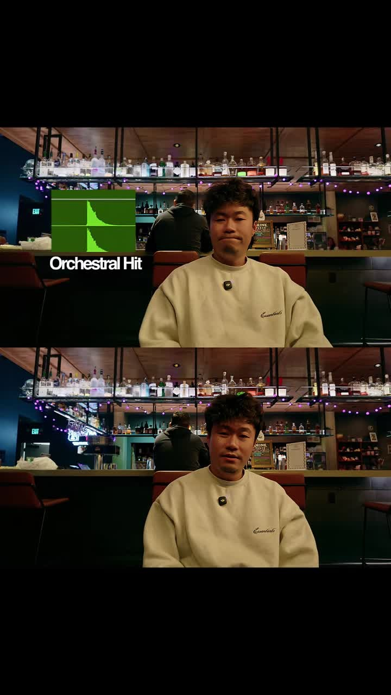

**0:15.0**: SFX 5 — Bonk (comedy)

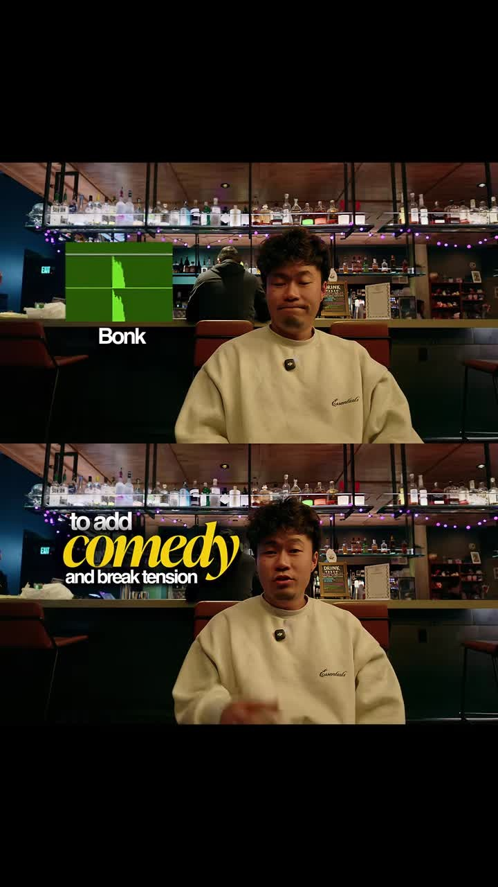

**0:18.5**: SFX 6 — Sad Trombone (bad example)

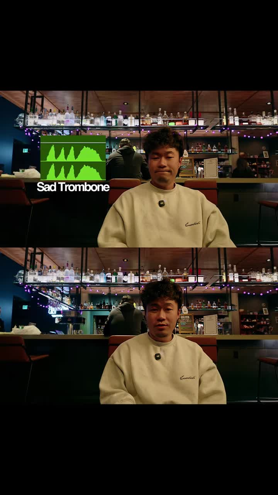

**0:21.5**: SFX 7 — Tada / Impact (win)

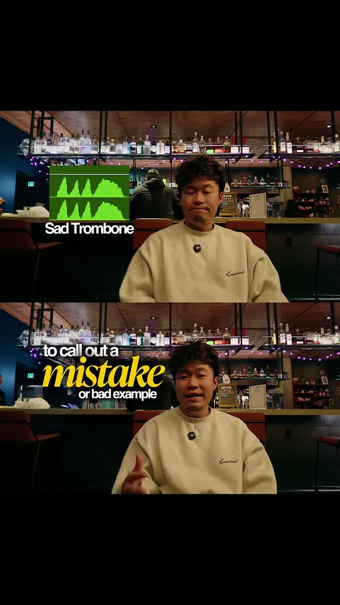

**0:24.5**: SFX 8 — Tada (celebrate)

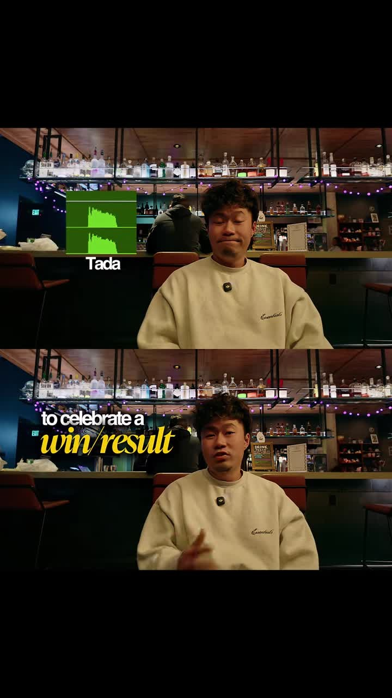

**0:27.5**: SFX 9 — Impact (hype before payoff)

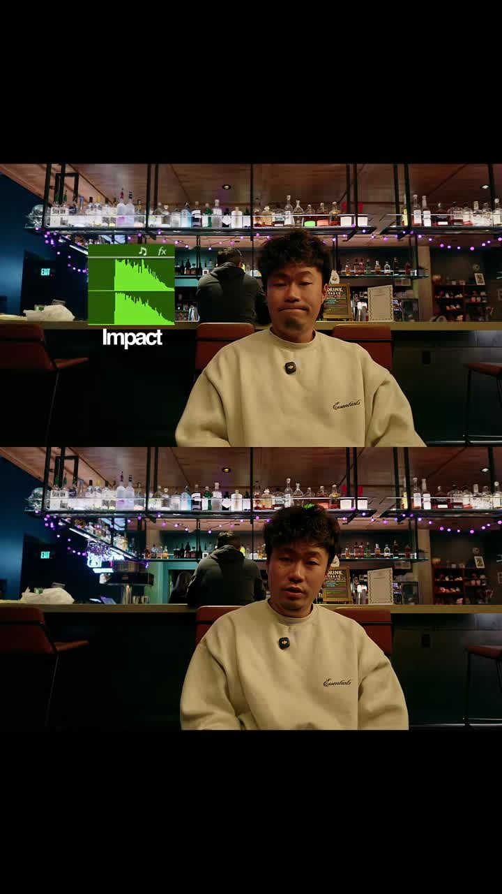

**0:31.0**: SFX 10 — Violin screech / suspense

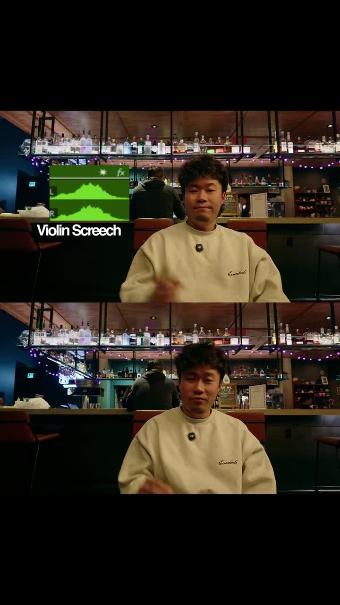

**0:33.5**: End frame

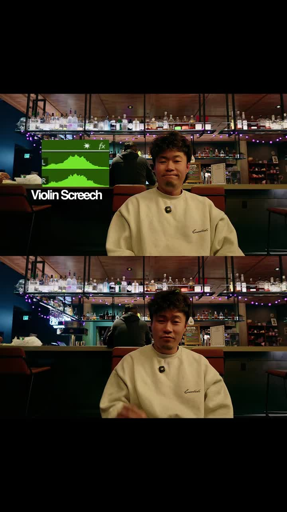

## Faceless & Automated Short-Form Analogue

Map each narrative beat in the faceless pipeline (claw-shorts / Remotion / FFmpeg) to a local SFX asset from a free pack (Freesound, Pixabay Audio, or CC0 libraries — no paid libraries, no ElevenLabs):

| Narrative beat | SFX class | Pipeline rule |
|---|---|---|
| Hook / first 1s | `fahh` / impact | Fire high-transient SFX + bold keyword caption ≤1.0s |
| Scene / asset swap | whoosh | Sync SFX peak to Remotion/FFmpeg cut timestamp |
| Reveal / twist | `dun-dun-dun` | Gate on transcript keyword (`but`, `actually`, reveal noun) |
| Key claim | orchestral hit | Fire on numeric or claim tokens |
| Joke / fail | bonk / sad trombone | Fire on negative-example segments |
| Win / CTA / metric | tada / impact | Fire on $ / % / "result" beats |
| Pre-payoff riser | impact / riser | 0.4–0.8s before payoff frame |
| Suspense hold | violin screech | Hold under black/scoreboard card |

**Implementation:**
Represent cues as an `sfx_cues.json` alongside the script: `[{t, class, label}, ...]` consumed by Remotion `<Audio>` or FFmpeg `-i sfx.wav -filter_complex amix`. Pair with Ken-Burns stills / app UI B-roll space — no talking head required.

**Dependencies (zero paid SaaS):**
- FFmpeg (local)
- Remotion (MIT license)
- Freesound / Pixabay Audio CC0 packs
- Claude/Codex/Grok basic plans for script gen

## How to apply

1. **Pre-score the script.** After the LLM draft, run a beat-detection pass that tags reveal, joke, win, and suspense tokens.
2. **Build a local SFX asset folder.** Nine subfolders (`fahh/`, `whoosh/`, `dun-dun-dun/`, `orchestral-hit/`, `bonk/`, `sad-trombone/`, `tada/`, `impact/`, `violin-screech/`), each with 2–4 variations.
3. **Emit `sfx_cues.json` from the script parser.** Each cue: `{t: seconds, class: folder-name, label: optional-on-screen-text}`.
4. **Render SFX.** Remotion sequence reads cues; FFmpeg fallback via `amix` filter.
5. **QA rule.** Ensure at least one SFX fires in the first 1s and no two high-transient SFX overlap within 0.3s.

## Transcript

Full timestamped transcript: [transcript.md](transcript.md).
