# How editors & creators should add captions

| | |
|---|---|
| Source | <https://www.tiktok.com/@ginyboi/video/7703008350983769375> |
| Creator | ginyboi (@ginyboi) |
| Uploaded | 2026-11-01 |
| Duration | 33s |
| Views (at ingest) | ~10.3k |
| Hashtags | (none) |
| Audio | original sound - ginyboi |
| Ingested | 2026-11-07 by yeung-assistant (yt-dlp + faster-whisper `small`, language `en`) |

**Caption (verbatim):**

> How editors & creators should add captions

## Summary

ginyboi argues that defaulting to generic "TikTok captions" after a long edit is a common editor mistake. Captions are part of storytelling — their length, style, and motion should match the audience. Young teens get short, bouncy animated captions; professionals (doctors, lawyers) get clean sans-serif fonts and simple layouts. Workflow rule: finish the video first, then spend extra time finding the right caption style.

## Key takeaways

- Captions are not just accessibility text; they are a design/storytelling layer (length, style, motion).
- Do **not** slap on generic TikTok-style captions as an afterthought after a long edit.
- Match caption style to audience age/role:
  - Young teens → short captions + bouncy animations (attention span).
  - Professionals (doctors, lawyers) → clean sans-serif fonts + simple layouts (authority).
- Finish the edit first, then deliberately pick caption style (worth the extra minutes).
- Reinforces the same audience-aware caption rule from his earlier 5-step pipeline video (`ginyboi-7678511193039981854`).

## Verbatim phrases and script

> "One of the biggest mistakes I see from editors is the captions. They build a nice long video for two hours and then add TikTok captions. Just please don't do that."

> "Captions aren't just for reading. They are part of the video telling the story through their length, style and motion."

> "For example, if your audience are young teenagers, they use short captions with bouncy animations to keep their attention."

> "Or if your clients are professionals like doctors or lawyers, use clean sans serif fonts and simple layouts to reflect their expertise."

> "That's why I always recommend to finish your video first, then spend some extra time finding the right caption style for your content. That's how you finish a perfect video."

## On-screen text

Read from frames by eye (no OCR). Burned-in word-by-word captions track the voiceover throughout.

- Hook caption: "One of the biggest mistakes I see from editors is the captions."
- Demo anti-pattern over a "Tokyo Vlog" Premiere preview: **"ADD TIKTOK CAPTIONS."** (TIKTOK in pink/magenta; ADD/CAPTIONS in white)
- "Just please, don't do that." / "Captions aren't just for reading."
- Storytelling demo captions: "They are part of the video" / "telling the story" / "STYLE" / "MOTION"
- Teen example: short captions + "animations" / "their attention"
- Pro example: "use clean sans-serif fonts" / "and simple layouts" over doctor and lawyer B-roll
- Workflow close: "finish your video first," / "then spend some extra time" / "finding the right caption style"
- Meme card: orange **"comic sanssss"** above a frustrated desk meme; white text **"finding the right caption style"**
- Close: "That's how you finish a perfect video."

## Screenshots

Frames chosen where a tip, audience contrast, or key overlay appears. Unedited 720px JPGs.

**0:00.4**: Hook: biggest caption mistake editors make

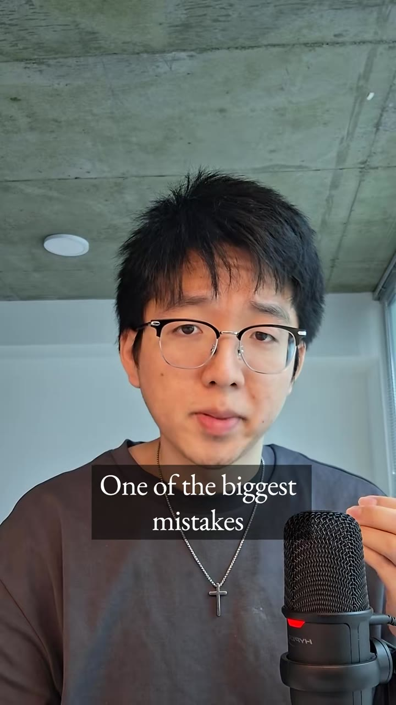

**0:02.0**: Red arrows pointing at default TikTok-style captions on laptop

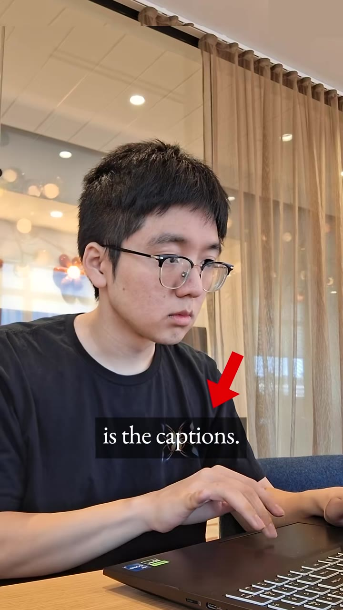

**0:06.0**: Anti-pattern demo: ADD TIKTOK CAPTIONS over Tokyo Vlog

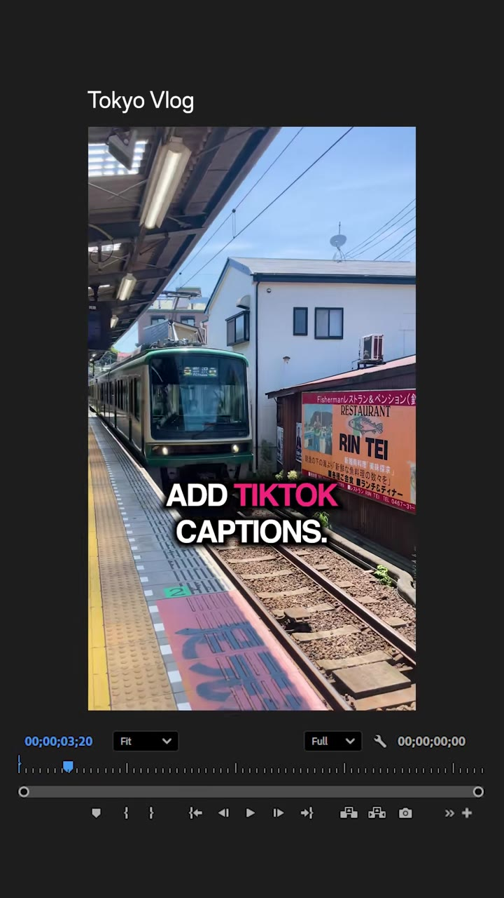

**0:08.0**: Captions aren't just for reading

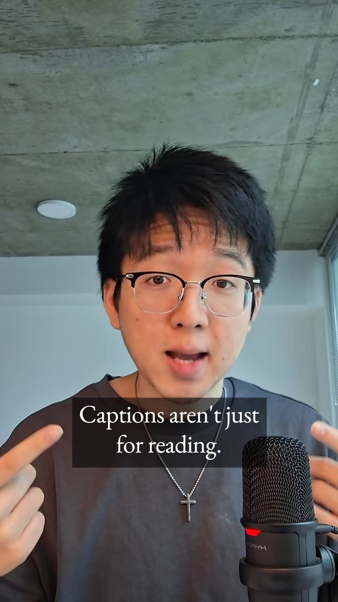

**0:12.0**: Captions tell the story through length, style, and motion

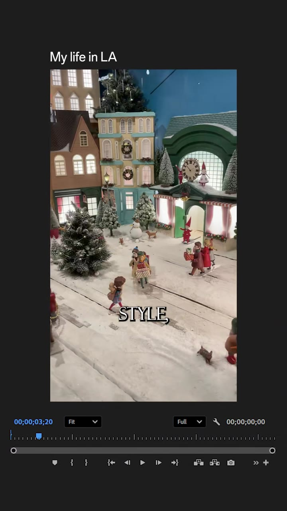

**0:16.0**: Young teens: short captions

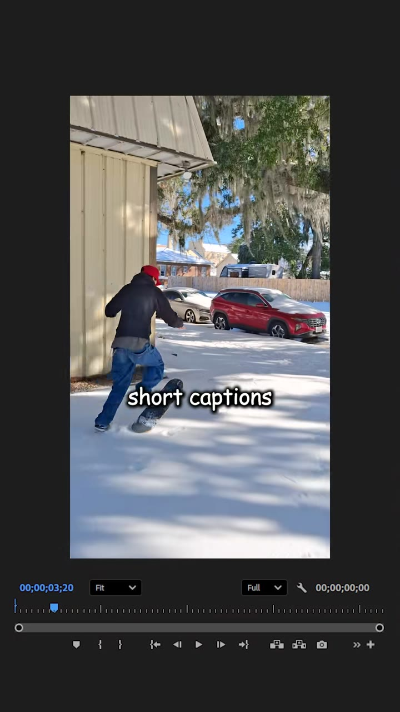

**0:18.0**: Young teens: bouncy animations to keep attention

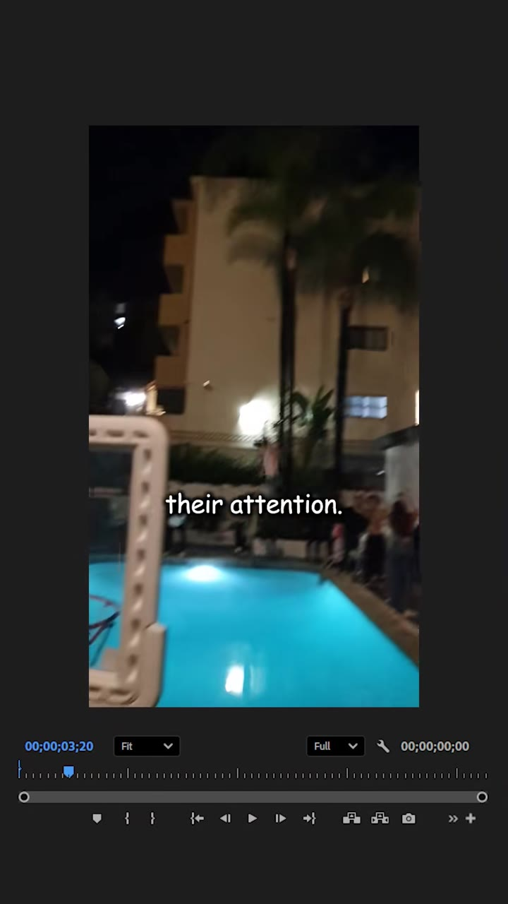

**0:20.0**: Professionals (doctors/lawyers) need a different caption style

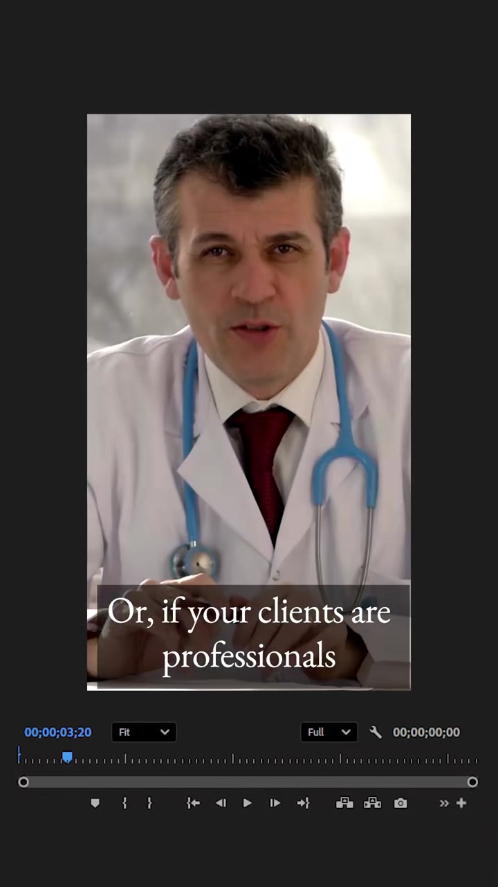

**0:22.0**: Use clean sans-serif fonts for pro audiences

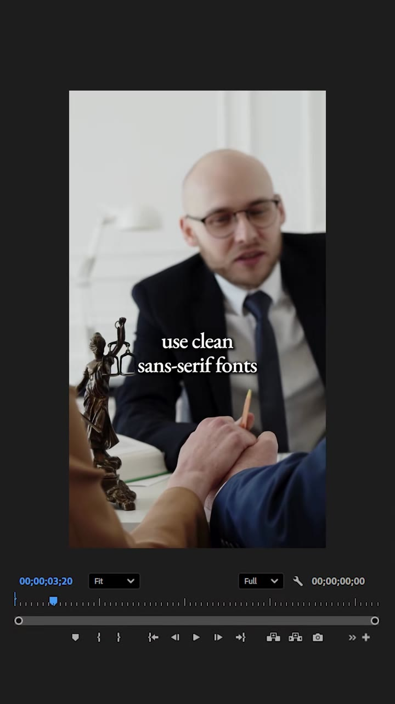

**0:24.0**: Simple layouts for professional clients

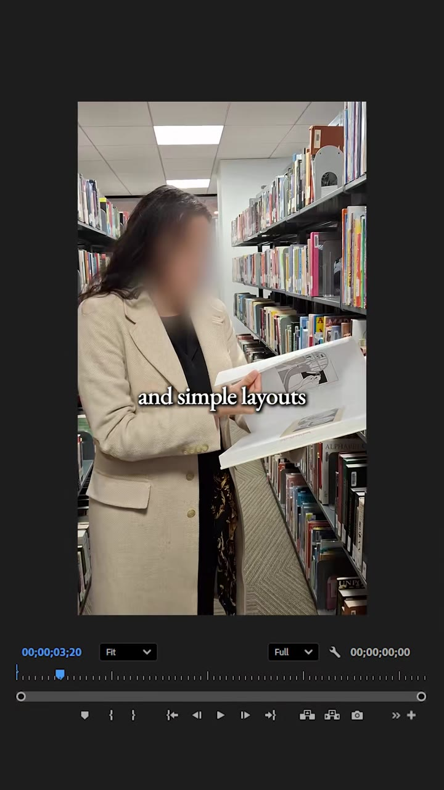

**0:28.0**: Finish the video first, then pick caption style

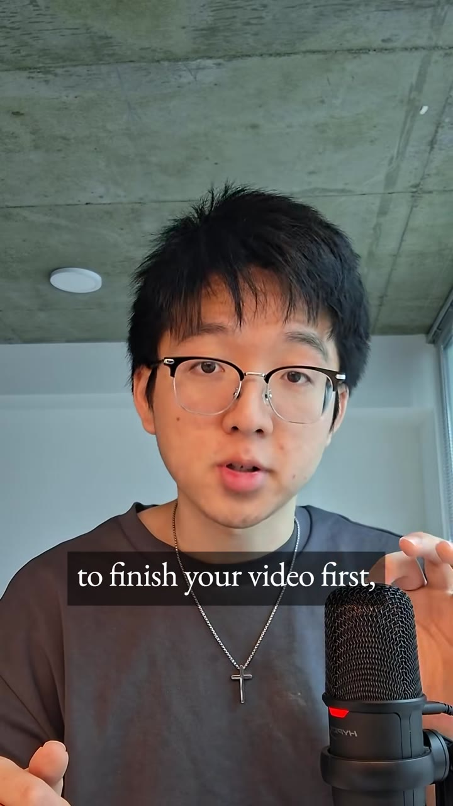

**0:30.0**: Meme: comic sanssss / finding the right caption style

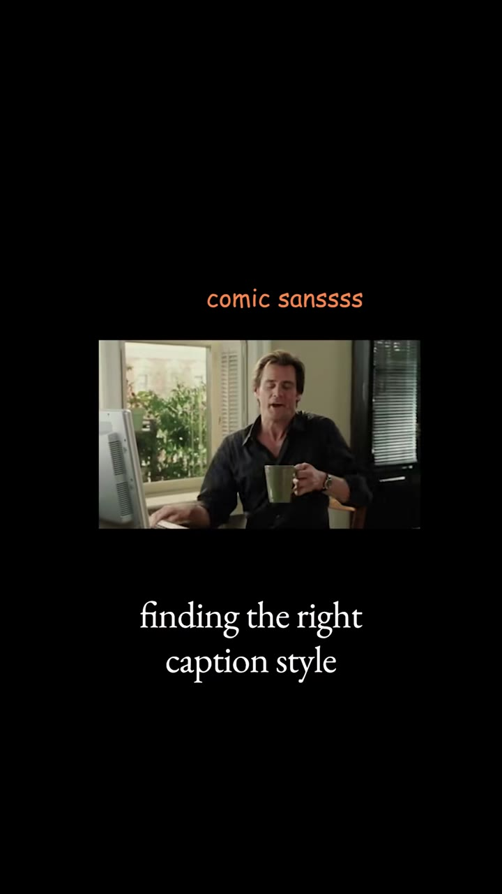

**0:31.5**: Close: that's how you finish a perfect video

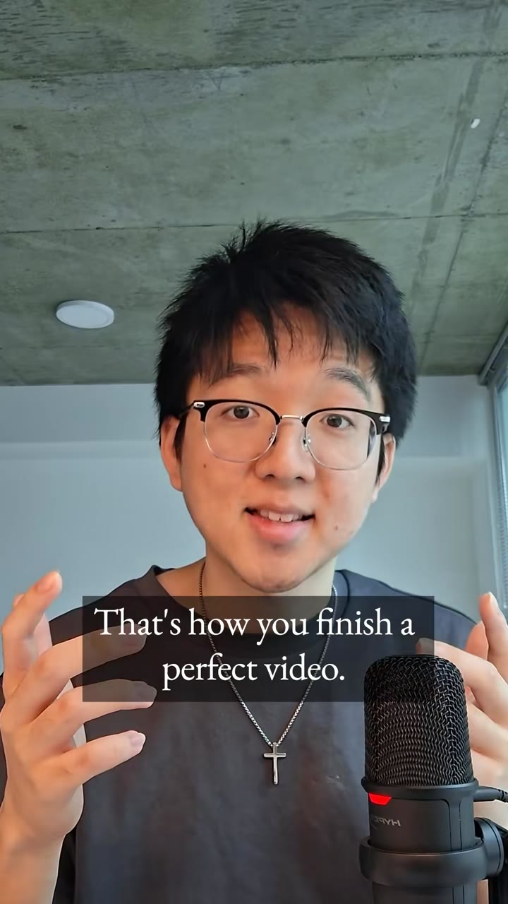

## How to apply

- **Caption presets in a faceless pipeline:** keep at least two styles — `young` (1–3 words, bounce/pop animation) and `pro` (short full lines, static sans-serif). Pick by channel audience, not by habit.
- **Do not default to CapCut/TikTok auto-caption look** for every niche; that is the anti-pattern called out here.
- **Order of operations:** script → cut → B-roll/visuals → **then** caption style. Caption styling is a deliberate last pass, not a dump of auto captions.
- Pairs with `ginyboi-7678511193039981854` (5-step pipeline): this video is a deeper cut of step 4 (captions).

## Transcript

Full timestamped transcript: [transcript.md](transcript.md).
