# How creators should post every day

| | |
|---|---|
| Source | <https://www.tiktok.com/@ginyboi/video/7704173307838352671> |
| Creator | ginyboi (@ginyboi) |
| Uploaded | 2026-11-04 |
| Duration | 49s |
| Views (at ingest) | ~3.1k |
| Hashtags | (none) |
| Audio | original sound - ginyboi |
| Ingested | 2026-11-07 by yeung-assistant (yt-dlp + faster-whisper `small`, language `en`) |

**Caption (verbatim):**

> how creators should post every day

## Summary

Responding to a comment ("How do I post consistently? I'm too busy working"), ginyboi gives three tips for daily posting while keeping a job or business: (1) **minimal editing** — under 1 hour/day; talking-head + B-roll + captions only; skip fancy effects and motion graphics; (2) **weekends** — batch-write and film 2–3 hours every Saturday for the whole week, then spend minimal weekday time editing; (3) **hire an editor** if still too busy — price your own hour (example $50) and pay an editor less ($25–$30/hr) so daily output continues while personal content time stays under an hour.

## Key takeaways

- Consistency is the #1 obstacle for creators who already have a job or business.
- Cap creation time at **≤1 hour/day**.
- Minimum viable edit: record talking, add B-roll/"viral shots", add captions. Skip fancy effects and motion graphics.
- **Batch on Saturday:** write + film everything for the week in a 2–3 hour block; weekdays = light edit only.
- If still overloaded, **outsource editing**: compare your hourly value to editor rates; example math uses **$50/hr (your time) vs $25–$30/hr (editor)**.
- Goal stated: produce new videos every day while spending less than one hour on content.

## Verbatim phrases and script

> "How do I post content consistently? I'm too busy. Okay, so this is probably the biggest obstacle for new creators, especially if you already have a job or running a business. Here are three tips I want to give you."

> "Don't spend more than one hour a day creating content. All you need to do is record yourself talking and add some viral shots and captions. That's it. Don't waste time adding fancy effects or motion graphics. That's not important at all."

> "Write and film all your videos on Saturdays instead of filming new content every day. This way you can spend minimal time each day simply editing the videos you prepared over the weekend. Grab two to three hours every Saturday and film everything for the week."

> "Now if you're still too busy hire an editor. Calculate how much your time is worth based on your salary or income and invest part of that money to hire an editor. That way you can produce new videos every day while spending less than an hour on content."

## On-screen text

Read from frames by eye (no OCR). Numbered tip cards and the pay math are the key data frames.

### Comment hook
- TikTok-style comment from `newbie_cr`: **"How do I post consistently? I'm too busy working"**

### 3-tip list (verbatim cards)
1. **Minimal editing**
2. **Weekends**
3. **Editor**

### Other overlays
- "Here are 3 tips I want to give you:"
- "Don't spend more than 1 hour/day creating content."
- Talking-head + B-roll + captions demo frames
- Large **"DON'T"** / **"OR MOTION"** warning against fancy effects / motion graphics
- Week strip (Sun–Sat) with red arrow on **Sat** + Mr. Incredible desk meme; text **"all your videos on Saturdays,"**
- "Grab 2~3 hours every Saturday," / "and film everything for the week."
- Pay math (kept unredacted; public on-screen figures):
  - **"1 hour ="**
  - **"1 hour = $50"** (green)
  - **"r = $50"** with arrow down to **"$25~$30/hr"** (editor rate vs your time value)
- Close: "produce new videos everyday, while spending less than 1 hour on content."

## Screenshots

Frames chosen for the hook comment, each numbered tip card, the Saturday batch graphic, and the pay math. Unedited 720px JPGs (payout/rate figures kept).

**0:00.4**: Hook comment: How do I post consistently? I'm too busy working

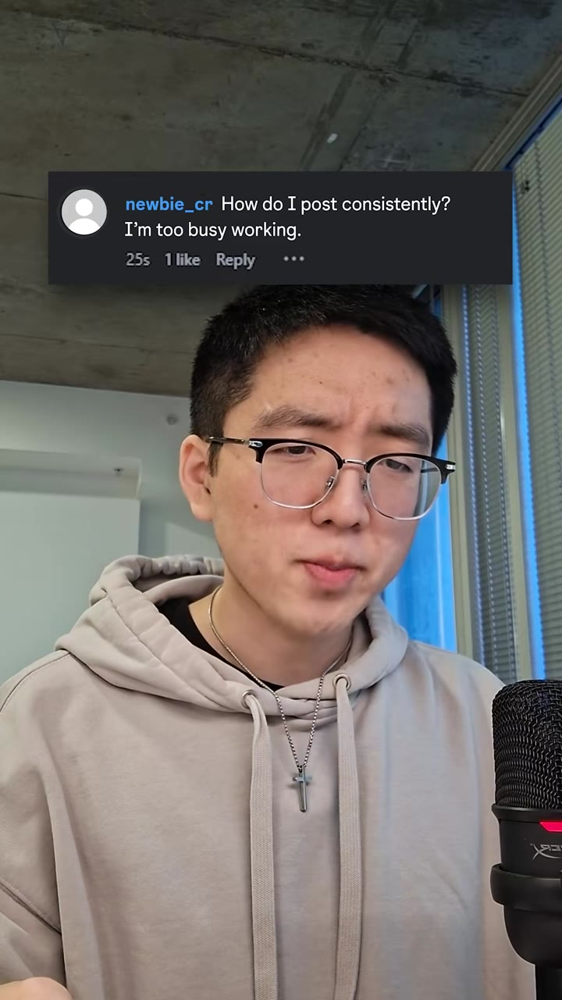

**0:03.7**: Biggest obstacle for new creators (Pepe meme card)

**0:08.4**: Here are 3 tips (holds up three fingers)

**0:10.0**: Tip card 1: Minimal editing

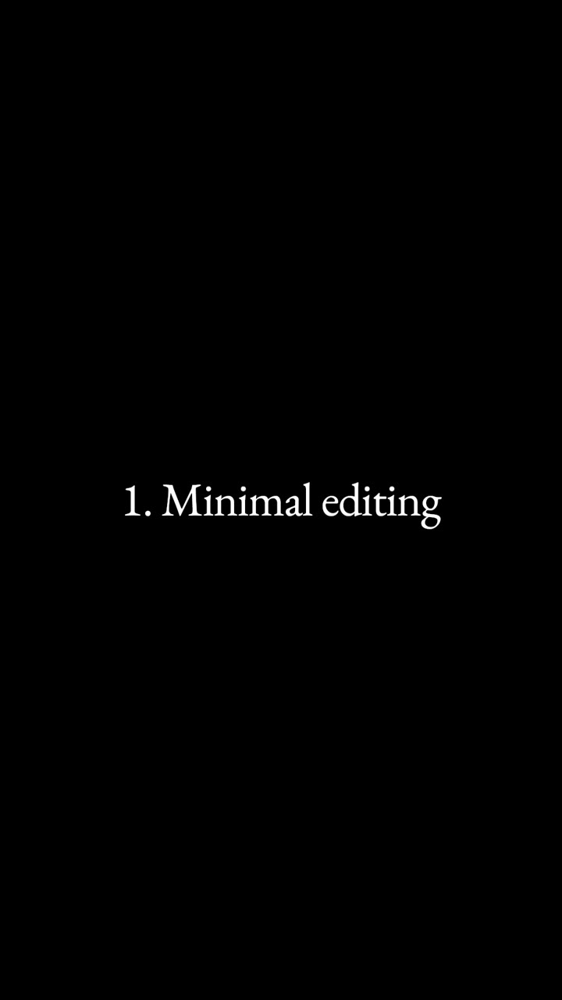

**0:11.0**: Don't spend more than 1 hour/day creating content

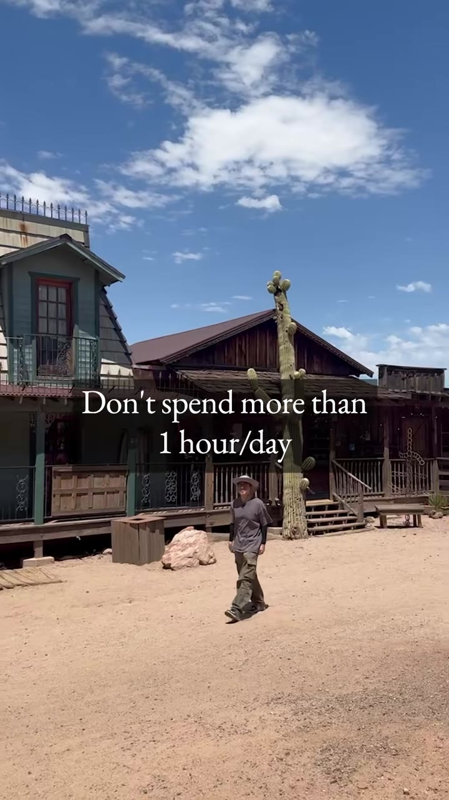

**0:16.0**: Just talking-head + B-roll + captions

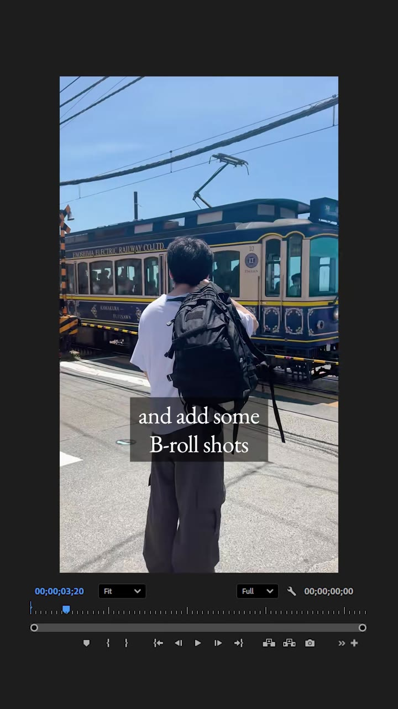

**0:18.0**: DON'T add fancy effects

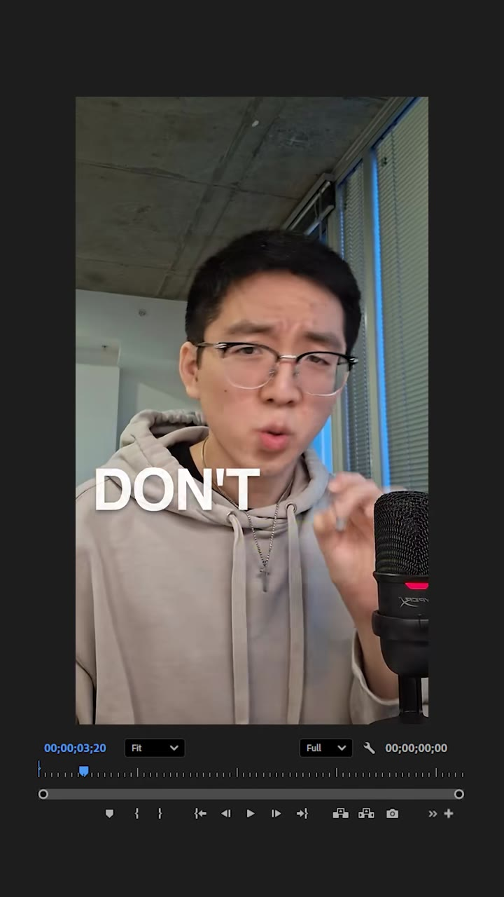

**0:20.0**: DON'T add motion graphics either

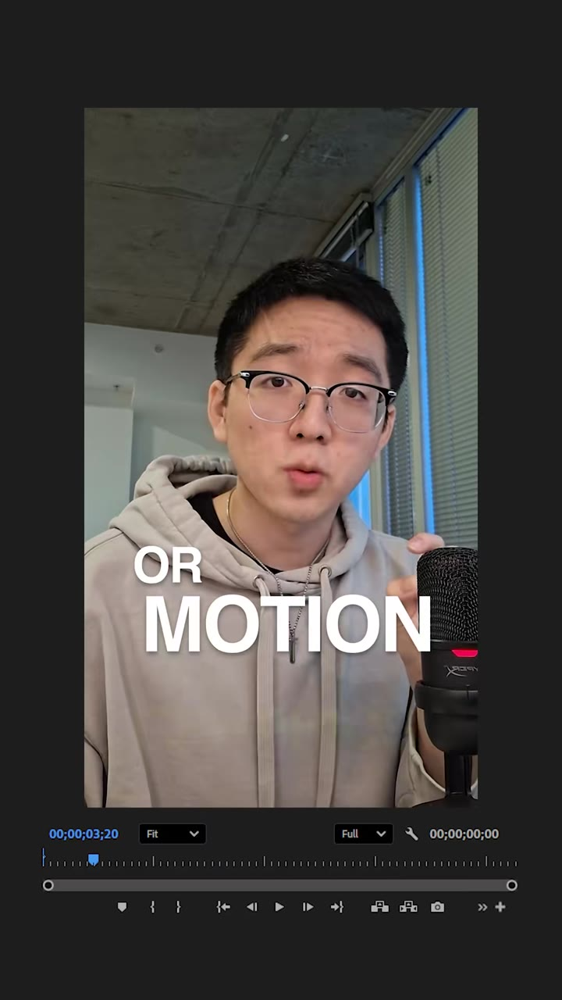

**0:22.0**: Tip card 2: Weekends

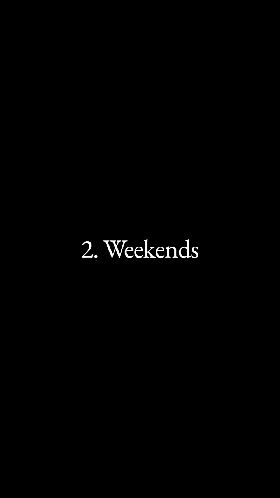

**0:24.0**: Batch all videos on Saturdays (week strip + Mr Incredible)

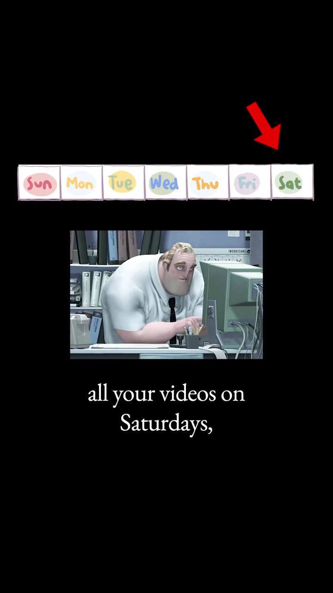

**0:32.0**: Grab 2-3 hours every Saturday and film the week

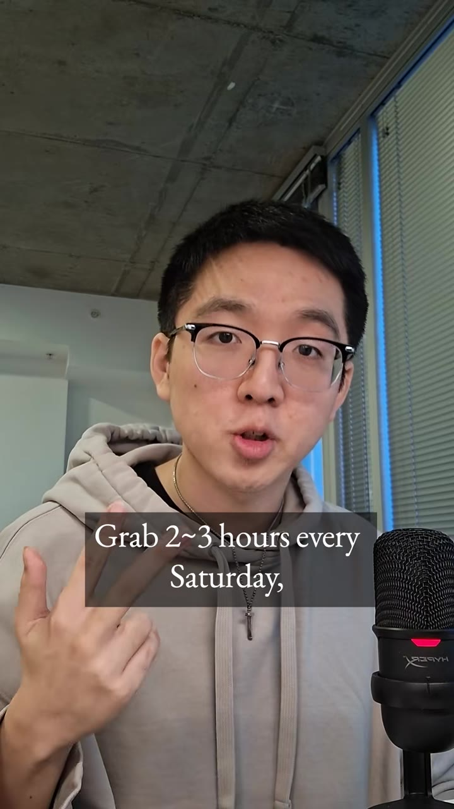

**0:35.4**: Tip card 3: Editor

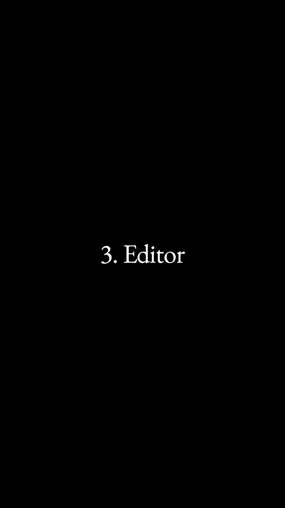

**0:38.0**: If still too busy, hire an editor

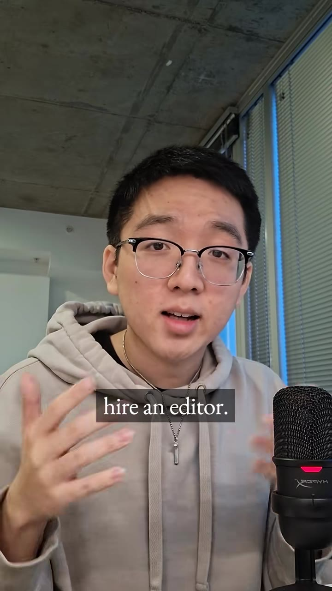

**0:40.0**: 1 hour = $50 (your time value example)

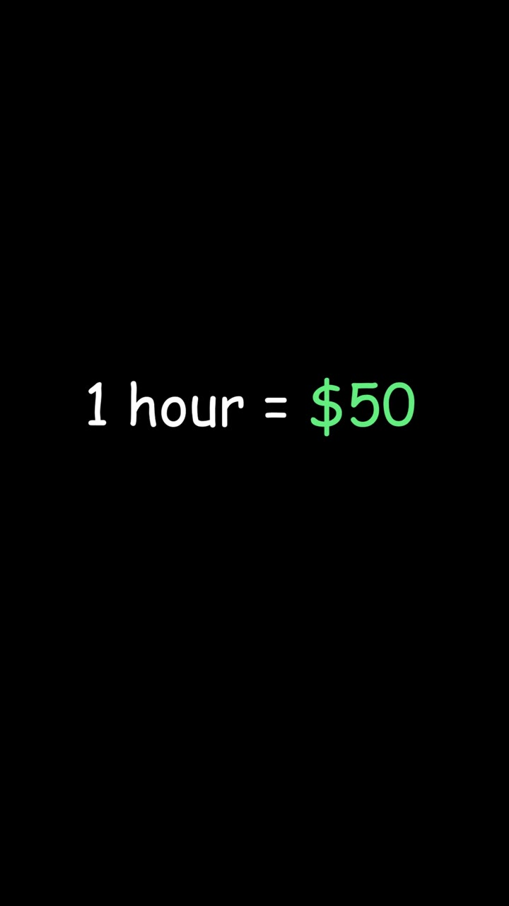

**0:44.0**: Pay editor $25-$30/hr vs your $50/hr time value

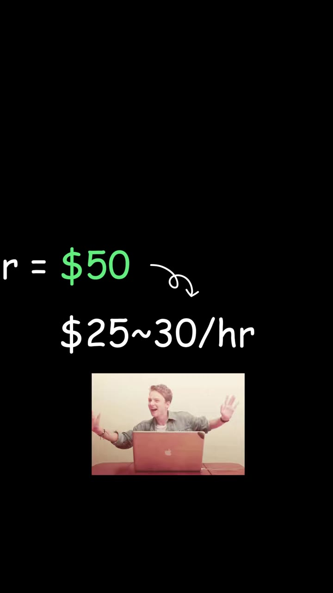

**0:48.0**: Close: daily posts while spending less than 1 hour

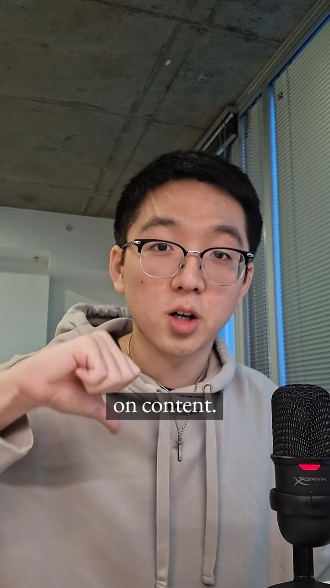

## How to apply

- **Faceless / automated channels:** the "minimal editing" rule maps cleanly — TTS/voice + stock/generated B-roll + captions; skip motion-graphics rabbit holes. Daily cadence without daily film time.
- **Batching:** one weekend capture/script block → weekday publish queue. Fits a ≤10–15% bandwidth side project.
- **Outsource vs automate:** his hire-an-editor math is the human version; for claw-dj / app marketing, the parallel is spending a bit of compute/automation so *your* hour stays free. Use your real hourly value, not his $50 example, when deciding what to automate.
- Pairs with `themekhicarter-7696704990320004366` (value + consistency over virality) and `ginyboi-7678511193039981854` (edit pipeline): this video is the **cadence/ops** layer.

## Transcript

Full timestamped transcript: [transcript.md](transcript.md).
