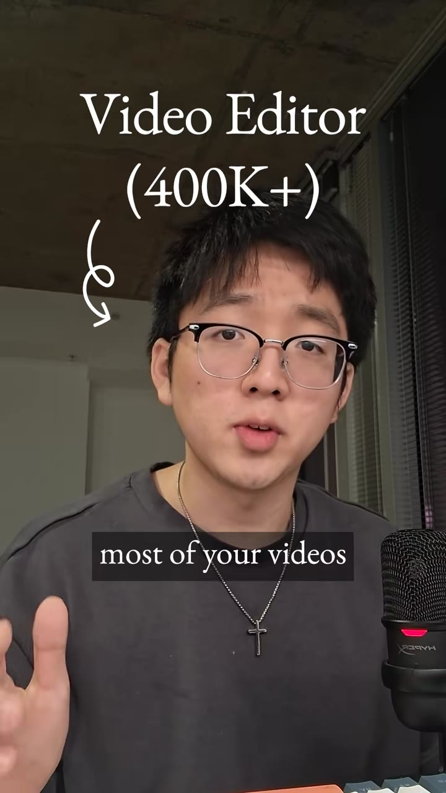
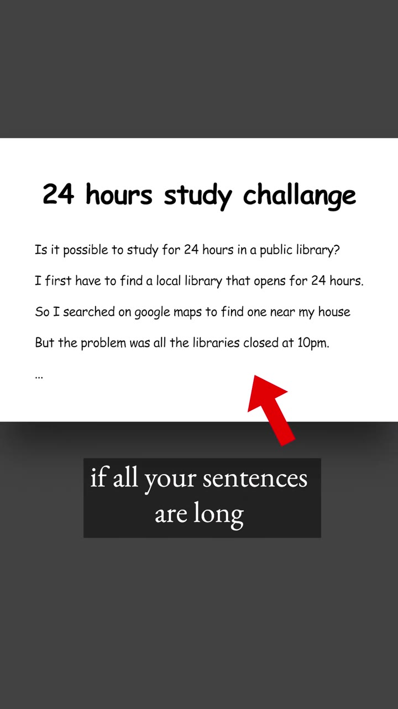
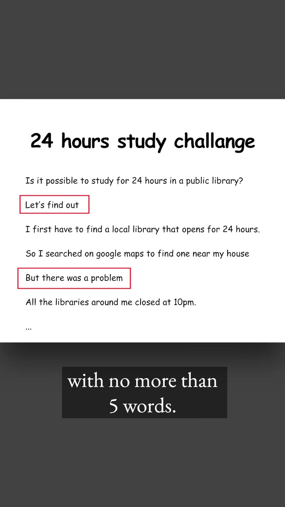
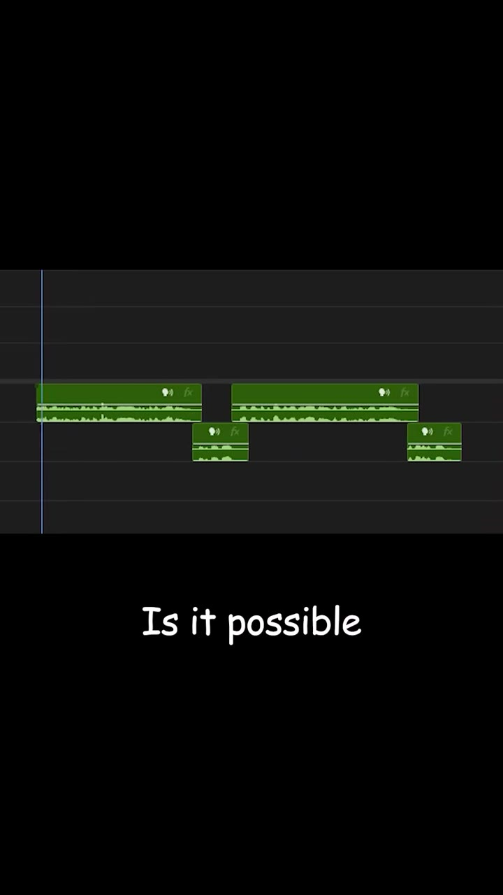
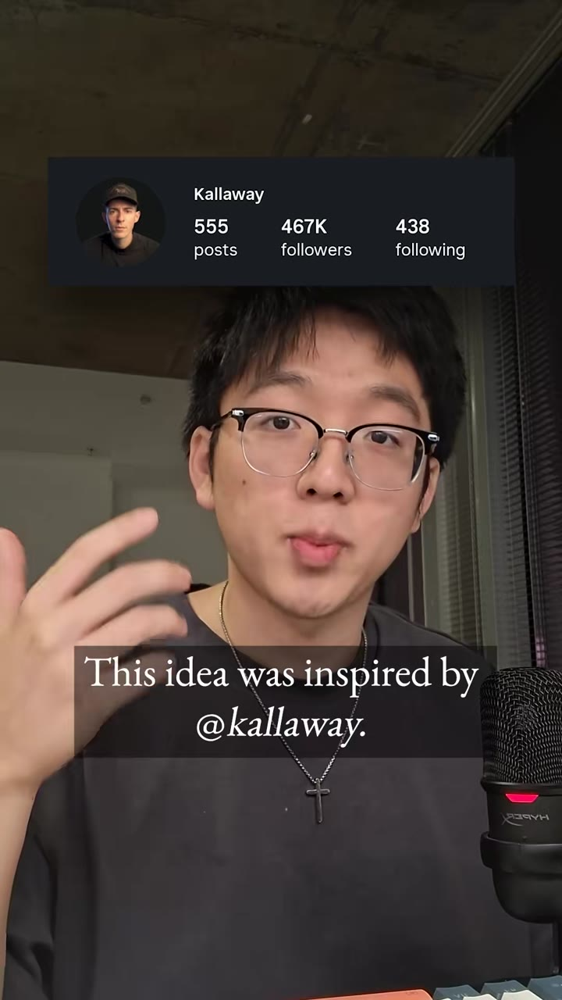

# Script rhythm: mix in short sentences (5 words or fewer)

| | |
|---|---|
| Source | <https://www.tiktok.com/@ginyboi/video/7699704871389383967> |
| Creator | ginyboi (@ginyboi) |
| Uploaded | 2026-10-23 |
| Duration | 29s |
| Hashtags | (none) |
| Audio | original sound - ginyboi |
| Ingested | 2026-10-31 by yeung-assistant (weekly creator check-in; yt-dlp + faster-whisper `small`, language `en`) |

**Caption (verbatim):**

> how creators should write their scripts

## Summary

Most videos sound boring because the script has no rhythm: every sentence is long. Insert short sentences of no more than five words between the long ones to create a long, short, long, short pattern. He demonstrates with a "24 hours study challenge" script where "Let's find out." and "But there was a problem." break up the long lines, then reads it aloud so you can hear the difference. He credits the idea to the creator @kallaway.

## Key takeaways

- Boring delivery is usually a script problem, not a voice problem: uniform long sentences flatten the rhythm.
- After every long sentence or two, add a short one of 5 words or fewer.
- Short lines work best as turns in the story: a question resolved ("Let's find out."), a conflict ("But there was a problem.").
- The long/short alternation is audible in the waveform and timeline too, so it also creates natural cut points.

## On-screen text

Read from the frames by eye (no OCR on the ingest box). `[...]` marks text that was hidden or is uncertain.

- "Video Editor (400K+)" label on the hook frame
- Script card "24 hours study challange" (sic): "Is it possible to study for 24 hours in a public library? / Let's find out / I first have to find a local library that opens for 24 hours. / So I searched on google maps to find one near my house / But there was a problem / All the libraries around me closed at 10pm. / ..." with the two short lines boxed in red
- Captions: "with no more than 5 words.", "giving your script", "This idea was inspired by @kallaway."

## Screenshots

Frames were chosen where a new tip, list, or settings panel appears, using the transcript and a 2-second contact sheet, then reviewed by eye. They are unedited 720px-wide JPGs.

**0:01.0**: Hook: "most of your videos..." (creator labels himself "Video Editor (400K+)")

**0:05.0**: A script made only of long sentences, flagged as the boring version

**0:11.0**: The fix: short lines "Let's find out" and "But there was a problem" boxed between long sentences, caption "with no more than 5 words."

**0:17.0**: Timeline view of the rewritten read: the voiceover clips now alternate long and short

**0:27.0**: Credit card: "This idea was inspired by @kallaway"

## How to apply

- Add a rhythm pass to the LLM script step of the faceless pipeline: after drafting, require that no two long sentences (over ~12 words) appear back to back without a line of 5 words or fewer between them. This is easy to lint automatically.
- Make the short lines do story work (a question, a twist, a stakes line) rather than filler.
- TTS voiceovers benefit even more than human reads, because TTS flattens prosody; short sentences force pauses and emphasis.
- Use the short lines as the cut or B-roll swap points in the edit.
- @kallaway is worth checking as a script-writing source.

## Transcript

Full timestamped transcript: [transcript.md](transcript.md).
