# Voice audio without a better mic: EQ, hard limiter, loudness to -14 LUFS

| | |
|---|---|
| Source | <https://www.tiktok.com/@ginyboi/video/7700389666234715423> |
| Creator | ginyboi (@ginyboi) |
| Uploaded | 2026-10-25 |
| Duration | 62s |
| Hashtags | (none) |
| Audio | original sound - ginyboi |
| Ingested | 2026-10-31 by yeung-assistant (weekly creator check-in; yt-dlp + faster-whisper `small`, language `en`) |

**Caption (verbatim):**

> Audio settings for creators and editors.

## Summary

You don't need a better mic: his is $40 and a phone works with the right settings. Three steps in Premiere Pro: (1) Equalizer, using the Parametric Equalizer's Vocal Enhancer preset and lifting the highs a little; (2) Hard limiter, setting Maximum Amplitude to -2 dB and raising Input Boost so everything is loud without peaking; (3) Loudness meter, because audio that sounds good on studio headphones can sound terrible on a phone, so use the YouTube preset and raise input boost until integrated loudness is about -14 LUFS, the YouTube standard.

## Key takeaways

- Processing beats gear for voice: a $40 mic or a phone is enough.
- EQ: start from the Vocal Enhancer preset, then lift the high end slightly for clarity.
- Hard limiter: Maximum Amplitude -2 dB, then Input Boost up (he shows 10 dB) so the voice is loud but never clips.
- Don't trust your ears or headphones; measure loudness, since most viewers are on phone speakers.
- Target about -14 LUFS integrated with -1 dBTP true peak (Premiere Loudness Meter YouTube preset).

## On-screen text

Read from the frames by eye (no OCR on the ingest box). `[...]` marks text that was hidden or is uncertain.

- Section cards: "1. Equalizer", "2. Hard limiter", "3. Loudness meter"
- "Parametric Equalizer" with the presets list open
- Hard Limiter panel: Peak selected, Maximum Amplitude -2.0 dB (partly hidden by the red circle), Input Boost 10.0 dB, Look-Ahead Time 7 ms, Release Time 100 ms, Link Channels checked
- Loudness Meter Settings tab, preset "YouTube": Target Loudness -14 LUFS, Low Level Below -20 LU, Maximum True Peak -1 dBTP, Scale EBU +18, Unit LUFS
- Captions: "Don't trust your ears while editing", "because while it might sound good", "it can sound terrible on your phone."

## Screenshots

Frames were chosen where a new tip, list, or settings panel appears, using the transcript and a 2-second contact sheet, then reviewed by eye. They are unedited 720px-wide JPGs.

**0:01.0**: Hook: before/after comparison, "my audio sounds"

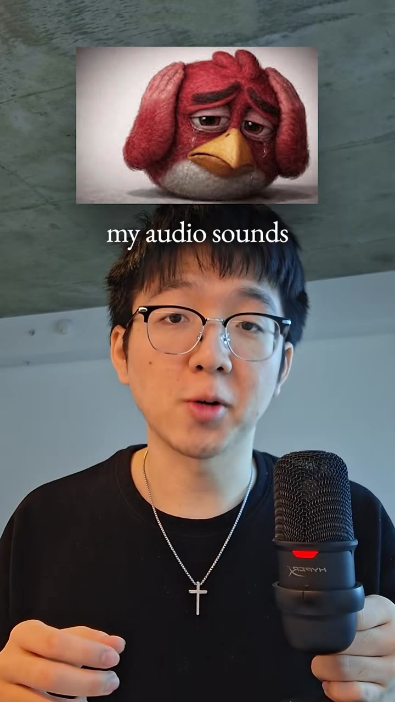

**0:16.0**: Section "1. Equalizer"

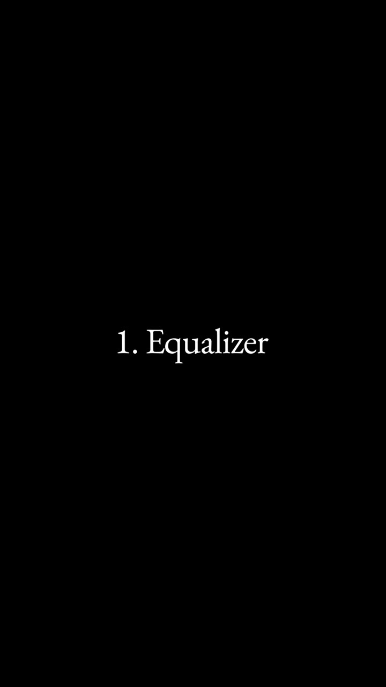

**0:25.0**: Premiere Parametric Equalizer preset dropdown (Vocal Enhancer is the pick)

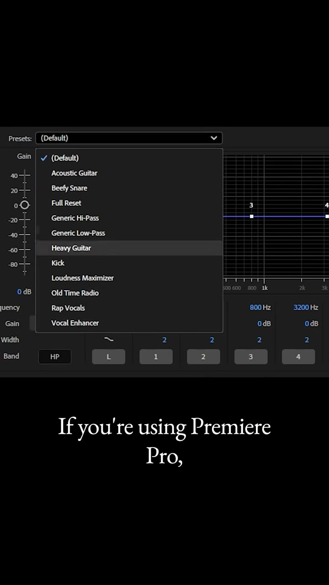

**0:28.0**: Vocal Enhancer curve, then nudging the high end up "a little bit to make it better"

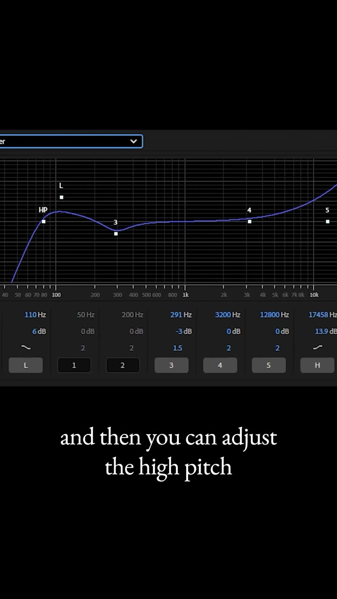

**0:32.0**: Section "2. Hard limiter"

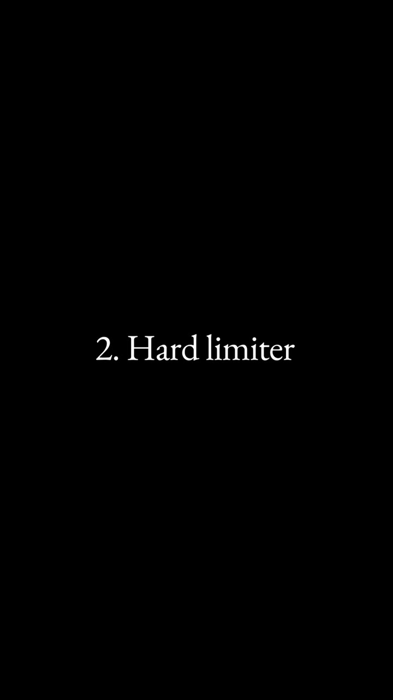

**0:35.0**: Hard Limiter: set the Maximum amp to -2 dB

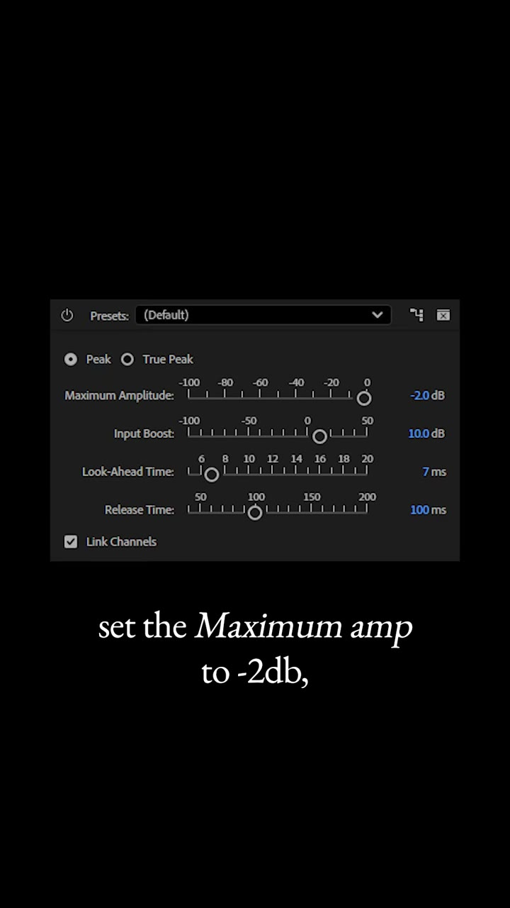

**0:37.0**: Hard Limiter: Input Boost circled at 10.0 dB (Look-Ahead 7 ms, Release 100 ms)

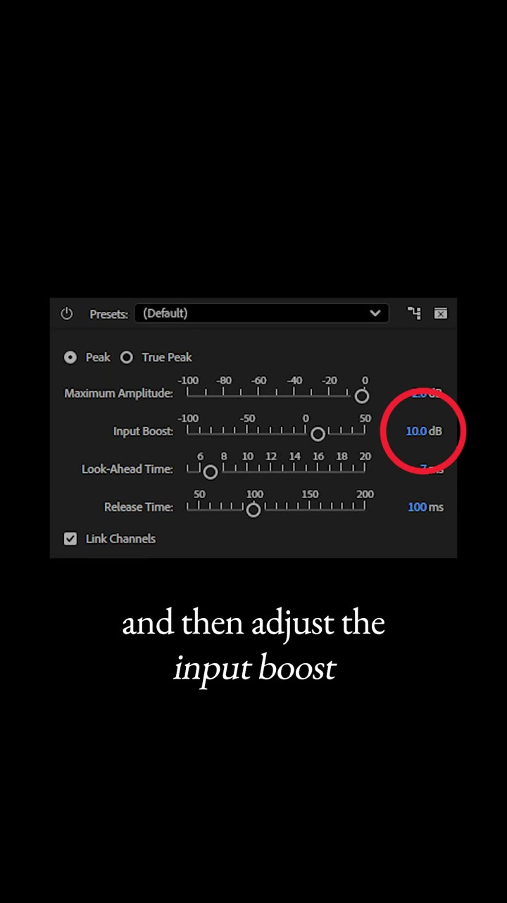

**0:44.5**: Section 3 lead-in: "Don't trust your ears while editing"

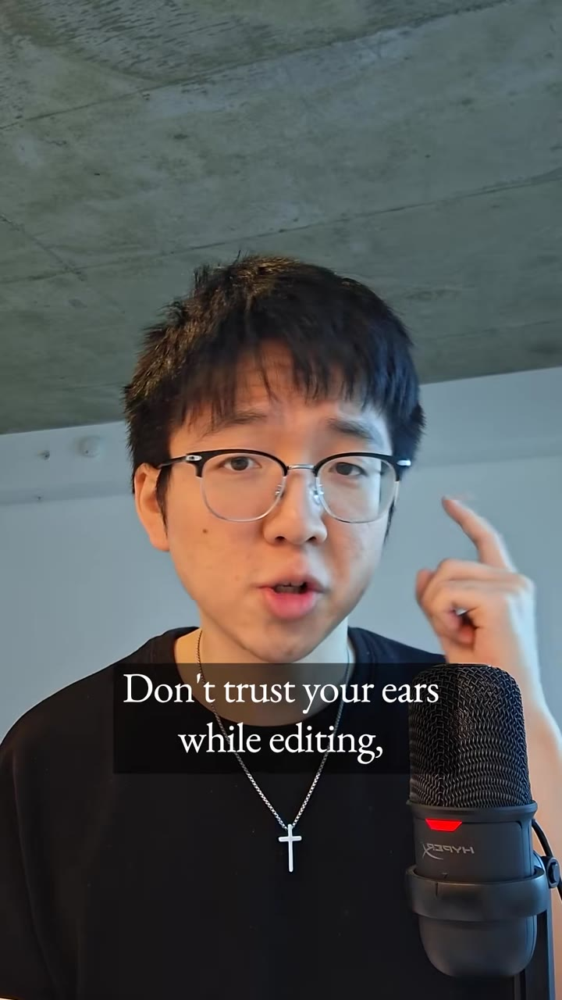

**0:50.0**: "Loudness Meter" effect panel

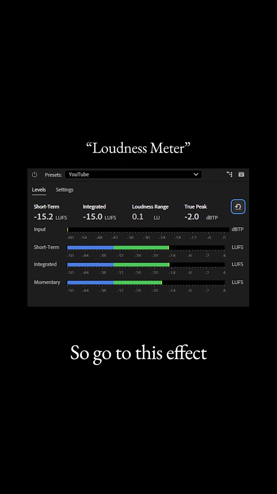

**0:56.0**: Input boost raised until Integrated loudness reads around -14

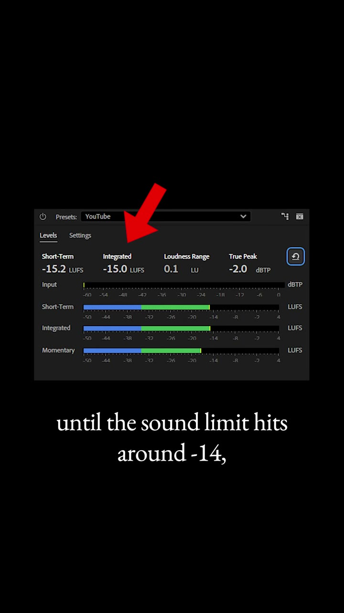

**0:58.0**: Loudness Meter YouTube preset settings: Target -14 LUFS, Low Level Below -20 LU, Max True Peak -1 dBTP, Scale EBU +18, Unit LUFS

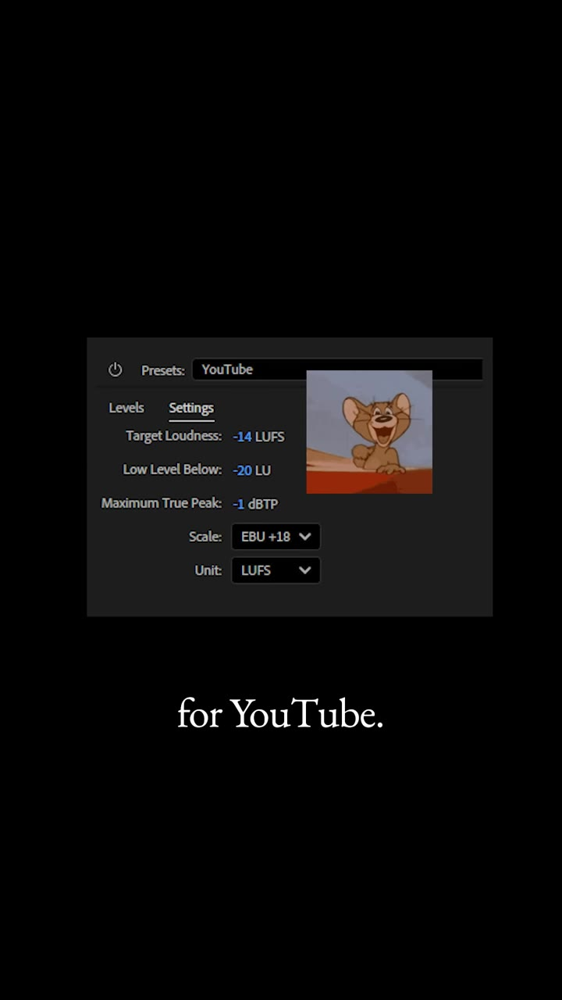

## How to apply

- The same chain works headless for a faceless pipeline: `ffmpeg -af "equalizer=f=4000:t=q:w=1:g=3, alimiter=limit=0.79, loudnorm=I=-14:TP=-1:LRA=11"` is a reasonable starting point (0.79 linear is about -2 dBFS). Tune the EQ by ear once, then freeze it as a preset.
- Run loudness normalization to -14 LUFS / -1 dBTP on every final render, TTS included, and check with `ffmpeg -af ebur128` rather than by ear.
- Music beds should sit well under the voice after normalization; normalize the final mix, not just the voice track.
- For talking-head or app-demo recordings, a phone mic plus this chain is good enough, so skip buying gear.

## Transcript

Full timestamped transcript: [transcript.md](transcript.md).
