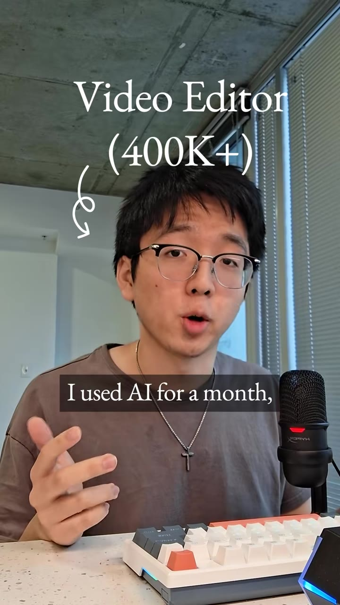
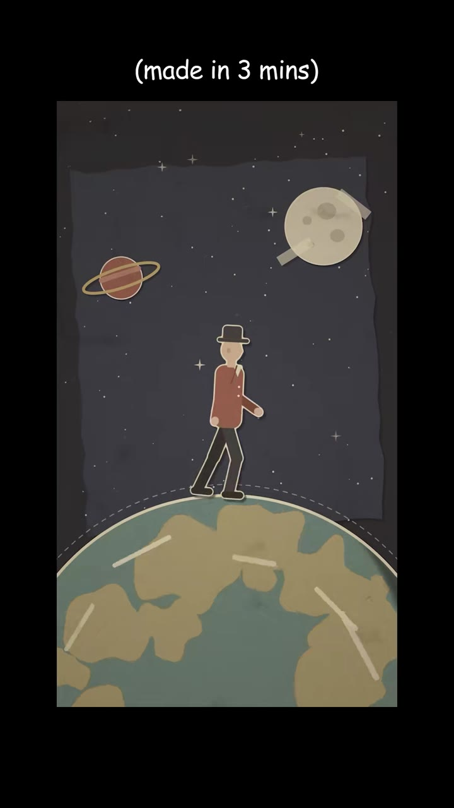
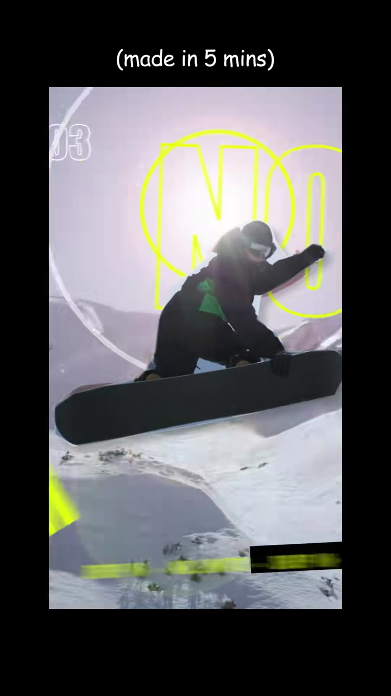
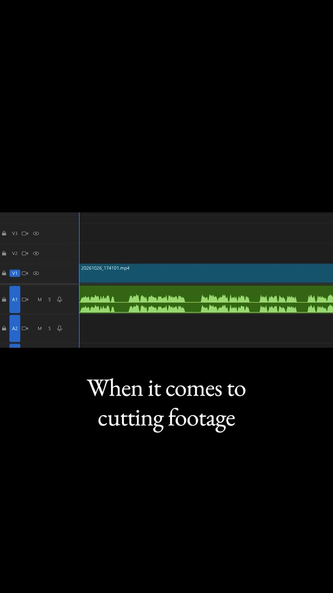
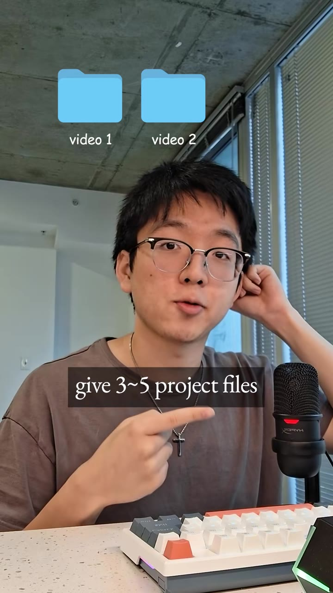
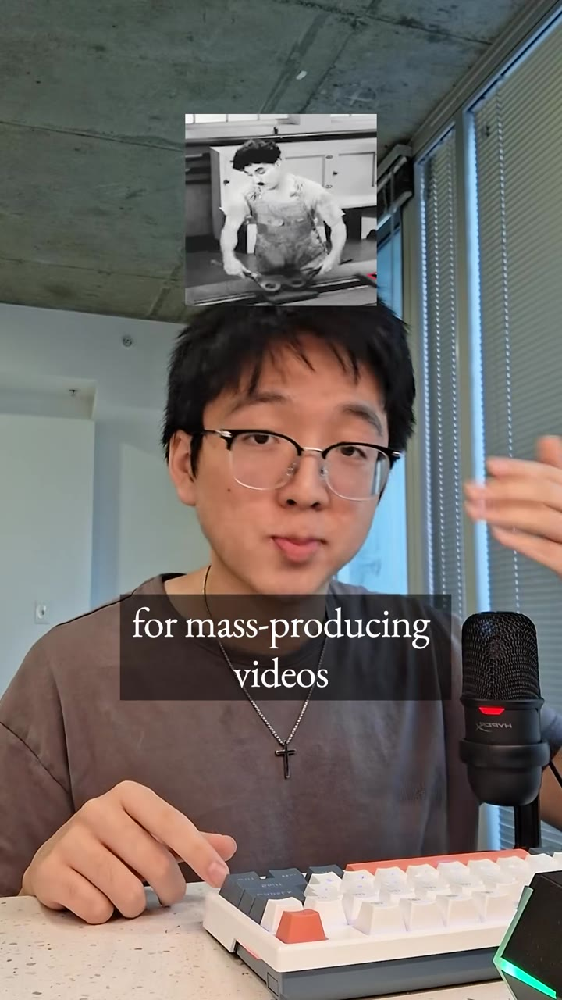
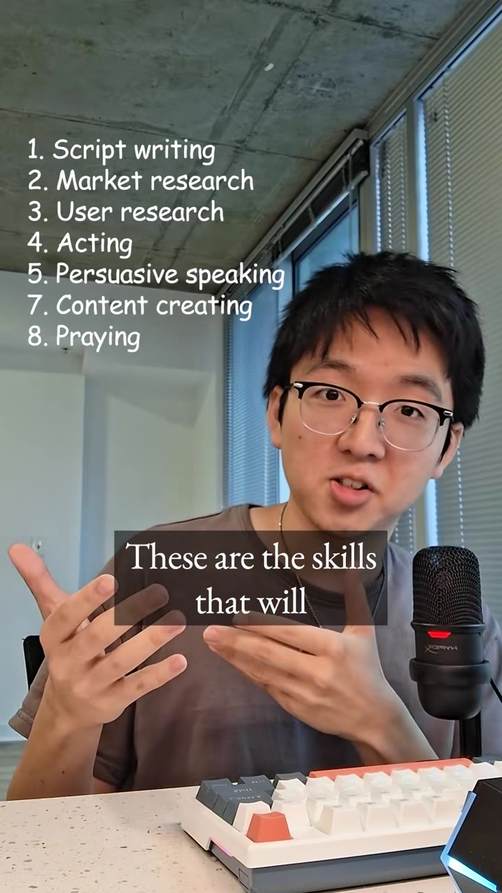

# A month testing AI as an editor: great at motion design and rough cuts, bad at scripts

| | |
|---|---|
| Source | <https://www.tiktok.com/@ginyboi/video/7701544336999140639> |
| Creator | ginyboi (@ginyboi) |
| Uploaded | 2026-10-28 |
| Duration | 66s |
| Hashtags | (none) |
| Audio | original sound - ginyboi |
| Ingested | 2026-10-31 by yeung-assistant (weekly creator check-in; yt-dlp + faster-whisper `small`, language `en`) |

**Caption (verbatim):**

> Will Ai replace video editors?

## Summary

After a month of trying to replace himself with AI, he found: AI is now better than humans at motion design (samples made in 3 and 5 minutes); AI is still terrible at writing, because scripts come out cheesy and longer ones repeat the same message, so he writes every script himself and uses AI only to fix grammar; AI is good at basic editing (cutting footage, adding captions), so he hands it 3-5 project files and goes to eat or nap while it works. Conclusion: AI is a great tool for mass-producing videos if you know editing, so stop chasing tutorials and focus on fundamentals.

## Key takeaways

- Automate motion graphics, rough cuts, and captions; these are where AI already matches or beats humans.
- Don't let AI write the script unsupervised: it sounds cheesy and gets repetitive as length grows. Human-written script, AI only for grammar.
- Batch: queue 3-5 projects for AI processing at once and walk away.
- AI rewards people who already know editing; the leverage is in fundamentals.
- His fundamentals list: script writing, market research, user research, acting, persuasive speaking, content creating, praying.

## On-screen text

Read from the frames by eye (no OCR on the ingest box). `[...]` marks text that was hidden or is uncertain.

- "Video Editor (400K+)" label
- "AI editor" meme sequence and an "I will be back with capcut" Terminator meme
- Samples captioned "(made in 3 mins)" and "(made in 5 mins)"
- Section "3. Basic editing" and a "time consuming" timeline note
- Folders "video 1", "video 2" (a third appears in the sequence)
- List (verbatim, numbering skips 6): "1. Script writing 2. Market research 3. User research 4. Acting 5. Persuasive speaking 7. Content creating 8. Praying"

## Screenshots

Frames were chosen where a new tip, list, or settings panel appears, using the transcript and a 2-second contact sheet, then reviewed by eye. They are unedited 720px-wide JPGs.

**0:01.0**: Hook: "I used AI for a month" ("Video Editor (400K+)")

**0:12.0**: AI-generated motion design sample labeled "(made in 3 mins)"

**0:18.0**: AI-generated design sample labeled "(made in 5 mins)"

**0:44.0**: Basic editing: a raw timeline, "When it comes to cutting footage" (AI is pretty good at this)

**0:48.0**: Batching: "give 3-5 project files" (folders video 1, video 2)

**0:56.0**: "AI will be a great tool... for mass-producing videos"

**1:04.0**: The fundamentals list: 1. Script writing, 2. Market research, 3. User research, 4. Acting, 5. Persuasive speaking, 7. Content creating, 8. Praying (no item 6 on screen)

## How to apply

- This validates the faceless pipeline split: automate cutting, captions, B-roll placement, and motion graphics, but keep a human (Ernest) pass on the script. At minimum, edit the LLM draft hard, and keep scripts short to avoid the repetition he describes.
- Run renders in batches of 3-5 overnight or while away, then review in one sitting.
- Put research time into script writing, market and user research, and persuasion (which overlaps with the cold-email and sales interest) rather than editing tutorials.
- Pair with the script-rhythm video: the rhythm lint is a cheap guard against flat AI scripts.

## Transcript

Full timestamped transcript: [transcript.md](transcript.md).
