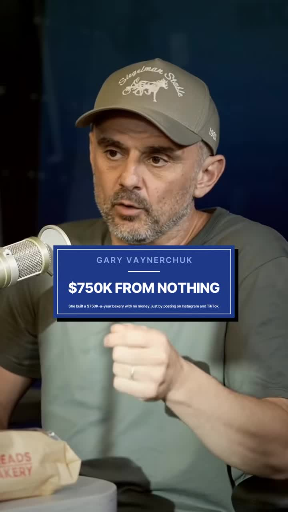
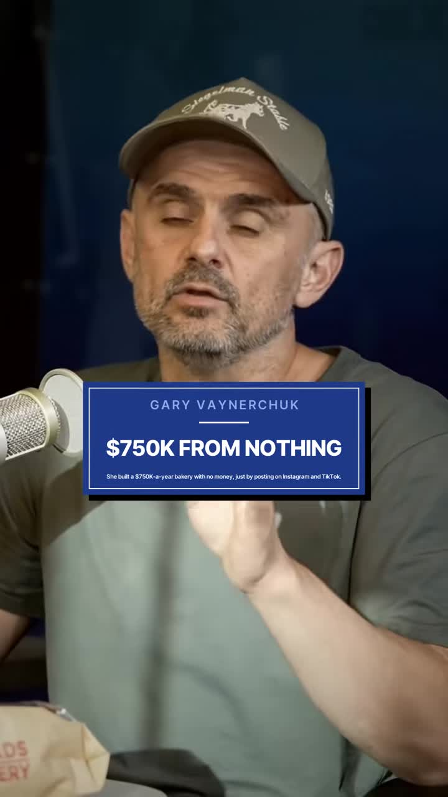
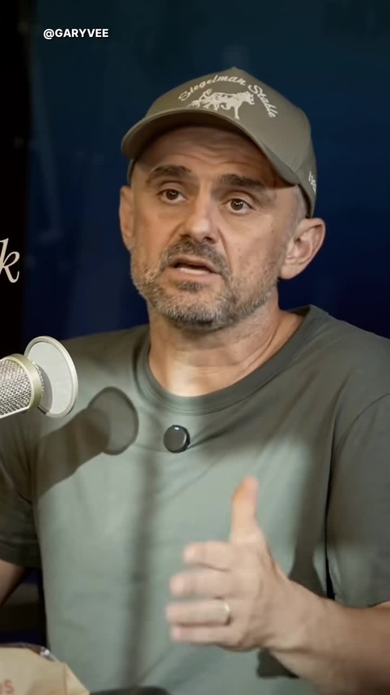

# GaryVee $750k bakery case study: organic Instagram + TikTok distribution

| | |
|---|---|
| Source | <https://www.tiktok.com/@venturewhys/video/7703211604229246221> |
| Creator | Venture Whys (@venturewhys); footage of Gary Vaynerchuk (@garyvee) |
| Uploaded | 2026-11-01 |
| Duration | 20s |
| Hashtags | #venturewhys #entrepreneur #smallbusiness |
| Audio | original sound |
| Ingested | 2026-11-06 by yeung-assistant (yt-dlp + faster-whisper `small`, language `en`) |

**Caption (verbatim):**

> She had no money or a team. Now she's making $750,000 a year, built over two years just by posting on Instagram and TikTok. Credit GaryVee. #venturewhys #entrepreneur #smallbusiness

## Summary

GaryVee tells the story of a woman who started a small baking business (bread, cookies, pickles) with no money or team. After seeing his content about organic social media distribution, she started posting consistently on Instagram and TikTok. Two years later, she makes $750,000 a year take-home, baking and shipping nationwide.

## Key takeaways

- Organic short-form content (Instagram + TikTok) can build a $750k/year business from nothing in ~2 years.
- The woman had no initial capital or team — just the ability to post content consistently.
- The business model: bake locally, ship nationwide. Social media is the distribution/marketing layer.
- Consistency over time is the key driver — "two years later" implies sustained posting, not a viral moment.

## Verbatim phrases and script

> "There's a woman I've recently come across who either sells bread, cookies, pickles, a cup, but she literally saw my content. She said, okay, I'll just start posting about it. And long story short, just by posting on Instagram and TikTok, two years later, she makes $750,000 a year take home, baking a thing, and shipping it to people around the country."

## On-screen text

Read from the frames by eye. `[...]` marks text that was hidden or is uncertain.

- "GARY VAYNERCHUK"
- "$750K FROM NOTHING"
- "She built a $750K-a-year bakery with no money, just by posting on Instagram and TikTok."
- "@GARYVEE" (credit label)

## Screenshots

Frames were chosen where a new tip, list item, or on-screen demo starts, using the transcript, ffmpeg scene-change detection, and manual review. They are 720px wide JPGs.

**0:01.0**: Hook frame with "$750K FROM NOTHING" card and subtitle explaining the premise

**0:05.0**: Key card: "$750K FROM NOTHING" — the central claim

**0:12.0**: Credit label: "@GARYVEE"

## How to apply

- **Proof point for faceless content strategy:** This is a concrete example of organic short-form content driving a real business. No paid ads, no team, no initial capital — just consistent posting.
- **Distribution-first mindset:** The product (baked goods) is simple and replicable. The moat is distribution via organic social. This aligns with the "distribution is everything" thesis.
- **Timeline expectation:** Two years of consistent posting. Not a get-rich-quick story — it's a compounding play.
- **Local product, national audience:** Ship nationwide. The content finds customers everywhere; the product doesn't need to be local-only.

## Transcript

Full timestamped transcript: [transcript.md](transcript.md).
